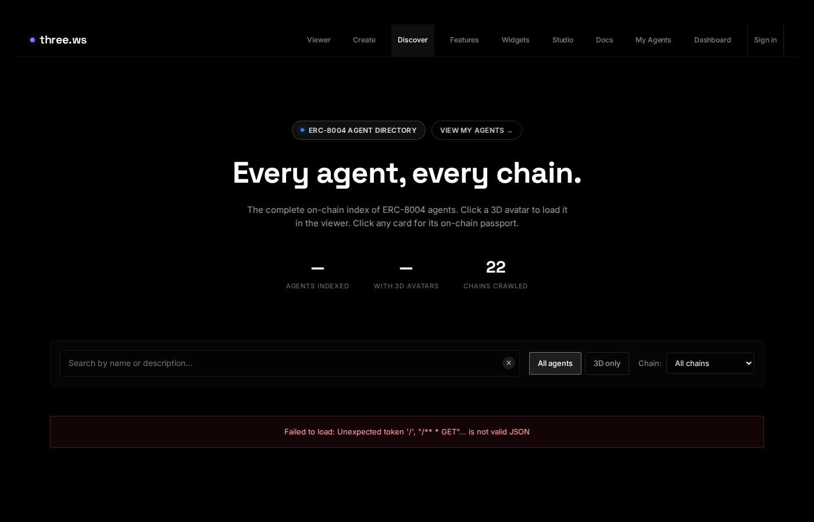

# three.ws

**Give your AI a body.** Open-source (Apache-2.0), browser-native platform for 3D AI agents: generate a model from a prompt, add an LLM brain and a Solana wallet, embed it anywhere with one tag.

[**Website**](https://three.ws) · [**Docs**](https://three.ws/docs) · [**Forge**](https://three.ws/forge) · [**Changelog**](https://three.ws/changelog) · [**X**](https://x.com/trythreews) · [**Telegram**](https://t.me/three_ws_community) · [**$THREE**](https://pump.fun/FeMbDoX7R1Psc4GEcvJdsbNbZA3bfztcyDCatJVJpump)

[](https://three.ws) [](https://github.com/nirholas/three.ws/stargazers) [](https://www.npmjs.com/package/@three-ws/sdk) [](https://www.npmjs.com/package/@three-ws/mcp-server) [](https://registry.modelcontextprotocol.io/?q=io.github.nirholas) [](LICENSE) [](https://github.com/nirholas/three.ws/labels/good%20first%20issue) [](https://codespaces.new/nirholas/three.ws)

https://github.com/user-attachments/assets/d52515d1-cb04-4dd6-98bd-fef233312dc4

## Try it in 60 seconds

**No install.** Open [three.ws/forge](https://three.ws/forge), type *"a brass steampunk owl, full body"*, download the GLB. Text to 3D, image to 3D and sketch to 3D, free draft tier, no account.

**One command.** Prompt to rigged, animated, embeddable agent:

```bash
npm create @three-ws/agent "a friendly cartoon astronaut"
```

**One tag.** Drop a live 3D agent on any page, no build step:

```html
<script type="module" src="https://three.ws/agent-3d/1.5.2/agent-3d.js"></script>
<agent-3d body="https://three.ws/avatars/default.glb"></agent-3d>
```

**Give Claude (or any MCP client) a body:**

```bash
npx -y @three-ws/mcp-server
```

## What you get

| | |
|---|---|
| **Forge** | Text, photo or sketch to a textured, auto-rigged GLB. [Try it](https://three.ws/forge) |
| **Viewer** | Drop any glTF/GLB, full PBR, Draco/KTX2/Meshopt, zero server processing. [/app](https://three.ws/app) |
| **Agent runtime** | LLM brain, tools, memory, skills, emotion through morph targets, voice and lip-sync |
| **`<agent-3d>`** | One web component, five widget types, Open Graph and oEmbed built in |
| **Identity and wallet** | Custodial Solana wallet per agent, Metaplex Core and ERC-8004 on-chain identity |
| **Payments** | x402 per-call skills in USDC or $THREE, agent-to-agent hiring with spend caps |
| **MCP + A2A** | 26-tool MCP server, OAuth 2.1, agent-to-agent protocol |
| **Worlds** | Multiplayer club, coin communities, city, walk mode |

<table>
<tr>
<td><a href="https://three.ws/forge"></a></td>
<td><a href="https://three.ws/club"></a></td>
</tr>
<tr>
<td><a href="https://three.ws/discover"></a></td>
<td><a href="https://three.ws/x402"></a></td>
</tr>
</table>

## Why three.ws

| | three.ws | A bare three.js viewer | Chatbot widgets |
|---|---|---|---|
| Generates the 3D body from a prompt | yes | no | no |
| Rigged, animated, expressive | yes | you build it | 2D avatar at best |
| Own wallet and on-chain identity | yes | no | no |
| Sells skills and pays other agents | yes (x402) | no | no |
| Embed with one tag | yes | no | varies |
| Self-hostable, Apache-2.0 | yes | yes | rarely |

## Run it locally

```bash
git clone https://github.com/nirholas/three.ws.git
cd three.ws
npm install
cp .env.example .env.local   # fill in the keys you need
npm run dev                  # http://localhost:3000
```

The viewer at `/app` runs with no keys and no backend. Prefer a browser? [Open in Codespaces](https://codespaces.new/nirholas/three.ws): the dev container installs everything and forwards port 3000. Node 24 is required.

## Learn more

- [Full reference](docs/reference.md): architecture, every subsystem, API, SDKs, deployment, environment variables
- [Roadmap](ROADMAP.md) and [changelog](CHANGELOG.md)
- [Architecture](ARCHITECTURE.md) and [repo map](STRUCTURE.md)
- [Examples](examples/) and [live examples with a Run button](https://three.ws/examples)
- [Developer SDKs](docs/reference.md#developer-sdks) and [MCP server](docs/reference.md#mcp-server)

## Contribute

[Your first contribution](docs/first-contribution.md) takes you from clone to open pull request in about 15 minutes. Every [`good first issue`](https://github.com/nirholas/three.ws/labels/good%20first%20issue) names the file to change and the command that proves it worked. Read [CONTRIBUTING.md](CONTRIBUTING.md), then say hello in [Discussions](https://github.com/nirholas/three.ws/discussions) or [Telegram](https://t.me/three_ws_community). Questions: [SUPPORT.md](SUPPORT.md). Vulnerabilities: [SECURITY.md](.github/SECURITY.md).

## License

[Apache-2.0](LICENSE). Use it, fork it, self-host it, ship commercial work on it. Vendored third-party code keeps its own license, see [NOTICE](NOTICE).

<!-- three.ws:growth -->
## Support the project

If three.ws saves you time, **[star it on GitHub](https://github.com/nirholas/three.ws)**. Stars are how other developers and AI agents find the repositories worth trusting, and they cost you one click.

Know someone who would use it? [Post on X](https://twitter.com/intent/tweet?text=three.ws%3A%20Open-source%20platform%20for%203D%20AI%20agents&url=https%3A%2F%2Fgithub.com%2Fnirholas%2Fthree.ws) · [Share on Bluesky](https://bsky.app/intent/compose?text=three.ws%3A%20Open-source%20platform%20for%203D%20AI%20agents%20https%3A%2F%2Fgithub.com%2Fnirholas%2Fthree.ws) · [Share on LinkedIn](https://www.linkedin.com/sharing/share-offsite/?url=https%3A%2F%2Fgithub.com%2Fnirholas%2Fthree.ws) · [Submit to Hacker News](https://news.ycombinator.com/submitlink?u=https%3A%2F%2Fgithub.com%2Fnirholas%2Fthree.ws&t=three.ws%3A%20Open-source%20platform%20for%203D%20AI%20agents) · [Share on Reddit](https://www.reddit.com/submit?url=https%3A%2F%2Fgithub.com%2Fnirholas%2Fthree.ws&title=three.ws%3A%20Open-source%20platform%20for%203D%20AI%20agents)

## Built for AI agents too

Coding agents and LLM tooling can read this repo directly: [AGENTS.md](./AGENTS.md), [llms.txt](./llms.txt), [llms-full.txt](./llms-full.txt). Point an agent at `https://github.com/nirholas/three.ws` and it has the context it needs.

## More from the same author

- [All repositories by nirholas](https://github.com/nirholas/nirholas#readme): the full catalog, grouped by topic
- [three.ws](https://three.ws): the platform for 3D AI agents with Solana wallets, a skill marketplace and x402 payments
- Questions or ideas: [open an issue](https://github.com/nirholas/three.ws/issues) or [start a discussion](https://github.com/nirholas/three.ws/discussions)

## Contributors

[](https://github.com/nirholas/three.ws/graphs/contributors)

## Star history

[](https://www.star-history.com/#nirholas/three.ws&Date)
<!-- /three.ws:growth -->
