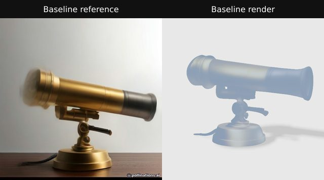

# Grok Imagine as a text-to-3D reference-image lane: eval

Generated by `scripts/grok-eval-ref-image.mjs` from `data/evals/ref-image-results.json` (last run 2026-11-20, commit 7ca96e42e). Rerun the command at the bottom to refresh every number on this page.

## Decision

**The production default is unchanged.** Only the baseline column exists: 1 of 40 prompts were run on the lane production serves today, and the Grok Imagine column has not been generated because no xAI API key is configured on this deployment yet. `FORGE_REF_IMAGE_PROVIDER` stays unset (the Vertex lane, then the text-to-image ladder). Once the key is set, one command adds the xAI column and the pairwise judgments, and this section is recomputed from them.

## Method

- **Prompts:** 40 in `data/evals/ref-image-prompts.json`, across props, characters, vehicles, food, architecture, hard. The hard category holds thin structures (spokes, wire, wings) and transparent objects (glass, crystal), the shapes image-to-3D handles worst.
- **Baseline:** `generateReferenceImage()` with `FORGE_REF_IMAGE_PROVIDER` unset, i.e. exactly what the forge serves today. The served model is recorded per row.
- **Grok Imagine:** the same call with `FORGE_REF_IMAGE_PROVIDER=xai`, so the image comes from `grok-imagine-image-2.0` with the identical composition instruction (`buildReferenceInstruction`). A row where the xAI lane did not serve counts as an xAI failure, not a baseline result.
- **Image to 3D:** the self-hosted TRELLIS worker with the standard tier's quality settings and background matting on, as `api/forge.js` submits it. Same seed per prompt for both providers.
- **Render:** `/api/render/glb` at 512px on white.
- **Objective score (0 to 100):** bgClean 15, singleSubject 20, centered 10, saneFill 10, notCropped 5, mesh 15, closed 10, render 15. Background clean: at least 90% of a 6px border within RGB distance 28 of the median border color. Single subject: the largest 4-connected foreground component holds at least 92% of foreground pixels. Centered: bounding-box center within 12% of the image center. Sane fill: subject extent between 45% and 95% of the frame. Closed: under 1% of welded mesh edges are open boundaries; strict watertightness (zero open and zero non-manifold edges) is reported separately.
- **Blind pairwise judge:** for every prompt with both results, the two renders (or the two reference images when a render is missing) are composited side by side, sides shuffled per prompt by a hash, and sent to the repo's free vision chain led by NVIDIA Nemotron 3.5 Super VL (`describeImageJson`, the `seed_judge` lead). Grok never judges its own output; the harness refuses any answer from a Grok model.
- **Cost and latency:** Grok Imagine cost is metered from the `usage.cost_in_usd_ticks` field of every xAI response, including best-of-2 retries. Latency is wall-clock time for the whole reference step (generation, QA scoring, persistence), as a user waits for it.

## Results by provider

| Provider | Prompts | Reference ok | Mean score | Clean bg | Single subject | Centered | Sane fill | Mesh ok | Closed mesh | Watertight | Render ok | Median triangles | Median reference latency | Median TRELLIS latency | Cost per image |
|---|---|---|---|---|---|---|---|---|---|---|---|---|---|---|---|
| Production lane (baseline) | 1 | 100% | 70.0 | 0% | 100% | 100% | 0% | 100% | 100% | 100% | 100% | 39,846 | 25.1 s | 107.1 s | not metered per image (see served models) |

Production lane (baseline) served models: `pollinations/flux` x1.

## Results by category

| Category | Production lane (baseline) mean score | Judged pairs | Grok Imagine wins | Baseline wins | Ties | Grok Imagine win rate (decisive) | Default |
|---|---|---|---|---|---|---|---|
| props | 70.0 (n=1) | 0 | 0 | 0 | 0 | n/a | existing lane |
| characters | n/a | 0 | 0 | 0 | 0 | n/a | existing lane |
| vehicles | n/a | 0 | 0 | 0 | 0 | n/a | existing lane |
| food | n/a | 0 | 0 | 0 | 0 | n/a | existing lane |
| architecture | n/a | 0 | 0 | 0 | 0 | n/a | existing lane |
| hard | n/a | 0 | 0 | 0 | 0 | n/a | existing lane |

No pairwise judgments yet: the judge runs once both providers have a result for a prompt.

## Side by side

**props: "a brass ship's telescope with leather grip"** (`props-01`; Baseline reference, Baseline render)



## Every prompt

| Prompt | Provider | Served by | Clean bg | Single | Centered | Fill extent | Triangles | Open-edge ratio | Render | Score | Judge | Failure |
|---|---|---|---|---|---|---|---|---|---|---|---|---|
| `props-01` a brass ship's telescope with leather grip | baseline | `pollinations/flux` | no | yes | yes | 1 | 39,846 | 0 | yes | 70 |  |  |

## Reproduce

```bash
npm run grok:eval-ref-image -- --prod-env                    # baseline column, resumable
npm run grok:eval-ref-image -- --prod-env --providers xai    # Grok Imagine column + blind judge (needs GROK_API_KEY on Cloud Run)
npm run grok:eval-ref-image -- --report-only                 # rebuild this page from the results file
```

