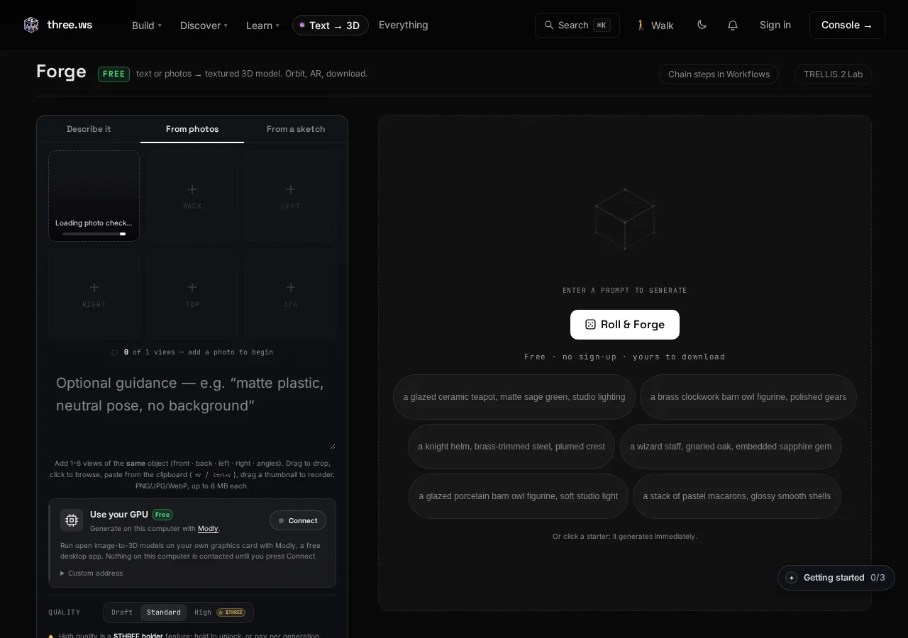
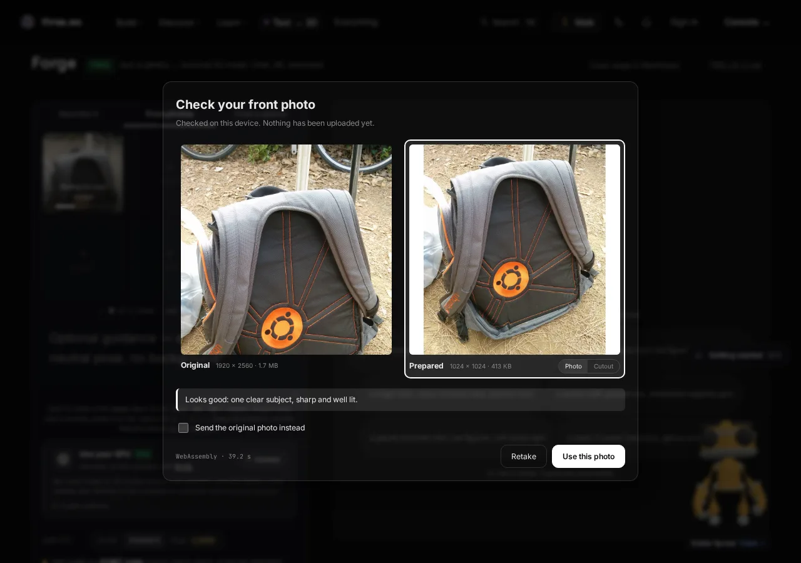
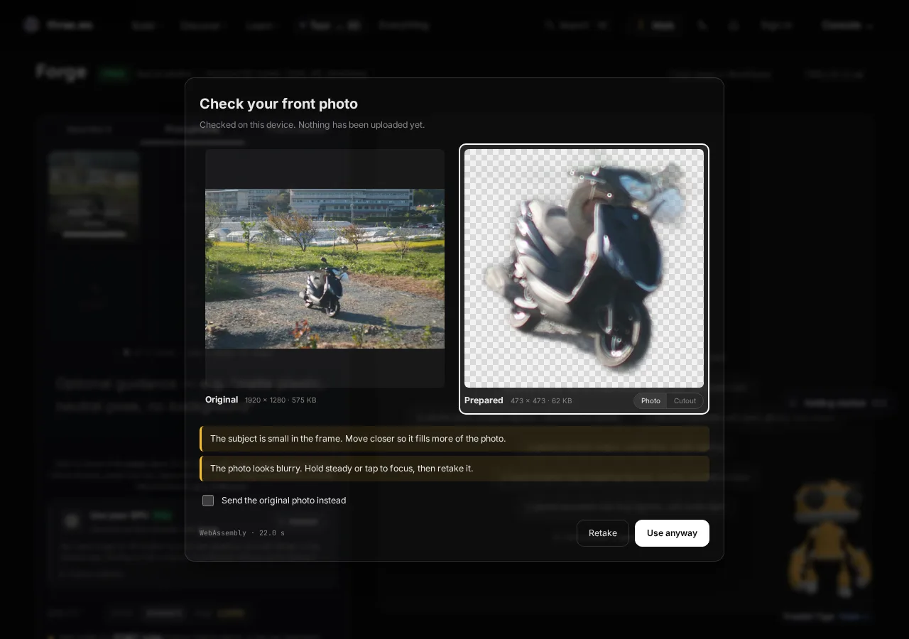
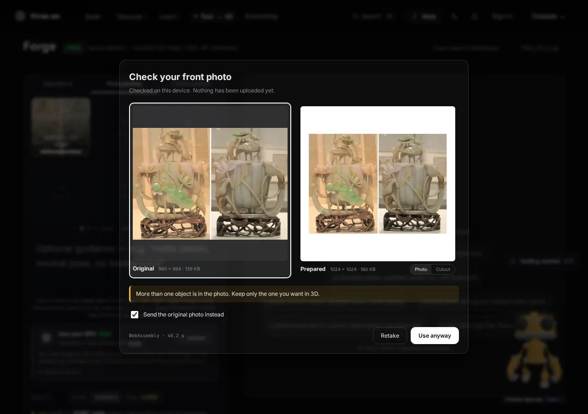
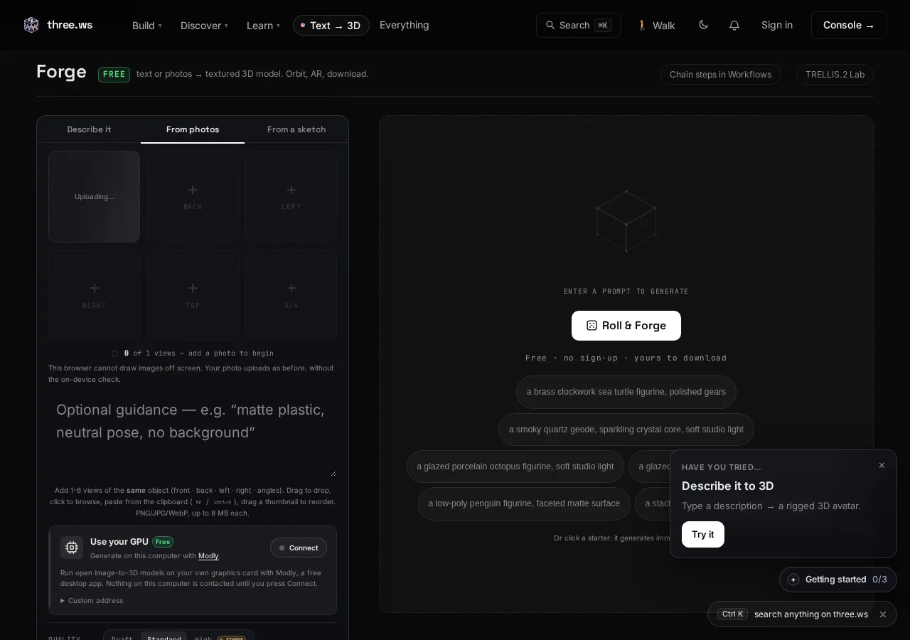

# Forge on-device photo check

When a visitor picks a photo for photo-to-3D in [Forge](https://three.ws/forge), the browser checks and prepares it before anything is uploaded. ONNX Runtime Web (Microsoft, MIT) runs a background matting model on the visitor's device, the page crops a square around the subject, and plain-language warnings flag photos that would produce a bad mesh. The visitor sees the original next to the prepared image and decides what to send. Code: [`src/forge-photo-prep/`](../src/forge-photo-prep/README.md).

## What runs on the device

| Step | Detail |
|---|---|
| Runtime | `onnxruntime-web` in a Web Worker, WebGPU execution provider with a WebAssembly fallback. The wasm binaries are shared with the voice loop and served from `/models/voice/runtime/`. |
| Model | U²-Netp, 4,574,861 bytes, Apache-2.0, served from our own origin as `public/models/photo-prep/u2netp.309c8469.onnx` (immutable cache) and kept in the Cache API (`three-ws-photo-prep-v1`). Source, licence and SHA-256 are in the [module README](../src/forge-photo-prep/README.md#model). It loads only after a photo is picked. |
| Matting | 320 x 320 saliency map, stretched to a 0..255 alpha mask. |
| Crop | Bounding box of the subject plus 8% padding per side, padded to a square, longest edge capped at 1024 px (TRELLIS.2 downsizes anything larger). |
| Checks | Connected components, subject size, Laplacian sharpness on the subject, exposure. Every threshold is in `THRESHOLDS` in [`core.js`](../src/forge-photo-prep/core.js). |
| Output | The prepared JPEG (crop, original background) and a cutout WebP (crop with the on-device alpha). |

Progress in the slot is real: the worker reports the `runtime`, `model`, `inference` and `encode` stages as they happen.

## Warnings and thresholds

| Code | Fires when | What the visitor reads |
|---|---|---|
| `no_subject` | No component, or under 0.2% of the frame | No clear subject was found. Photograph one object against a plain background. |
| `subject_small` | Under 5% of the frame, or longer edge under 256 source pixels | The subject is small in the frame. Move closer so it fills more of the photo. |
| `blurry` | Laplacian variance under 100 on the subject, measured at 512 px | The photo looks blurry. Hold steady or tap to focus, then retake it. |
| `too_dark` | Mean subject luminance under 55 of 255 | The subject is too dark. Add light or move somewhere brighter. |
| `overexposed` | Over 25% of subject pixels at 250 or above | Parts of the subject are blown out. Move out of direct light or lower the exposure. |
| `multiple_subjects` | A second component at least 15% the size of the largest | More than one object is in the photo. Keep only the one you want in 3D. |
| `cut_off` | The subject box touches the frame edge | The subject touches the edge of the photo, so part of it may be missing. Step back a little. |

A photo with warnings shows "Use anyway" and "Retake". A clean photo reads "Looks good: one clear subject, sharp and well lit." Either way, "Send the original photo instead" uploads the untouched file.

## Privacy

Nothing leaves the device until the visitor confirms the review dialog. The browser verification ([`scripts/forge-photo-prep-verify.mjs`](../scripts/forge-photo-prep-verify.mjs)) records every request. On 2026-11-12, all 66 requests before confirm were GETs for page code, the model and the runtime, with no request body and nothing sent to `/api/forge-upload` or storage. After confirm came the one `POST /api/forge-upload` that presigns the upload, then the `PUT` of the chosen file. Cancel, Esc and Retake sent nothing. The committed log is [`forge-photo-prep/screens/network-log.json`](./forge-photo-prep/screens/network-log.json).

## Fallback

The check is skipped and the original uploads exactly as before, with a one-line note, when the browser lacks Web Workers, `OffscreenCanvas` or `createImageBitmap`, reports under 1 GB of device memory, the photo is over 40 MB, or the model fails to load or run.

| State | Screen |
|---|---|
| Preparing |  |
| Clean photo |  |
| Warnings, cutout selected |  |
| Sending the original |  |
| Fallback note |  |

## Server-side matting

The TRELLIS.2 worker keeps its own BiRefNet matting and runs it only on opaque input: an image with an alpha channel is used as is. So the three upload variants test different things:

- **original**: the untouched photo, matted by BiRefNet on the GPU.
- **prepared**: the on-device crop with its background, matted by BiRefNet on the GPU.
- **cutout**: the on-device crop with the U²-Netp alpha, so BiRefNet is skipped.

MEASUREMENT_SECTION
