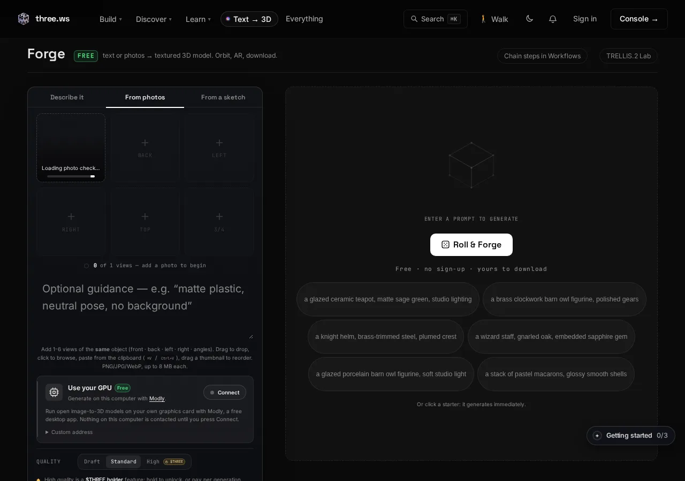
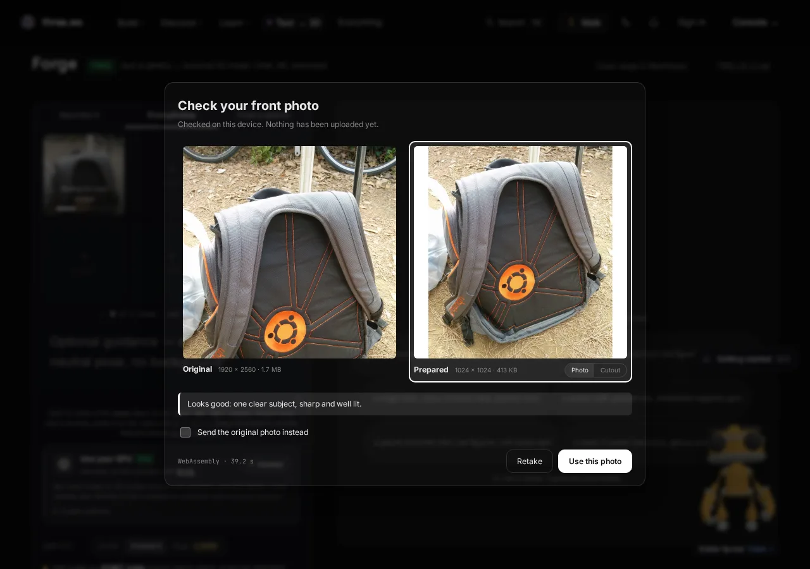
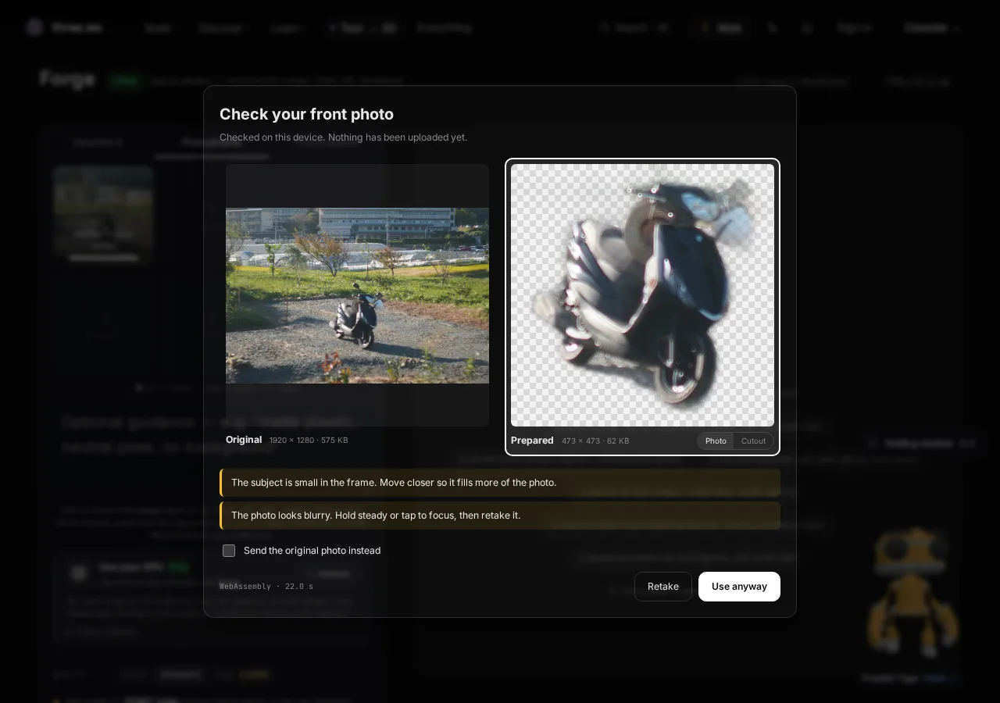
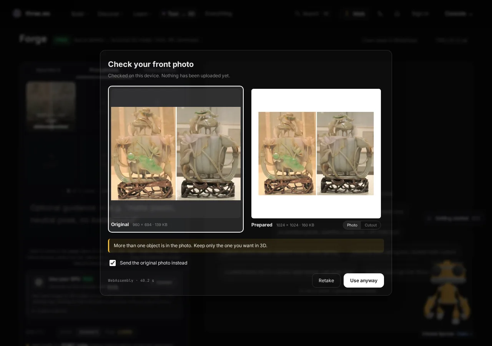
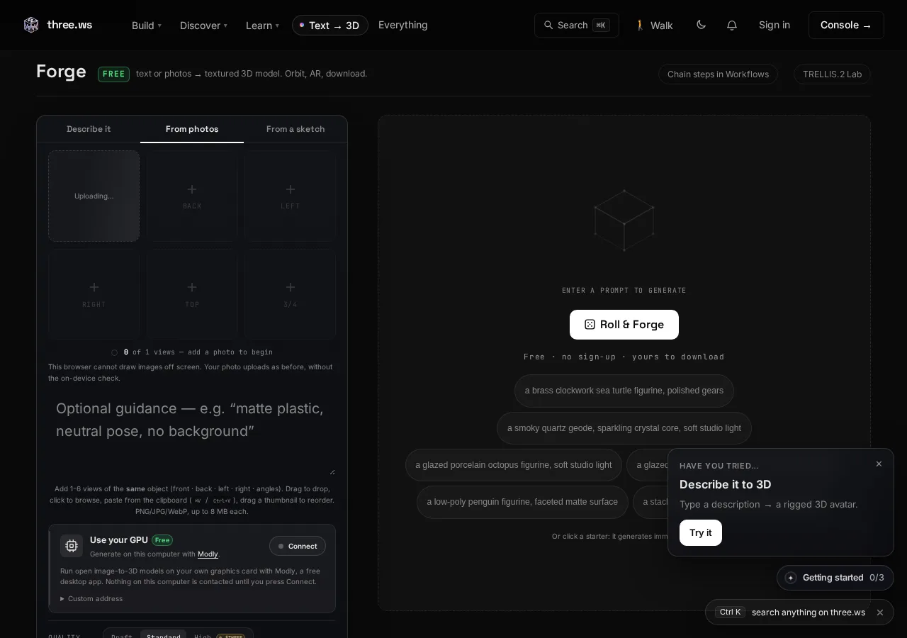

# Forge on-device photo check

When a visitor picks a photo for photo-to-3D in [Forge](https://three.ws/forge), the browser checks and prepares it before anything is uploaded. ONNX Runtime Web (Microsoft, MIT) runs a background matting model on the visitor's device, the page crops a square around the subject, and plain-language warnings flag photos that would produce a bad mesh. The visitor sees the original next to the prepared image and decides what to send. Code: [`src/forge-photo-prep/`](../src/forge-photo-prep/README.md).

## Which files work, and what happens to each

Before the check above, every file goes through one intake step shared by /forge and Forge Studio ([`src/shared/forge-image-intake.js`](../src/shared/forge-image-intake.js) decides, [`src/shared/forge-image-normalize.js`](../src/shared/forge-image-normalize.js) converts). A file is judged by its leading bytes, never by its name or the type the operating system guessed, so a HEIC with no type is read and a PDF renamed `.jpg` is refused.

- **Passed through untouched:** a PNG, JPEG or WebP under 8 MB, upright, still, with a longer edge of 8192 px or less. The same file object is uploaded, so the lane receives exactly the bytes it received before this step existed.
- **Converted on the device:** HEIC and HEIF (the browser's own decoder in Safari, the vendored libheif WebAssembly build in [`public/vendor/libheif/`](../public/vendor/libheif/) elsewhere), AVIF, GIF (the first frame of an animation), SVG (drawn at 2048 px), a JPEG with an EXIF rotation (turned upright, since the lane ignores the tag), a file over 8 MB, or one wider than 8192 px. The result is an upright JPEG, or WebP when the image has transparency, at most 4096 px on its longer edge and stepped down in quality until it fits under 8 MB. A one-line note says what was done.
- **Refused with a reason:** an empty file, anything that is not an image (the message names the format it found, such as PDF, web page or ZIP, and lists the formats that work: JPG, PNG, WebP, HEIC, AVIF or GIF), an image under 64 px on a side, or a file over 100 MB. The photo tile shows a few words and the full sentence appears beside it.

### Four ways in, one path

Picking a file, dropping it on a view slot or anywhere on the page, pasting an image (Cmd+V or Ctrl+V), and pasting or dragging an image link all end in the same intake and upload code ([`src/shared/forge-dropzone.js`](../src/shared/forge-dropzone.js) is the one dropzone both pages install). A link is fetched for the visitor by `POST /api/forge-upload { source_url }` through the SSRF guard ([API reference](./api-reference.md)): a private, local or metadata address is refused, a page link follows its preview image once, and a link that 404s, times out, is too large or is not an image gets a sentence saying which, and what to do instead. A link pasted into a text field is left alone.

### When the upload fails

The upload ([`src/shared/forge-upload-client.js`](../src/shared/forge-upload-client.js)) keeps the photo on every failure. A dropped connection, a storage error (5xx), a PUT that runs past two minutes and an expired session each get their own message, and the tile's Retry button sends the same prepared photo again without asking the visitor to find it. A file storage refuses as too large (413) is final, so Retry becomes "Choose another".

### Checking it in a browser

[`scripts/forge-intake-verify.mjs`](../scripts/forge-intake-verify.mjs) pushes the whole test image set ([`scripts/forge-intake-fixtures.mjs`](../scripts/forge-intake-fixtures.mjs), built at run time, nothing binary committed) through the picker, paste, drop and link paths of the real page, signed in as the QA account, and records each tile's outcome and the exact bytes each upload sent. It stops before generation.

## What runs on the device

| Step | Detail |
|---|---|
| Runtime | `onnxruntime-web` in a Web Worker, WebGPU execution provider with a WebAssembly fallback. The wasm binaries are shared with the voice loop and served from `/models/voice/runtime/`. |
| Model | U²-Netp, 4,574,861 bytes, Apache-2.0, served from our own origin as `public/models/photo-prep/u2netp.309c8469.onnx` (immutable cache) and kept in the Cache API (`three-ws-photo-prep-v1`). Source, licence and SHA-256 are in the [module README](../src/forge-photo-prep/README.md#model). It loads only after a photo is picked. |
| Matting | 320 x 320 saliency map, stretched to a 0..255 alpha mask. |
| Crop | Bounding box of the subject plus 8% padding per side, padded to a square, longest edge capped at 1024 px (TRELLIS.2 downsizes anything larger). |
| Checks | Connected components, subject size, Laplacian sharpness on the subject, exposure. Every threshold is in `THRESHOLDS` in [`core.js`](../src/forge-photo-prep/core.js). |
| Output | The prepared JPEG (crop, original background) and a cutout WebP (crop with the on-device alpha). |

Progress in the slot is real: the worker reports the `runtime`, `model`, `inference` and `encode` stages as they happen.

## Warnings and thresholds

| Code | Fires when | What the visitor reads |
|---|---|---|
| `no_subject` | No component, or under 0.2% of the frame | No clear subject was found. Photograph one object against a plain background. |
| `subject_small` | Under 5% of the frame, or longer edge under 256 source pixels | The subject is small in the frame. Move closer so it fills more of the photo. |
| `blurry` | Laplacian variance under 100 on the subject, measured at 512 px | The photo looks blurry. Hold steady or tap to focus, then retake it. |
| `too_dark` | Mean subject luminance under 55 of 255 | The subject is too dark. Add light or move somewhere brighter. |
| `overexposed` | Over 25% of subject pixels at 250 or above | Parts of the subject are blown out. Move out of direct light or lower the exposure. |
| `multiple_subjects` | A second component at least 15% the size of the largest | More than one object is in the photo. Keep only the one you want in 3D. |
| `cut_off` | The subject box touches the frame edge | The subject touches the edge of the photo, so part of it may be missing. Step back a little. |

A photo with warnings shows "Use anyway" and "Retake". A clean photo reads "Looks good: one clear subject, sharp and well lit." Either way, "Send the original photo instead" uploads the untouched file.

## Privacy

Nothing leaves the device until the visitor confirms the review dialog. The browser verification ([`scripts/forge-photo-prep-verify.mjs`](../scripts/forge-photo-prep-verify.mjs)) records every request. On 2026-11-12, all 66 requests before confirm were GETs for page code, the model and the runtime, with no request body and nothing sent to `/api/forge-upload` or storage. After confirm came the one `POST /api/forge-upload` that presigns the upload, then the `PUT` of the chosen file. Cancel, Esc and Retake sent nothing. The committed log is [`forge-photo-prep/screens/network-log.json`](./forge-photo-prep/screens/network-log.json).

## Fallback

The check is skipped and the photo uploads as the intake step left it (untouched when it already worked, converted when the lane could not read it), with a one-line note, when the browser lacks Web Workers, `OffscreenCanvas` or `createImageBitmap`, reports under 1 GB of device memory, the photo is over 40 MB, or the model fails to load or run.

| State | Screen |
|---|---|
| Preparing |  |
| Clean photo |  |
| Warnings, cutout selected |  |
| Sending the original |  |
| Fallback note |  |

## Server-side matting

The TRELLIS.2 worker keeps its own BiRefNet matting and runs it only on opaque input: an image with an alpha channel is used as is. So the three upload variants test different things:

- **original**: the untouched photo, matted by BiRefNet on the GPU.
- **prepared**: the on-device crop with its background, matted by BiRefNet on the GPU.
- **cutout**: the on-device crop with the U²-Netp alpha, so BiRefNet is skipped.

MEASUREMENT_SECTION
