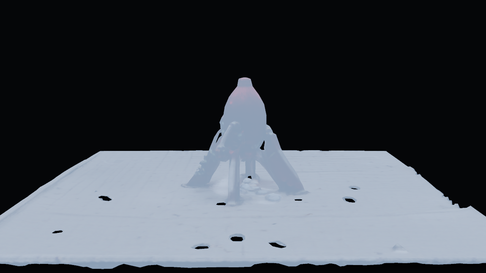
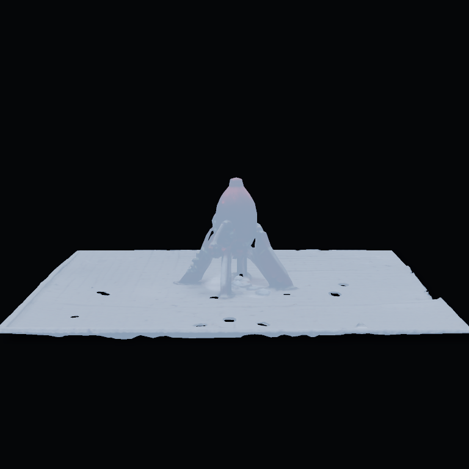
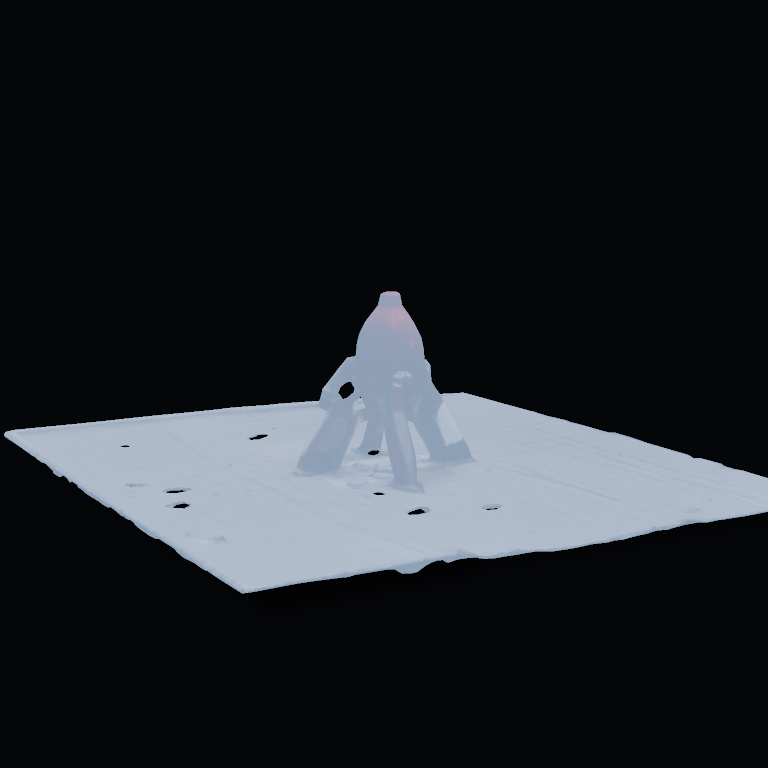
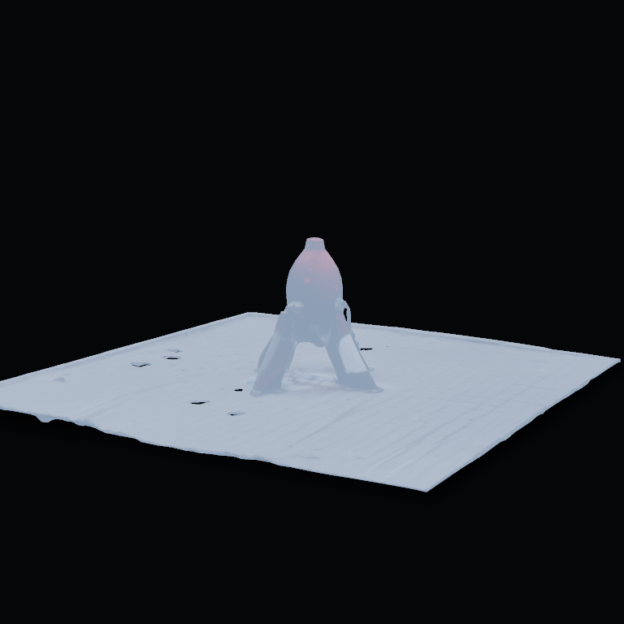

# Hero clips

A hero clip is a short video of one 3D model, made for a post, a profile or a
product page. three.ws renders the model itself first, then asks Grok Imagine
Video to animate that render. The first frame is a real render of the creator's
own mesh, and the video model is told to keep the model exactly as it is: same
shape, same materials, same colours, no added logos or text.

- **Where:** the **Make a hero clip** button on any model page (`/m/<id>`, the
  "Hero clip" panel under Model tools, or `/m/<id>#hero-clip` to open it
  directly) and the **Hero clip** button on the [forge](/forge) result card.
- **Who:** anyone signed in to a free three.ws account. Signed out, the panel
  shows the presets and a sign-in link.
- **Share:** every finished clip gets a public page at `/hero-clip/<id>` with
  `og:video` and large-image cards, so the link unfurls as the clip on X and
  elsewhere. The panel's **Share to X** button posts that page.

## How a clip is made

1. **Render.** The server loads the model's GLB with the same headless renderer
   as `/api/render/glb` and draws a 1280x720 first frame from a front
   three-quarter camera (azimuth 0, elevation 10). On the full tier it also
   draws six reference angles around the model (every 60 degrees). The code is
   [api/_lib/glb-turntable-refs.js](../api/_lib/glb-turntable-refs.js).
2. **Animate.** The render goes to `POST https://api.x.ai/v1/videos/generations`
   as the starting image, with a preset's camera direction and a fidelity clause.
   A creator's title is reduced to a plain subject hint (no quotes, no control
   characters, 80 characters at most) so it cannot steer the prompt.
3. **Poll.** The endpoint answers `202` with a signed job handle. The page polls
   it; xAI holds the job until it is done.
4. **Store.** When xAI finishes, the clip is copied into three.ws storage
   (`/cdn/hero-clips/<id>.mp4`) and gets its public page. The xAI URL is never
   shown to anyone.

Measured on 2026-11-20 against the forge model in
[docs/img/hero-clips](img/hero-clips/manifest.json): the first frame took
4866 ms (the GLB fetch and the first draw) and the six reference angles took
7235 ms, **1206 ms per angle**.

| First frame | Reference angles (full tier) |
|---|---|
|  |    |

## Presets, lengths and tiers

| Preset | What the camera does | Loops |
|---|---|---|
| `turntable` (default) | A level studio camera while the model turns a full circle | yes |
| `hero_push_in` | A slow cinematic push toward the model, ending close and low | no |
| `light_sweep` | The model holds still while a hard light rakes across it | no |
| `product_reveal` | Out of darkness, rim lights up, then a quarter orbit | no |

Lengths: 4, 6 (default), 8 or 10 seconds.

| Tier | Model | Output | References |
|---|---|---|---|
| `lite` (default) | `grok-imagine-video-1.5-lite` | 480p | the first frame only |
| `full` | `grok-imagine-video-1.5` | 720p | the first frame, six reference angles, and the first frame again as the last frame so a turntable loops cleanly |

## Limits

- Signed-in accounts only.
- 3 clips per 10 minutes, and 5 per 24 hours per account by default. The daily
  number is the `HERO_CLIP_DAILY_CAP` env var on the service (an integer from 1
  to 100).
- A job that is still pending after 15 minutes is reported as timed out.

## When clips are not available

The service needs an xAI key (`GROK_API_KEY`). Without one, the panel says so in
plain words: "Hero clips are not available yet." It never shows a fake clip or
a fake progress bar. Instead it offers the turntable three.ws already builds
from the model on its own renderer (`/api/render/animate`, an animated PNG of
36 frames) plus the six still angles a full-tier clip would start from.

## API

All answers use the v1 envelope (`{ data }`); failures carry
`{ error, error_description, message, retry }`.

### `GET /api/v1/models/hero-clip`

What the feature offers right now. No sign-in needed.

```bash
curl -s https://three.ws/api/v1/models/hero-clip
```

```json
{
  "data": {
    "available": true,
    "signed_in": false,
    "presets": [{ "id": "turntable", "label": "Turntable", "description": "...", "loop": true }],
    "default_preset": "turntable",
    "durations": [4, 6, 8, 10],
    "default_duration": 6,
    "tiers": ["lite", "full"],
    "default_tier": "lite",
    "daily_cap": 5
  }
}
```

### `POST /api/v1/models/hero-clip`

Signed in with a session cookie or a three.ws API key
([Dashboard, API keys](/dashboard/api-keys)). Name the model by `model_id` (a
forge creation or avatar id you own or that is public) or by `glb_url` (a public
https GLB, with an optional `title` and `source_page`).

```bash
curl -s https://three.ws/api/v1/models/hero-clip \
  -H "Authorization: Bearer $THREE_WS_API_KEY" \
  -H "Content-Type: application/json" \
  -d '{"model_id":"3abac32f-ced2-4189-b822-d30c96dbc87e","preset":"turntable","duration":6,"tier":"lite"}'
```

| Status | Meaning |
|---|---|
| `202` | `{ data: { status: "generating", job, poll_url, preset, tier, model, seconds, renders, poster, daily } }` |
| `401 sign_in_required` | No session or key. Carries `sign_in_url` and `api_keys_url` |
| `404` | The model is private or does not exist |
| `422 render_failed` | The GLB could not be rendered |
| `429 rate_limited` | The burst or daily limit; `retry_after` is in seconds |
| `503 clips_unavailable` | No xAI key on the service (`retry: false`, with `fallback.turntable_url` and `fallback.refs`), or xAI refused the key (`retry: true`) |

### `GET /api/v1/models/hero-clip?job=<handle>`

Poll every few seconds with the same account that started the job. A handle from
another account answers `404`, exactly like a forged one.

- `200 { data: { status: "generating", elapsed_s, preset, poster } }`
- `200 { data: { status: "done", clip_url, page_url, share_url, share_text, duration, model, preset, poster, source } }`
- a failure with `status: "failed"` (the clip will not finish; `retry` says
  whether starting a new one can help) or `status: "unknown"` (a busy provider
  or a storage hiccup: keep polling).

### `GET /api/v1/models/hero-clip?fallback=1&model_id=<id>`

The turntable and angle render URLs for one model, without starting anything:
no render runs and nothing is sent to xAI. The panel uses it once the describe
call has said clips are off, so a page without a key never sends a create it
knows will fail. Takes `model_id`, or `glb_url` with an optional `title`, and
resolves the model exactly like a create (a private model only for its owner).

```bash
curl -s "https://three.ws/api/v1/models/hero-clip?fallback=1&model_id=3abac32f-ced2-4189-b822-d30c96dbc87e"
```

`200 { data: { available, source: { kind, id, title, page }, fallback: { turntable_url, refs } } }`,
or the same `400` and `404` answers as a create.

## Run it end to end from a terminal

[scripts/hero-clip-e2e.mjs](../scripts/hero-clip-e2e.mjs) renders the first
frame and the reference angles of any GLB through the same code, sends the real
create request, and with a key polls, stores and prints the clip page:

```bash
node scripts/hero-clip-e2e.mjs --glb https://three.ws/cdn/forge/anon/3abac32f-ced2-4189-b822-d30c96dbc87e.glb --title "Chrome toy rocket"
node scripts/hero-clip-e2e.mjs --glb <url> --out docs/img/hero-clips --renders-only
```

[scripts/hero-clip-ui-shots.mjs](../scripts/hero-clip-ui-shots.mjs) walks the
panel through its states in Chromium and saves a screenshot of each.

## Code map

| Piece | File |
|---|---|
| Endpoint | [api/v1/models/hero-clip.js](../api/v1/models/hero-clip.js) |
| Presets, prompt, job handle, failure copy | [api/_lib/hero-clip.js](../api/_lib/hero-clip.js) |
| xAI video client | [api/_lib/xai-video.js](../api/_lib/xai-video.js) |
| Renders | [api/_lib/glb-turntable-refs.js](../api/_lib/glb-turntable-refs.js) |
| Public clip page | [api/hero-clip-page.js](../api/hero-clip-page.js) |
| Panel | [src/hero-clip-panel.js](../src/hero-clip-panel.js), [src/hero-clip.css](../src/hero-clip.css) |
| Forge wiring | [src/forge-hero-clip.js](../src/forge-hero-clip.js) |
| Tests | `tests/hero-clip.test.js`, `tests/hero-clip-endpoint.test.js`, `tests/xai-video.test.js`, `tests/glb-turntable-refs.test.js` |

Related: [three.ws for Grok](./grok.md#hero-clips-with-grok-imagine-video).
