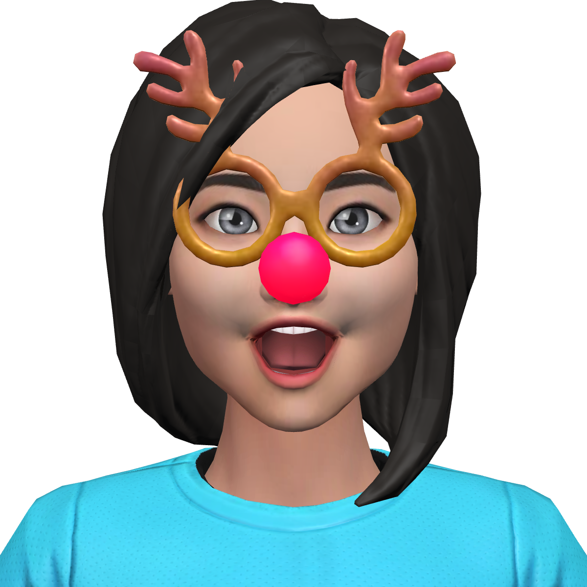
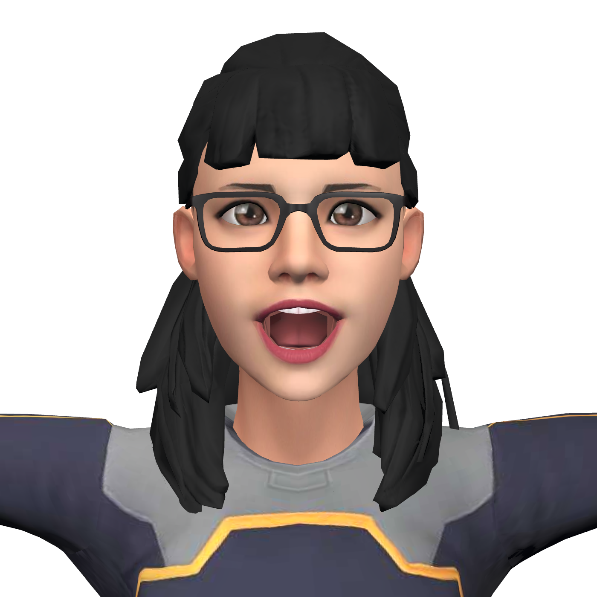
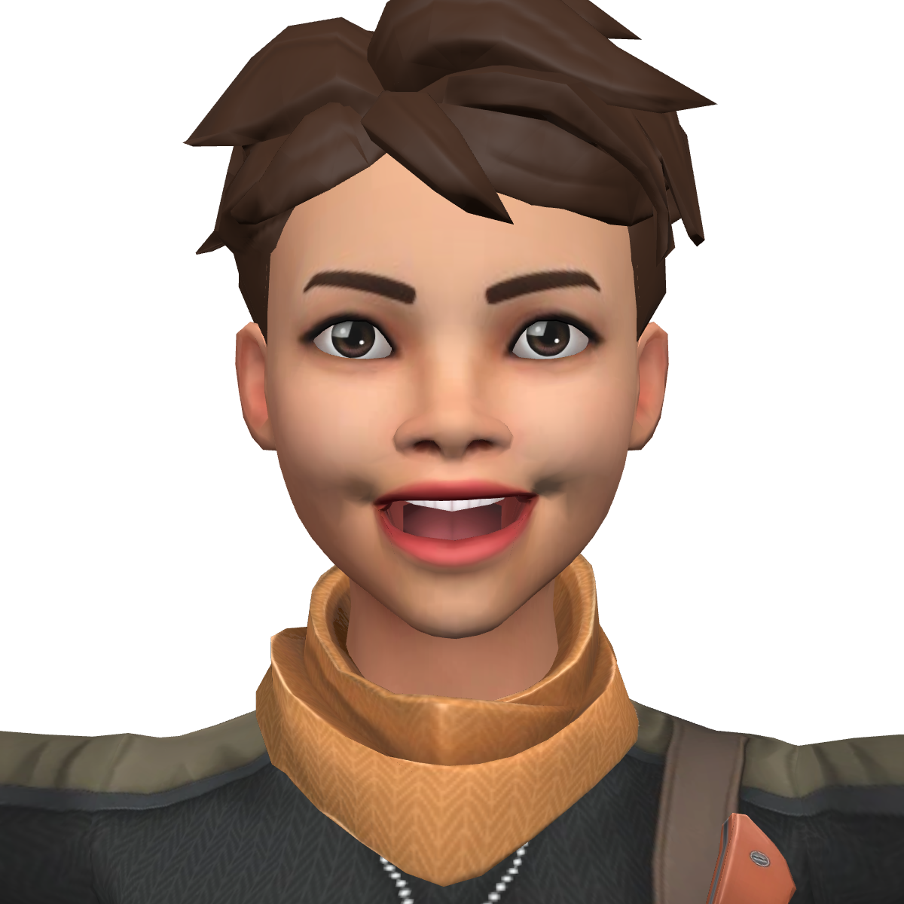
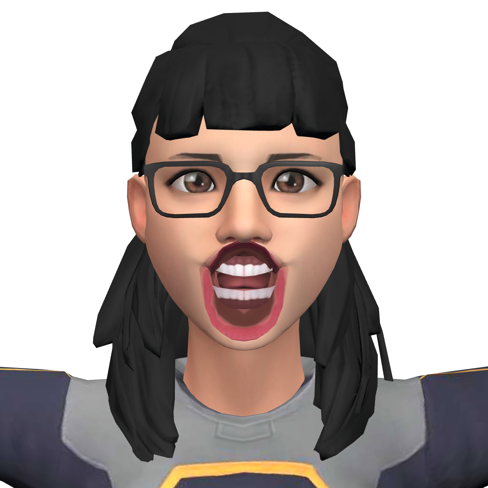
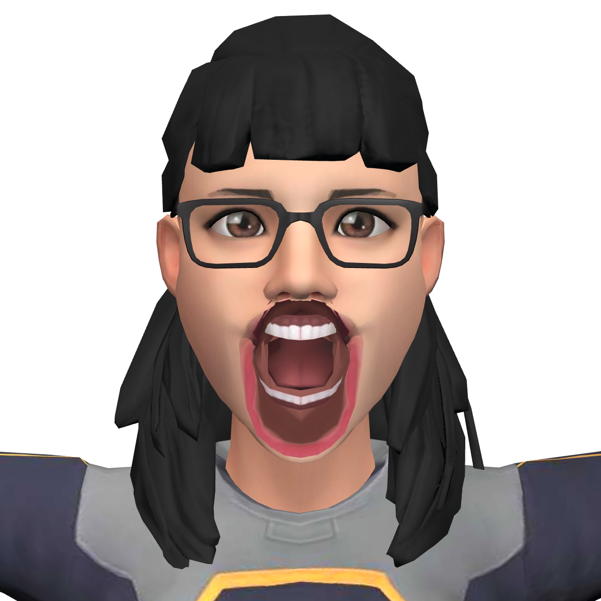
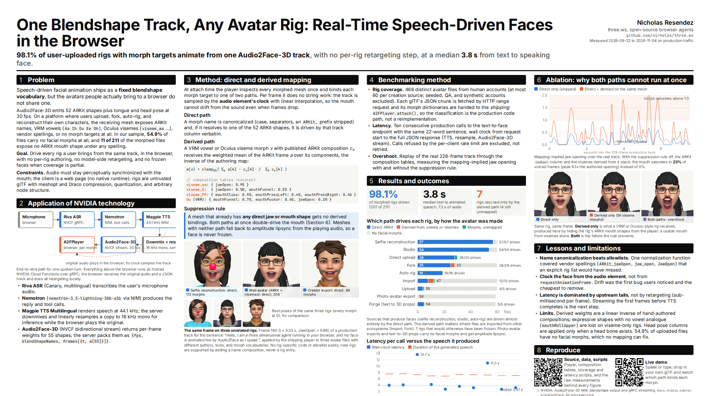

# One blendshape track, any avatar rig: speech-driven faces in the browser

Hello again, Hugging Face community. Our earlier pieces here covered [why agents deserve bodies](https://huggingface.co/blog/three-ws/giving-ai-agents-bodies-and-wallets) and [the whole stack end to end](https://huggingface.co/blog/three-ws/building-3d-ai-agents-end-to-end). This one is narrower and, we think, more useful to anyone shipping a talking character on the web: how to drive a face you did not author from a speech-to-animation model that assumes you did.

We just submitted this work as a poster to NVIDIA GTC 2027, so the numbers below are the ones on the sheet. The poster, the data files, and the scripts that regenerate every figure are in the repository at `docs/nvidia-gtc-2027`, Apache-2.0 like everything else at [github.com/nirholas/three.ws](https://github.com/nirholas/three.ws).

**The idea in one sentence: canonicalize what you can, derive what you cannot, and never let both fire on the same mesh.**

## The problem: the model speaks ARKit, the web does not

NVIDIA Audio2Face-3D turns speech audio into a per-frame track of ARKit-52 blendshape weights at 30 fps (55 weights in practice: the ARKit set plus three tongue shapes). It is usually demonstrated inside Unreal or Omniverse, driving a character somebody built for it.

Our characters are not built for it. On three.ws an avatar arrives from a text prompt, a selfie, an avatar creator, an auto-rigger, or a GLB somebody uploaded from anywhere. The face we have to drive might expose:

- ARKit shapes under any of several spellings (`jawOpen`, `JawOpen`, `jaw_open`, `ARKit_jawOpen`),
- VRM vowel expressions (`Aa`, `Ih`, `Ou`, `Ee`, `Oh`),
- Meta's Oculus Lipsync visemes (`viseme_PP`, `viseme_FF`, `viseme_aa`, and twelve more),
- or no facial morph targets at all.

The model emits one vocabulary. The content uses four. And because the visitor brought the file, there is no step where we get to fix it in a DCC tool first.



*Selfie reconstruction, ARKit names, direct path. Frame 160 (t = 5.33 s, JawOpen = 0.684) of a real production track.*



*Web avatar, Oculus visemes plus ARKit shapes, same frame, same player, no rig-specific code.*



*Creator export, ARKit plus visemes, same frame.*

## The pipeline

The whole voice loop runs on NVIDIA-hosted models reached over NVIDIA Cloud Functions gRPC with one key, and the browser does the rest:

1. **Riva ASR** turns the visitor's microphone audio into text.
2. **Nemotron** (through the NIM chat endpoint) writes the reply.
3. **Magpie TTS** speaks it, at 44.1 kHz.
4. Our server downmixes that WAV to mono by averaging and resamples it to the 16 kHz mono 16-bit PCM that Audio2Face-3D is trained on. Linear interpolation is enough; we could not hear or measure a difference in the resulting track.
5. **Audio2Face-3D** streams back an animation header with the ordered blendshape names, then one frame of weights per 1/30 s.
6. The browser plays the **original 44.1 kHz** audio and samples the track by the audio element's clock.

Step 6 is the one people get wrong. The 16 kHz copy is right there, and it is tempting to play it. Do not: the visitor hears a downsampled voice for no reason. Audio2Face-3D time codes are seconds from clip start, independent of the sample rate it consumed, so the lips can track the real voice.

The other half of step 6 is that the model gives you 30 fps and a display paints at 60 or 120. Interpolate between frames by the audio clock rather than holding the last frame, or the mouth reads as stepped at exactly the moment a viewer looks at it. We clock everything from the audio element, never from `requestAnimationFrame`. Drift was the first bug users noticed and the cheapest to remove.

## The mapping: direct and derived

The player (`src/voice/a2f-player.js`) walks every skinned mesh in the glTF and, per morph target, picks one of two paths.

**Direct.** The morph name canonicalizes to an ARKit shape. One normalization function (`canonicalARKitName` in `src/voice/arkit-blendshapes.js`) folds the vendor spellings we have seen on real uploads onto the ARKit identifier, and the model's weight is written straight to that morph.

**Derived.** The mesh only has monolithic expressions: VRM vowels or Oculus visemes. We already hold forward tables from each of those to its ARKit components, hand-authored for the reverse problem (driving a VRM face from an ARKit capture). A few rows:

| Expression | ARKit components |
|---|---|
| `Aa` (VRM) | jawOpen 1.0 |
| `Ou` (VRM) | mouthFunnel 0.7, mouthPucker 0.4, jawOpen 0.2 |
| `viseme_PP` (Oculus) | mouthClose 0.9, mouthPressLeft 0.4, mouthPressRight 0.4 |
| `viseme_O` (Oculus) | jawOpen 0.5, mouthFunnel 0.55 |

At playback we run that table backwards. An expression's activation is the weighted mean of the ARKit weights it is composed of, taken from the current Audio2Face-3D frame:

```js
export function deriveExpressionWeight(arkitFrame, components) {
	let sum = 0;
	let denom = 0;
	for (const name in components) {
		const w = components[name];
		denom += w;
		sum += (arkitFrame[name] || 0) * w;
	}
	return denom > 0 ? clamp01(sum / denom) : 0;
}
```

A rig that only knows five vowels still lip-syncs, because the vowel is reconstructed out of the ARKit frame rather than looked up from a phoneme we never received. No phoneme alignment, no second model, no per-rig configuration.



*Derived path only: the same rig with its ARKit mouth shapes hidden from the player, which is exactly what a VRM or Oculus-style rig receives. A usable mouth from visemes alone, 56 derived viseme bindings across the rig's meshes.*

### The rule that makes it safe

Both paths cannot run on the same mesh. A rig that carries ARKit shapes *and* visemes (common on creator exports) would receive `jawOpen` directly and then every viseme that contains a `jawOpen` component on top of it. Both open the jaw. We replayed a real 228-frame production track through the Oculus table with the rule off: the mapping-implied jaw opening saturates in 23% of voiced frames, peaking at 6.1 times the authored opening. With the rule on it saturates in none.

So the player checks for direct jaw or mouth coverage first, and a mesh that has any gets no derived bindings. Meshes with neither path fall back to amplitude lipsync from the playing audio, so a face is never frozen in bind pose. A face that moves approximately is worth far more than one that does not move, and the failure has to be graceful because nobody can audit every GLB on the internet in advance.



*Both paths on one mesh: the overshoot the suppression rule exists to prevent.*

## How we measured it

Claims about "any rig" are cheap, so the benchmark is the shipping player on real content.

**Rig coverage.** We took 470 distinct avatar files from human accounts on three.ws, at most 60 per creation source (seeded, QA and synthetic accounts excluded), read each glTF's JSON chunk by HTTP range request, and classified its morph dictionaries with the production `A2FPlayer.attach()`, not a reimplementation. 468 were readable.

**Latency.** Ten consecutive production calls to the public endpoint with the same 22-word sentence; wall clock from request start to the full JSON response, which includes TTS, resampling and the Audio2Face-3D stream. Rate-limited calls are excluded, not retried.

**Overshoot.** The real 228-frame track replayed through the composition tables with and without the suppression rule, as above.

`node scripts/a2f-rig-coverage.mjs` reruns the first; the latency run is ten `curl` calls against `https://three.ws/api/a2f`; the build script under `docs/nvidia-gtc-2027` recomputes the third from the saved track.

## Results

**98.1% of rigs that have a face to drive are driven by Audio2Face-3D: 207 of 211.** Of those, 200 bind by the direct path and 7 only by the derived path. 4 carry morphs we could not map. The remaining 257 of 468 files have no facial morph targets at all, which no mapping can fix; they get the amplitude fallback.

Where the avatar came from decides which path it needs:

| Source | Direct | Derived | Unmapped | No morphs |
|---|---|---|---|---|
| Selfie reconstruction | 57 | 0 | 0 | 3 |
| Studio | 54 | 0 | 0 | 6 |
| Direct upload | 28 | 0 | 2 | 0 |
| Fork | 25 | 3 | 0 | 32 |
| Auto-rig | 19 | 0 | 0 | 0 |
| Import | 8 | 4 | 1 | 47 |
| Upload | 4 | 0 | 1 | 55 |
| Photo-avatar export | 0 | 0 | 0 | 59 |
| Text-to-3D props | 5 | 0 | 0 | 54 |

Face-producing sources (selfie, studio, auto-rig) bind directly, because those tools emit ARKit names. The derived path earns its keep on files imported from other ecosystems (Import, Fork): seven rigs that would otherwise be frozen. Text-to-3D output is mostly props with no face, and the photo-avatar exports stored on our platform carry no morph targets at all (verified on the raw files).

**Latency: a median 3.8 s from text in to synchronized speech and animation out, for 7.3 s of speech.** Eight of the ten calls finished in 2.7 to 4.3 s, faster than the speech they produced (real-time ratio 0.39 to 0.61). Two hit upstream tail latency at 11.0 and 13.7 s. An earlier run on 2026-10-08 had a median of 2.96 s, and with audio supplied directly (skipping TTS) the same endpoint answered in 1.29 to 2.19 s on 2026-09-22. Retargeting itself is sub-millisecond per frame; the latency is all upstream.



*The poster as submitted. The PDF, the data behind every number, and the build scripts are in `docs/nvidia-gtc-2027`.*

## What we would tell anyone doing this

1. **Name canonicalization beats allowlists.** One normalization function covered vendor spellings that an explicit list of supported rigs would have missed, and new rigs are supported by adding a name composition, never a rig entry.
2. **Clock the face from the audio element.** Not from the frame loop, not from a timer started at play.
3. **Never double-drive a mouth.** If a mesh has any direct jaw or mouth coverage, the derived pass must stay off it.
4. **Make the lane additive.** With no key configured, the avatar still speaks and still moves its mouth on the amplitude fallback. Nothing hard-depends on the model path, which is what made it safe to ship.
5. **Know your limits.** Derived weights are a linear inverse of hand-authored compositions. Shapes with no vowel analogue (`mouthRollUpper`, for one) are lost on viseme-only rigs, and 55% of uploaded files have no facial morphs to drive.

Streaming the first frames before TTS completes is the next step on latency. If you are driving Audio2Face-3D, or any ARKit-emitting model, onto rigs you did not author, we would like to compare mapping tables. The live demo needs no signup: [three.ws/demos/audio2face](https://three.ws/demos/audio2face).
