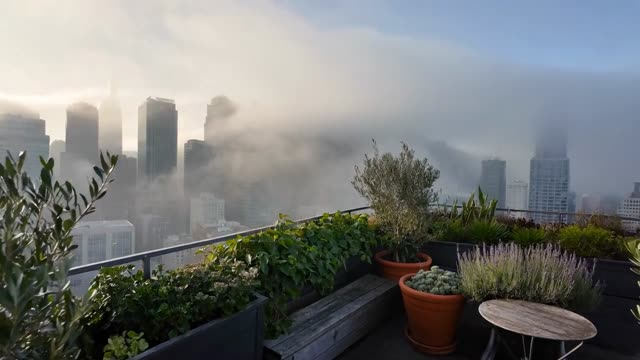

# Cosmos world lane: old versus new, 2026-11-16

The [/cosmos](../../cosmos.md) world lane moved from the hosted NVIDIA Cosmos Predict1 Text2World routes to a self-hosted Cosmos 3 Nano worker ([workers/model-cosmos](../../../workers/model-cosmos/README.md)). This report measures both on the same five prompts.

## Result in one line

The old lane rendered nothing: both hosted predict1 routes refuse every submit for this account with 404 "Not found for account". The new lane rendered all five worlds at 1280x720, 121 frames, with a **median wall time of 245.7 s** from submit to a playable CDN URL on a warm worker. The first world after the worker scales to zero also pays a **checkpoint load of 1041.5 s** (17.4 minutes).

## Method

- `node scripts/nvidia-cosmos-eval.mjs`, run from this repository with the production API env, on 2026-11-16.
- For each prompt, the old side is a real authenticated Text2World submit to the predict1 7B route and then the 5B route, through the production provider code ([api/_providers/nvidia-cosmos.js](../../../api/_providers/nvidia-cosmos.js)).
- The new side submits through the production worker client ([api/_providers/cosmos-worker.js](../../../api/_providers/cosmos-worker.js)) and polls every 5 s until the clip is copied to the CDN. That copy is part of the wall time.
- Settings: seed 42, 720p, 121 frames (about 5 s at 24 fps), 35 sampling steps, NVIDIA's published defaults.
- The worker expands each prompt into Cosmos 3's structured caption with `nvidia/nemotron-3.5-super-vl-120b-a12b` before sampling ("Upsample").
- The frame column is the middle frame of each clip, pulled with ffmpeg. The raw run, including every upstream answer with the account id redacted, is in [data/evals/cosmos/runs/cosmos-2026-11-16.json](../../../data/evals/cosmos/runs/cosmos-2026-11-16.json).

## Five prompts, side by side

<!-- eval:begin -->
Run 2026-11-16, seed 42, 720p, 121 frames, worker GPU NVIDIA RTX PRO 6000 Blackwell Server Edition, checkpoint revision `45666784803b`.

| # | Prompt | Old: predict1-7b | Old: predict1-5b | New: Cosmos 3 Nano wall time | Sampling | Upsample | Encode | Frame |
|---|---|---|---|---|---|---|---|---|
| 1 | a neon Tokyo street in the rain at night | 404 lane_unavailable | 404 lane_unavailable | 246.9 s | 229.3 s | 9.2 s | 0.6 s |  |
| 2 | a windswept desert canyon at golden hour | 404 lane_unavailable | 404 lane_unavailable | 243.1 s | 228.5 s | 10.6 s | 0.6 s |  |
| 3 | a bioluminescent forest at midnight | 404 lane_unavailable | 404 lane_unavailable | 268.0 s | 228.7 s | 34.9 s | 0.5 s |  |
| 4 | a rooftop garden above a foggy city skyline | 404 lane_unavailable | 404 lane_unavailable | 245.7 s | 229.1 s | 10.7 s | 0.6 s |  |
| 5 | a snowy mountain pass under aurora | 404 lane_unavailable | 404 lane_unavailable | 244.4 s | 230.2 s | 11.0 s | 0.5 s |  |

New lane, warm runs (5 of 5): median wall time 245.7 s, median sampling 229.1 s, median worker total 240.8 s.
Old lane: no hosted predict1 route served a single request on this account; every submit was refused before generation, so there is no old-model clip or time to measure.

Clips (served from /cdn):

1. [a neon Tokyo street in the rain at night](https://three.ws/cdn/forge/cosmos/cw_c8eb39430cb24936806bb455f4774bf4.mp4) (1280x720, 121 frames, 1.6 MB)
2. [a windswept desert canyon at golden hour](https://three.ws/cdn/forge/cosmos/cw_61ce74a9acb347f1ba7f7be08246e7b7.mp4) (1280x720, 121 frames, 1.4 MB)
3. [a bioluminescent forest at midnight](https://three.ws/cdn/forge/cosmos/cw_cd6416a2f18b456a95175c1e29b23f83.mp4) (1280x720, 121 frames, 0.8 MB)
4. [a rooftop garden above a foggy city skyline](https://three.ws/cdn/forge/cosmos/cw_77fb116442ce4efe9f5e217e14b0bd69.mp4) (1280x720, 121 frames, 1.9 MB)
5. [a snowy mountain pass under aurora](https://three.ws/cdn/forge/cosmos/cw_ca18760a5dee4f2dad34fe35c9421165.mp4) (1280x720, 121 frames, 0.4 MB)
<!-- eval:end -->

## Reading the numbers

- **Sampling dominates and is flat.** Sampling took 228.5 to 230.2 s on every prompt, about 6.5 s per step on one RTX PRO 6000 Blackwell. Prompt content does not move it.
- **Wall time varies through the upsampler.** Prompt 3 took 268.0 s because its upsample call took 34.9 s against about 10 s for the others. That is the hosted Nemotron call taking longer, not the GPU. If the call fails outright, the worker falls back to the plain prompt and records `upsampler: "none"` on the job.
- **The CDN copy is cheap.** The copy and the polling interval add about 5 s on top of the worker's own total (median 240.8 s).
- **Prompt adherence held on all five.** Each mid-clip frame shows the asked-for scene: wet neon signage with reflections, golden canyon light, glowing fungi, fog rolling between towers behind a planted terrace, and a green aurora over a snow ridge. No clip came back blank, frozen or off-topic.
- **No old-model comparison exists to make.** The predict1 routes failed before generation on every request, so the comparison is "no world" against a world. The routes stay in the ladder behind Cosmos 3 Nano in case NVIDIA restores them for this account.

## Scene-conditioned worlds (dev server, same day)

These runs were driven through the real /cosmos page on the dev server (port 3260), with the scene captured in the browser from the three.js stage:

| Mode | Prompt | Worker timings | Result |
|---|---|---|---|
| text | a neon Tokyo street in the rain at night, reflections on wet asphalt | shot 10.8 s, render 231.1 s, encode 1.8 s, total 244.1 s | 1280x720, 121 frames, 1.48 MB H.264. A reload mid-render resumed the same job at the same step |
| image (still of the avatar) | a bioluminescent forest at midnight, glowing mushrooms and drifting spores | shot 12 s, render 3m 52s, encode 1 s, total 4m 05s | the world grows out of the captured 1280x720 still; the avatar stands in the generated forest |
| depth (4 s orbit of the avatar, MeshDepthMaterial) | a neon Tokyo street in the rain at night | shot 10 s, control decode 0 s, render 17m 30s (50 steps with control guidance, about 21 s per step), encode 1 s, total 17m 44s | 1280x720 clip playing on the stage; the avatar's silhouette and orbit carry into a rain-soaked neon street |

Control modes cost about 4.3x a text world at 720p: 50 steps instead of 35, and each step runs the control branch as well. 480p or a shorter clip is the lever when a scene world needs to land faster.

## Cold start

The worker scales to zero between worlds. Loading the 34.9 GB checkpoint over the gcsfuse model mount took 1041.5 s on revision `model-cosmos-00001-p9q`. The checkpoint is a 7-shard transformer, a Wan VAE, a Qwen3-VL vision encoder, a sound tokenizer and a text tokenizer.

While the model loads, the page shows "Warming the GPU" from the worker's real state. Setting `_MIN_INSTANCES=1` in [workers/model-cosmos/cloudbuild.yaml](../../../workers/model-cosmos/cloudbuild.yaml) removes the wait at the cost of one GPU held warm. Today it is kept at 0.

## Rerun

```bash
set -a; . ./.env.local; set +a
node scripts/nvidia-cosmos-eval.mjs                 # five prompts, writes this report between the markers
node scripts/nvidia-cosmos-eval.mjs --report-only   # rebuild the table from the saved run
node scripts/verify-nvidia-cosmos.mjs --probe-only  # rung health only
```
