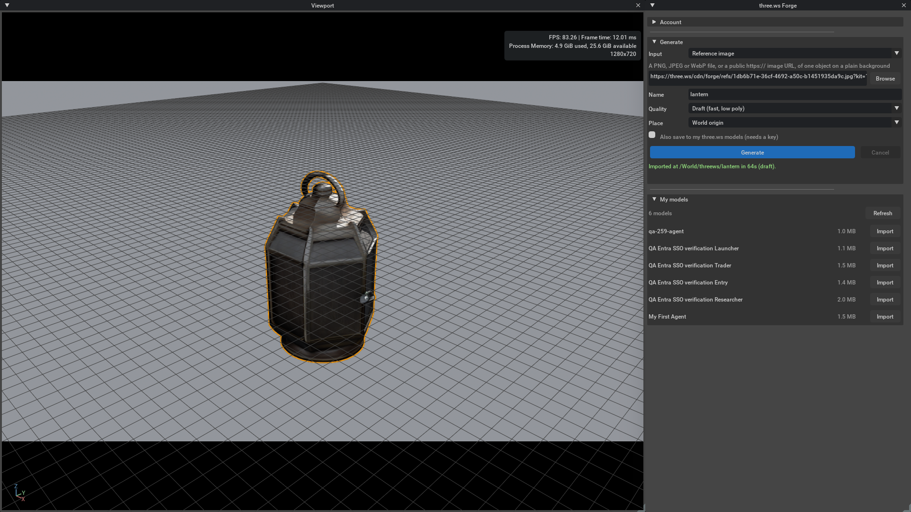
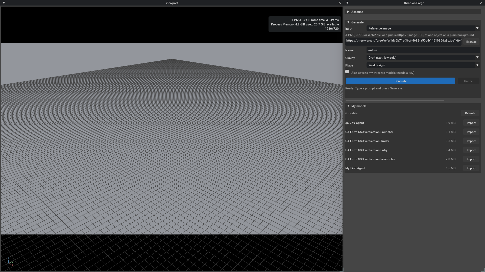

# Forge by three.ws for NVIDIA Omniverse Kit

`threews.forge` is a Kit extension that brings Forge into Omniverse: type a
prompt or pick a reference image, press Generate, and the textured model lands
in the open USD stage, upright and to scale. A **My models** browser imports
anything already saved in your three.ws account.



Source, install steps and the full developer guide:
[integrations/nvidia/omniverse-kit-extension/](../integrations/nvidia/omniverse-kit-extension/README.md).
Screen capture of a real run: [generate-from-panel.mp4](../integrations/nvidia/omniverse-kit-extension/media/generate-from-panel.mp4).

## Install

In any Kit 110 app (USD Composer, a kit-app-template app, or the
`omniverse-kit` Python package): **Window > Extensions**, gear icon, add
`integrations/nvidia/omniverse-kit-extension/exts` to the search paths, then
enable **Forge by three.ws**. Or from a shell:

```bash
kit <your app>.kit --ext-folder integrations/nvidia/omniverse-kit-extension/exts --enable threews.forge
```



## What it does

| Capability | Detail |
| --- | --- |
| Inputs | Text prompt; reference image as a local PNG, JPEG or WebP, or a public `https://` URL |
| Quality lanes | Draft and Standard with no account; High with an API key |
| Placement | World origin, the selected prim, or in front of the active camera |
| Progress | Real job state polled from `GET /api/forge?job=`; Cancel stops at once and Kit never blocks |
| Import | GLB through `omni.kit.asset_converter`; library models stored as USDZ are referenced directly |
| Units and axes | Reads the stage's `upAxis` and `metersPerUnit`; on a Z-up centimeter stage the wrapper Xform rotates +90 degrees about X and scales by 100, and the model is grounded at z = 0 |
| Web-optimized GLBs | `EXT_meshopt_compression`, `KHR_mesh_quantization` and `EXT_texture_webp` are decoded locally (numpy and Pillow from Kit) so saved models convert |
| Library | Paged list of your saved models with one-click import |
| Reliability | Network errors and 429/502/503/504 retried with exponential backoff |

## API key

Create one at [three.ws/dashboard/api](https://three.ws/dashboard/api) and paste it
into the **Account** section. It is stored at
`/persistent/exts/threews.forge/apiKey`, shown masked, sent only as a bearer
header to the configured API origin, and never written to the Kit log (a test
asserts this). A render node can set `THREEWS_API_KEY` instead. Missing,
rejected, under-scoped and out-of-credit keys each get their own message and a
**Fix this** button that opens the page that fixes it.

## Measured run (2026-11-16)

The suite is `omni.kit.test`. Headless it runs the client, import and decoder
tests; on a GPU node it adds the panel tests; with `THREEWS_LIVE=1` it adds real
generations against production three.ws.
[`scripts/gce_gpu_run.sh`](../integrations/nvidia/omniverse-kit-extension/scripts/gce_gpu_run.sh)
does the whole GPU run on a spot L4 VM and deletes it afterwards.

| Run | Result |
| --- | --- |
| Headless (`--no-window`, Kit 110.4.1) | 63 tests, OK (10 GPU or live tests skip), 0 `[Error]` lines in kit.log |
| GPU, windowed RTX, live (NVIDIA L4, driver 580.178.04) | 62 tests in 206 s, OK (1 skipped: live text to 3D), 0 `[Error]` lines in kit.log |
| Live image to 3D through the controller | 78.5 s from submit to referenced in the stage: 78.36 s generation (triposg), 0.12 s USD conversion, 32 progress events, 217 KB GLB, 1.30 x 1.11 x 1.87 m on a Z-up centimeter stage |
| Live image to 3D from the panel | "Imported at /World/threews/lantern in 64s (draft)", recorded as the screen capture above |
| Library import | A saved model (meshopt and WebP compressed) imported through the decoder and the asset converter |
| Invalid key | 401 `invalid_api_key`, shown as "three.ws did not accept this key" |
| `scripts/gce_gpu_run.sh` end to end (fresh spot L4 VM, deleted afterwards) | 62 tests in 772 s, OK (1 skipped: live text to 3D), 0 `[Error]` lines; live image to 3D 55.4 s total on TRELLIS, 0.72 x 0.56 x 1.00 m |

An earlier run the same day landed on the TRELLIS backend at 57.4 s total
(0.72 x 0.56 x 1.00 m). The size is the generator's; the import preserves it.

The live text to 3D test is skipped until the API fix for text jobs reaches
production; image to 3D covers the same import path.

## Known limits

- Cancel stops the extension waiting and frees the panel; a job already running
  on the server may still finish there.
- Fresh generations arrive as GLB. Direct USD referencing applies to library
  models that three.ws also stores as USDZ.
- Tested on Linux with Kit 110.4.1. The extension is pure Python with no native
  code.

## Publishing

Omniverse Exchange field values, the archive command and the GitHub topic are in
[PUBLISHING.md](../integrations/nvidia/omniverse-kit-extension/PUBLISHING.md).
