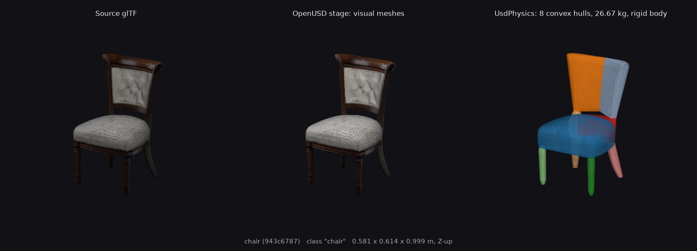
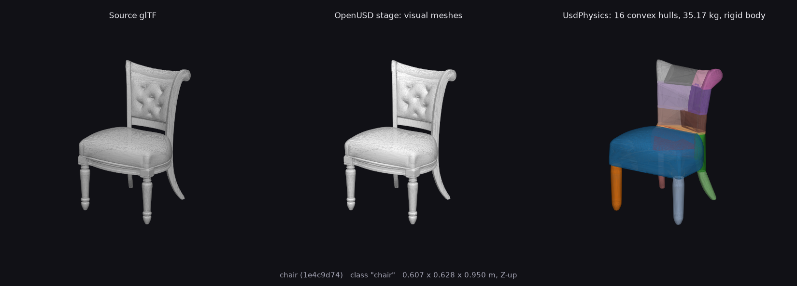
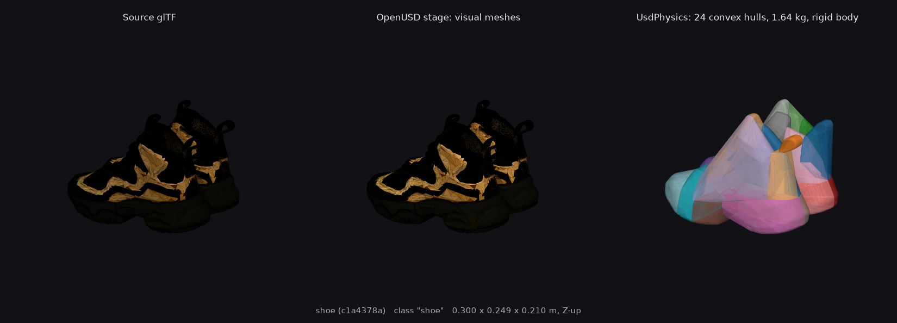
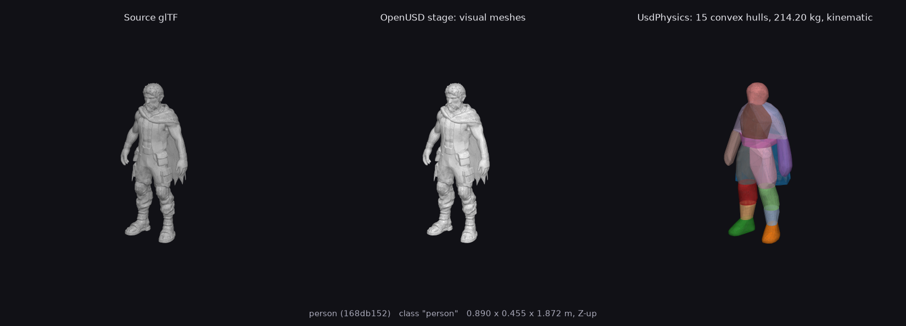

# OpenUSD export (simulation-ready)

Every Forge model can be downloaded as a validated OpenUSD package for NVIDIA
Omniverse and Isaac Sim, with the physics already set up: convex collision
hulls, a rigid body with a real mass, a friction material, semantic class
labels, and UsdSkel skeletons for rigged avatars. Drop the `.usdz` into a scene
and it falls, collides and labels itself in synthetic-data output.

Three ways in, one code path behind them:

| Surface | Where |
|---|---|
| Forge export menu | **OpenUSD (simulation-ready)** row in the Export menu on any finished Forge model |
| HTTP API | `POST /api/forge/export-usd`, `GET /api/forge/export-usd?job=` |
| MCP tool | `export_openusd` on the 3D Studio server (`/api/mcp-3d`), also `assets_export_openusd` on the unified server |

The conversion runs on a CPU worker on Cloud Run
([`workers/usd-export`](../workers/usd-export/README.md)) built on usd-core
26.8. The API and the MCP tool share
[`api/_lib/usd-export.js`](../api/_lib/usd-export.js); the menu row is
[`src/forge-openusd.js`](../src/forge-openusd.js).



## What is in the package

| File | Contents |
|---|---|
| `asset.usdz` | single self-contained file (binary crate plus textures). The one to drag into Omniverse or Isaac Sim. |
| `asset.usd` | binary crate, shipped in `asset.zip` with its `textures/` folder |
| `asset.usda` | the same stage as text, for diffs and review |
| `report.json` | the classification, scale decision, mass method, hull count, timings and every validator finding |

Stage layout, for a prop:

```
/<AssetName>                 Xform, defaultPrim, kind=component
    SemanticsLabelsAPI:class, :category, asset info
    PhysicsRigidBodyAPI, PhysicsMassAPI (mass, centerOfMass, diagonalInertia)
  /Looks/<material>          UsdPreviewSurface + UsdUVTexture network
  /Looks/PhysicsMaterial     PhysicsMaterialAPI (static and dynamic friction, restitution)
  /Geometry/geometry_N       UsdGeom.Mesh, render purpose, normals, st, displayColor
  /Collisions/Hull_NN        UsdGeom.Mesh, guide purpose, PhysicsCollisionAPI,
                             PhysicsMeshCollisionAPI approximation=convexHull
```

The stage is Z-up and in meters (`upAxis = Z`, `metersPerUnit = 1`), and the
model stands on the ground plane at the origin. glTF is Y-up, so the exporter
rotates it.

## Mapping from glTF

- **Meshes**: every triangle primitive becomes a `UsdGeom.Mesh` with its
  normals (smooth normals are computed when the GLB has none), UV sets as
  `primvars:st`, and vertex colours as a `displayColor` primvar that the material reads through a primvar reader.
  Meshopt-compressed GLBs are decoded first. Draco is refused with a clear
  message, since no Python decoder is safe to ship.
- **Materials**: glTF metallic-roughness becomes `UsdPreviewSurface` with
  `diffuseColor`, `metallic`, `roughness`, `normal`, `emissiveColor`,
  `occlusion` and `opacity`, each texture as a `UsdUVTexture` reading
  `primvars:st` through a `UsdPrimvarReader_float2`. WebP textures are
  transcoded to PNG because USDZ only allows PNG and JPEG.
- **Skeletons**: a skinned GLB becomes a `UsdSkel` SkelRoot with one
  `Skeleton` per distinct bind pose, joint indices and weights, blend shapes,
  and glTF animations as `SkelAnimation`. Rigged assets are authored as
  kinematic bodies, because a ragdoll needs per-limb bodies and joints that a
  single generated mesh cannot supply.

## Scale and semantics

Generative lanes fit every model into a box about 1.87 units tall, which is
wrong for a mug and wrong for a car. The exporter reads the object class from
the prompt (73 classes in
[`semantics.py`](../workers/usd-export/semantics.py), each with a label, a
group, a material, a density, a typical size and friction values) and then:

- keeps the native size when it is plausible for the class (`native`),
- otherwise rescales the longest side to the class's typical size
  (`category-typical-size`),
- or uses the caller's `size_m` when given (`caller-size`).

The decision is written into `report.json` as `scale.method`. The class label
and its group (`furniture`, `vehicle`, `character`, ...) are applied with the
OpenUSD `UsdSemantics` labels schema (instances `class` and `category`), which
synthetic-data annotators read as the object's semantic label. Prompts the
pipeline writes itself (`image-to-3d`, `auto-rig`) carry no object word and get
the generic `object` class; pass `label` (and optionally `density_kg_m3`) to
fix the class.

## Physics: how collision and mass are built

1. **Collision**: [CoACD](https://github.com/SarahWeiii/CoACD) (MIT)
   approximate convex decomposition of the visual mesh, capped at 24 hulls.
   Each hull is a guide-purpose mesh with `PhysicsCollisionAPI` and the
   `convexHull` approximation, so PhysX uses it exactly as authored. If CoACD
   returns nothing, the exporter falls back to one convex hull and says so.
2. **Mass**: volume times the class density. The volume is the visual mesh's
   own when it is watertight, otherwise the sum of the hull volumes. Centre of
   mass and the inertia tensor come from the same solids (each hull's inertia
   shifted to the common centre), then diagonalized into
   `physics:diagonalInertia` and `physics:principalAxes`.
3. **Material**: a `PhysicsMaterialAPI` with the class's friction and
   restitution, bound to every hull.

The method string (for example `volume x density; volume from sum of convex
hull volumes (visual mesh is not watertight)`) is written into the root prim's
`customData` and into `report.json`, so anyone reading the asset can see where
the number came from.

## Validation

Every file is checked twice before a job can finish:

- **OpenUSD `UsdValidation`**, the framework the `usdchecker` command runs in
  OpenUSD 26, with every registered validator (stage metadata, composition,
  USDZ packaging, UsdShade, UsdSkel, UsdPhysics).
- **NVIDIA omniverse-asset-validator 1.18.0** (Apache-2.0), the rule engine
  behind the Omniverse validation panel, with its default rule set.

Any error fails the job and no file is published. Warnings are recorded in
`report.json` and shown in the menu row. The worker's Docker build runs the
same validators in its test gate, so an exporter change that introduces an
error never reaches Cloud Run.

### Benchmark: ten Forge props and a rigged avatar

Eleven real public Forge creations exported through the deployed worker, three
generation lanes plus an auto-rigged avatar. Raw results:
[`openusd-export/bench-results.json`](openusd-export/bench-results.json).

| Creation | Lane | Class | Size (m) | Scale | Mass (kg) | Hulls | usdchecker errors / warnings | Asset validator errors / warnings | Time (s) |
|---|---|---|---|---|---|---|---|---|---|
| 1e4c9d74 | triposg | chair | 0.61 x 0.63 x 0.95 | class size | 35.17 | 16 | 0 / 0 | 0 / 2 (Manifold) | 19.7 |
| 8a0cff6a | triposg | vase | 0.27 x 0.27 x 0.35 | class size | 9.47 | 24 | 0 / 0 | 0 / 0 | 25.5 |
| cbc2a58e | triposg | rodent | 0.40 x 0.12 x 0.16 | class size | 1.65 | 10 | 0 / 0 | 0 / 0 | 13.0 |
| 943c6787 | trellis | chair | 0.58 x 0.61 x 1.00 | native | 26.67 | 8 | 0 / 0 | 0 / 2 (IndexedPrimvar, Manifold) | 22.8 |
| c8547eed | trellis | bird | 0.18 x 0.40 x 0.33 | class size | 3.74 | 11 | 0 / 0 | 0 / 1 (Manifold) | 39.1 |
| 5fe20c33 | trellis | car | 3.41 x 4.50 x 1.98 | class size | 1237.16 | 24 | 0 / 0 | 0 / 2 (IndexedPrimvar, Manifold) | 51.3 |
| 3891b587 | hunyuan3d | shield | 0.17 x 0.90 x 0.23 | class size | 1.52 | 14 | 0 / 0 | 0 / 2 (IndexedPrimvar, Manifold) | 22.9 |
| 6ad4d72d | hunyuan3d | device | 0.08 x 0.40 x 0.08 | class size | 0.67 | 10 | 0 / 0 | 0 / 1 (Manifold) | 19.8 |
| c1a4378a | hunyuan3d | shoe | 0.30 x 0.25 x 0.21 | class size | 1.64 | 24 | 0 / 0 | 0 / 1 (Manifold) | 57.5 |
| f25348ec | hunyuan3d | headphones | 0.19 x 0.13 x 0.20 | class size | 0.50 | 24 | 0 / 0 | 0 / 2 (IndexedPrimvar, Manifold) | 54.9 |
| 168db152 | auto-rig | person (52 joints) | 0.89 x 0.45 x 1.87 | native | 214.20 | 15 | 0 / 0 | 0 / 2 (Manifold) | 28.7 |

All eleven pass both validators on both the `.usd` and the `.usdz` with zero
errors. The counts are per file.

### Warnings we record and why they stay

| Rule | What it says | Why it is not fixed |
|---|---|---|
| `ManifoldChecker` (asset validator) | the visual mesh has non-manifold edges or open boundaries | Generative meshes are rarely closed 2-manifolds. Collision never uses the visual mesh (the hulls are convex and closed by construction), and repairing the render mesh would change what the user made. Mass falls back to hull volumes for exactly this case. |
| `IndexedPrimvarChecker` (asset validator) | a primvar with repeated values could be stored indexed | A file-size suggestion, not a correctness issue. Indexing UVs on dense generated meshes saves little and costs an extra pass. |

## Physics drop test

To check that the authored physics actually simulates, the chair export
(`1e4c9d74`, `asset.usd`) was imported into **Newton 1.8.0** (NVIDIA's
open-source GPU physics engine, on Warp 1.19.0, XPBD solver, run on CPU) and
dropped from 1 m onto a ground plane
([`workers/usd-export/drop_test.py`](../workers/usd-export/drop_test.py),
result in [`openusd-export/drop-test.json`](openusd-export/drop-test.json)):

| Check | Result |
|---|---|
| Mass read back from the USD | 35.1742 kg, identical to the authored mass |
| Collision shapes imported | 16 |
| First ground contact | 0.425 s (free fall from 0.917 m lowest point) |
| Deepest penetration | 1.9 mm |
| Settled (last 0.5 s) | max linear speed 0.00087 m/s, max angular speed 0.0004 rad/s |
| Verdict | passed (mass imported, fell and collided, settled, no tunnelling) |

Newton is used here for this test only. Omniverse and Isaac Sim themselves
were not run in this check; the files pass the validator Omniverse ships.

## Previews

Rendered from the exported files with
[`render_preview.py`](../workers/usd-export/render_preview.py): source glTF,
the USD stage's visual meshes, and its collision hulls with the authored mass.
usd-core ships no Hydra renderer, so the USD panels are drawn from the stage's
own points, faces, transforms and textures read through the USD API.





```
cd workers/usd-export
python render_preview.py --glb model.glb --usd asset.usdz --out preview.png
```

## Forge export menu

Open any finished model in Forge, open the Export menu (the caret next to
Download) and pick **OpenUSD (simulation-ready)**. The row shows each stage as
it runs (queued, downloading, converting, collision, packaging, validating,
publishing, with a step count and a progress bar), then the class, size, mass,
hull count and validator result, with links to the `.usdz`, the `.usd` plus
textures, the `.usda`, the report and this page. A model exported before comes
back at once. If the exporter is down or refuses the model, the row says what
happened and how to retry. The menu is keyboard reachable and caps its height
to the viewport, opening downward when there is more room below.

## HTTP API

```
POST /api/forge/export-usd
  { "id": "<creation uuid>" }          a public or unlisted Forge creation
  { "src": "https://.../model.glb" }   any public https GLB
  optional: prompt, label, size_m, density_kg_m3
-> 202 { job, status: "queued", stage, stage_label, stages, progress, poll }
-> 200 the finished job when the same export already exists

GET /api/forge/export-usd?job=<job>
-> 200 { job, status: queued|running|done|error, stage, stage_label, progress,
         files?: { usdz, zip, usd, usda, report }, summary?, error? }
```

```
curl -s -X POST https://three.ws/api/forge/export-usd \
  -H 'content-type: application/json' \
  -d '{"id":"1e4c9d74-65e0-4b73-b2d9-f07325c760d6"}'
```

No account is needed. Starts are rate limited per IP (`usdExportIp`), polls
share the 3D status limit. Errors use the platform shape `{ error, message }`:

| Status | `error` | Meaning |
|---|---|---|
| 400 | `validation_error` | missing or malformed input, a non-public URL, or a model the exporter refused (the message says why, for example a Draco GLB) |
| 404 | `creation_not_found` / `job_not_found` | no finished public creation with that id, or no such job |
| 429 | `rate_limited` | too many exports from this IP in the window |
| 502 | `worker_unavailable` | the exporter is not answering; retry in a minute |
| 503 | `not_configured` | the API service is missing `GCP_USD_EXPORT_URL` or `GCP_RECONSTRUCTION_KEY` |

`summary` carries `label`, `size_m`, `mass_kg`, `hulls`, `rigged`, `joints`,
`scale_method` and the per-file validator counts.

## MCP tool: `export_openusd`

On the 3D Studio MCP server (`https://three.ws/api/mcp-3d`) and on the unified
server as `assets_export_openusd`. No per-call charge; the server's normal
sign-in applies and starts are rate limited per caller like the web route.

| Argument | Meaning |
|---|---|
| `creation_id` | a public or unlisted Forge creation id |
| `glb_url` | a public https GLB, when there is no creation |
| `job` | a job id from an earlier call; polls instead of starting |
| `prompt`, `label`, `size_m`, `density_kg_m3` | the same overrides as the API |
| `wait_seconds` | how long to wait for the result (default 30, max 50) |

Exports take 10 to 60 s. The tool waits up to `wait_seconds`; if the export is
still running it returns the job and tells the caller to call again with
`job`. A finished result reads like:

```
OpenUSD export ready: class "chair", 0.607 x 0.628 x 0.950 m, 35.17 kg,
16 convex collision hulls, 0 validator errors, 4 warnings.
USDZ (single file, drag into Omniverse or Isaac Sim): https://storage.googleapis.com/.../asset.usdz
USD + textures (zip): .../asset.zip
USDA (text): .../asset.usda
Report (mass method, every validator finding): .../report.json
```

`structuredContent` is the same job object the API returns. Errors come back
as tool errors with the API's codes.

## Limitations

- **Avatar mass is an overestimate.** The hulls of a rigged character also
  wrap the gaps between arms and torso, so the 1.87 m avatar above gets
  214 kg. Rigged assets are kinematic, so the number does not move anything in
  simulation; pass `density_kg_m3` or edit `physics:mass` before switching one
  to a dynamic body.
- **Generic class for pipeline prompts.** Models made from an image or by
  auto-rig have no object word in their prompt and fall back to the `object`
  class (density 700 kg/m3). Pass `label` for a better size and mass.
- **Single rigid body.** Articulated objects (doors, wheels, drawers) export
  as one body; there are no physics joints between parts.
- **Draco GLBs are refused** with a message; meshopt is supported.

## Running it

| Task | Command |
|---|---|
| Worker tests (both validators) | `cd workers/usd-export && python test_export.py` |
| API and MCP tests | `npx vitest run tests/forge-export-usd.test.js tests/mcp-export-openusd.test.js` |
| Benchmark real creations | `USD_EXPORT_KEY=... python workers/usd-export/bench.py --worker <url> --json docs/openusd-export/bench-results.json` |
| Drop test | `pip install newton warp-lang && python workers/usd-export/drop_test.py out/asset.usd` |
| Deploy the worker | see [`workers/usd-export/README.md`](../workers/usd-export/README.md#deploy) |
