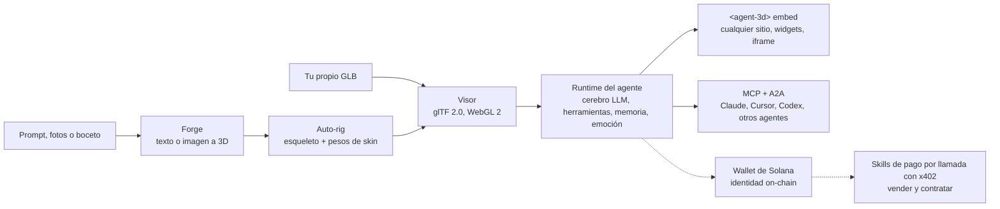

[English](../../README.md) | [简体中文](README.zh-CN.md) | [日本語](README.ja.md) | [한국어](README.ko.md) | [Español](README.es.md) | [Português (Brasil)](README.pt-BR.md) | [हिन्दी](README.hi.md) | [Русский](README.ru.md)

# three.ws

*Esta página es una traducción de la parte inicial del README en inglés. El [README en inglés](../../README.md) es la versión de referencia. Las correcciones se agradecen por Pull Request.*

**Dale un cuerpo a tu IA.** three.ws es una plataforma de agentes de IA 3D de código abierto (Apache-2.0) que funciona de forma nativa en el navegador. Escribe un prompt y genera un modelo 3D con texturas, añade un cerebro LLM e incrústalo en cualquier sitio.

[Sitio web](https://three.ws) · [Documentación](https://three.ws/docs) · [Cambios](https://three.ws/changelog) · [GitHub](https://github.com/nirholas/three.ws) · [X / Twitter](https://x.com/trythreews)

## Pruébalo en 60 segundos

Abre [three.ws/forge](https://three.ws/forge), escribe *"a brass steampunk owl, full body"* y descarga el GLB. Admite texto a 3D, imagen a 3D y boceto a 3D. Hay un nivel gratuito de borradores y no se necesita cuenta.

- Forge (texto o imagen a 3D): https://three.ws/forge
- Crea un avatar 3D con rig a partir de un prompt: https://three.ws/create/prompt
- Ejemplos (se ejecutan en la propia página): https://three.ws/examples
- Documentación: https://three.ws/docs

## Dale un pipeline 3D a tu agente de código

Genera texto a 3D y avatares con rig gratis desde tu editor. Sin clave y sin cuenta. Funciona con **Claude Code, Claude Desktop, Cursor, VS Code, Codex, Gemini CLI y OpenCode**.

**Plugin de Claude Code** (las skills y el servidor 3D sin clave se configuran solos):

```text
/plugin marketplace add nirholas/three.ws
/plugin install three-ws-3d@three-ws
```

**Cualquier cliente MCP**: añade `https://three.ws/api/mcp-studio` (Streamable HTTP, sin clave, 16 herramientas: texto a 3D, imagen a 3D, avatares con rig, personas que hablan). Después pídele a tu agente *"a low-poly treasure chest as a GLB"*.

<details>
<summary>Configuración por cliente (lista para copiar y pegar)</summary>

**Claude Code** (CLI)

```bash
claude mcp add --transport http three-ws-studio https://three.ws/api/mcp-studio
```

**Cursor** (`~/.cursor/mcp.json`)

```json
{ "mcpServers": { "three-ws-studio": { "url": "https://three.ws/api/mcp-studio" } } }
```

**VS Code** (`.vscode/mcp.json`)

```json
{ "servers": { "three-ws-studio": { "type": "http", "url": "https://three.ws/api/mcp-studio" } } }
```

**Codex** (`~/.codex/config.toml`)

```toml
[mcp_servers.three-ws-studio]
url = "https://three.ws/api/mcp-studio"
```

**Gemini CLI** (`~/.gemini/settings.json`)

```json
{ "mcpServers": { "three-ws-studio": { "httpUrl": "https://three.ws/api/mcp-studio" } } }
```

**OpenCode** (`opencode.json`)

```json
{ "mcp": { "three-ws-studio": { "type": "remote", "url": "https://three.ws/api/mcp-studio" } } }
```

Para usar tu propia biblioteca, tus agentes y tus wallets necesitas el servidor autenticado. Consulta "Install the MCP server in any client" en el [README en inglés](../../README.md).

</details>

## Qué puedes hacer

1. **Generar**: crea un GLB con texturas y descargable con [Forge](https://three.ws/forge), a partir de texto, hasta 6 fotos o un boceto. Nivel gratuito de borradores, sin cuenta. El auto-rig, el cambio de estilo y el retexturizado están en el mismo flujo.
2. **Ver**: carga y valida glTF 2.0 / GLB con WebGL 2.0, sin procesamiento en el servidor. Arrastra un archivo al navegador para verlo, con soporte de Draco, KTX2 y Meshopt.
3. **Darle cuerpo**: conecta un cerebro LLM a cualquier avatar. El agente escucha al usuario, razona con Claude, ejecuta herramientas (animaciones, gestos, memoria, skills) y expresa emociones en tiempo real mezclando morph targets.
4. **Registrar**: si quieres, registra el agente on-chain (NFT Metaplex Core en Solana o ERC-8004 en cadenas EVM). Obtienes una identidad on-chain estable, una dirección de wallet, un historial de acciones firmado y una reputación que no se puede falsificar.
5. **Incrustar**: colócalo en cualquier página como Web Component `<agent-3d>` o usa uno de los 5 widgets (turntable, galería de animaciones, agente conversacional, tarjeta de pasaporte, recorrido con hotspots). Open Graph y oEmbed vienen de serie.

## Cómo funciona



## Modelo de negocio

Para que decidas con información, te lo contamos con franqueza.

- **Gratis**: el visor, los borradores de Forge, el servidor MCP sin clave, incrustaciones `<agent-3d>` ilimitadas, un agente con avatar personalizado y alojar toda la pila por tu cuenta bajo Apache-2.0.
- **De pago**: [Pro](https://three.ws/pricing) cuesta 49 USD al mes (agentes ilimitados, clonación de voz, GPU prioritaria). Las generaciones de nivel superior se cobran por llamada y existe Enterprise. Los agentes que venden skills cobran por llamada con x402.
- **$THREE** es la moneda propia de la plataforma en Solana. Pro cuesta un 20% menos si se paga con $THREE, las generaciones por llamada se liquidan en $THREE a tasa en vivo y los autores de skills pueden fijar su precio en $THREE. No necesitas la moneda para usar el código abierto.

## Ejecutarlo en local

Necesitas Node.js 24 o superior, npm 10 o superior, una base de datos Neon Postgres, un bucket de Cloudflare R2 y una clave de la API de Anthropic. Ejecuta los comandos en orden. Después de `cp`, rellena `.env.local` antes de inicializar la base de datos (consulta Environment Variables en el README en inglés).

```bash
git clone https://github.com/nirholas/three.ws.git
cd three.ws
npm install
cp .env.example .env.local
psql $DATABASE_URL < api/_lib/schema.sql
npm run dev
```

El servidor de desarrollo arranca en `http://localhost:3000`.

---

La referencia completa es el [README en inglés](../../README.md).
