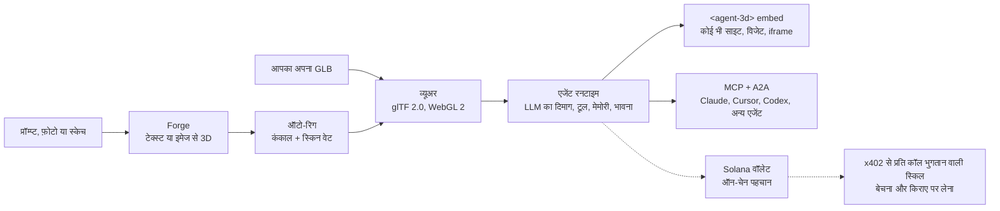

[English](../../README.md) | [简体中文](README.zh-CN.md) | [日本語](README.ja.md) | [한국어](README.ko.md) | [Español](README.es.md) | [Português (Brasil)](README.pt-BR.md) | [हिन्दी](README.hi.md) | [Русский](README.ru.md)

# three.ws

*यह पृष्ठ अंग्रेज़ी README के शुरुआती भाग का अनुवाद है। मूल संस्करण [अंग्रेज़ी README](../../README.md) ही है। सुधार Pull Request के ज़रिए भेजने का स्वागत है।*

**अपने AI को एक शरीर दीजिए।** three.ws एक ओपन सोर्स (Apache-2.0), ब्राउज़र-नेटिव 3D AI एजेंट प्लेटफ़ॉर्म है। प्रॉम्प्ट लिखकर टेक्सचर वाला 3D मॉडल बनाइए, उसमें LLM का दिमाग जोड़िए और किसी भी साइट पर एम्बेड कीजिए।

[वेबसाइट](https://three.ws) · [दस्तावेज़](https://three.ws/docs) · [बदलाव](https://three.ws/changelog) · [GitHub](https://github.com/nirholas/three.ws) · [X / Twitter](https://x.com/trythreews)

## 60 सेकंड में आज़माइए

[three.ws/forge](https://three.ws/forge) खोलिए, *"a brass steampunk owl, full body"* लिखिए और GLB डाउनलोड कीजिए। टेक्स्ट से 3D, इमेज से 3D और स्केच से 3D तीनों उपलब्ध हैं। ड्राफ़्ट का मुफ़्त स्तर है और खाते की ज़रूरत नहीं।

- Forge (टेक्स्ट या इमेज से 3D): https://three.ws/forge
- प्रॉम्प्ट से रिग वाला 3D अवतार बनाइए: https://three.ws/create/prompt
- उदाहरण (पृष्ठ पर ही चलते हैं): https://three.ws/examples
- दस्तावेज़: https://three.ws/docs

## अपने कोडिंग एजेंट को 3D पाइपलाइन दीजिए

अपने एडिटर के भीतर से मुफ़्त में टेक्स्ट से 3D और रिग वाले अवतार बनाइए। न कुंजी, न खाता। **Claude Code, Claude Desktop, Cursor, VS Code, Codex, Gemini CLI और OpenCode** के साथ काम करता है।

**Claude Code प्लगइन** (स्किल और बिना कुंजी वाला 3D सर्वर अपने आप सेट हो जाते हैं):

```text
/plugin marketplace add nirholas/three.ws
/plugin install three-ws-3d@three-ws
```

**कोई भी MCP क्लाइंट**: `https://three.ws/api/mcp-studio` जोड़िए (Streamable HTTP, बिना कुंजी, 16 टूल: टेक्स्ट से 3D, इमेज से 3D, रिग वाले अवतार, बोलने वाले पर्सोना)। फिर अपने एजेंट से कहिए *"a low-poly treasure chest as a GLB"*।

<details>
<summary>क्लाइंट के अनुसार सेटअप (सीधे कॉपी करके चिपकाइए)</summary>

**Claude Code** (CLI)

```bash
claude mcp add --transport http three-ws-studio https://three.ws/api/mcp-studio
```

**Cursor** (`~/.cursor/mcp.json`)

```json
{ "mcpServers": { "three-ws-studio": { "url": "https://three.ws/api/mcp-studio" } } }
```

**VS Code** (`.vscode/mcp.json`)

```json
{ "servers": { "three-ws-studio": { "type": "http", "url": "https://three.ws/api/mcp-studio" } } }
```

**Codex** (`~/.codex/config.toml`)

```toml
[mcp_servers.three-ws-studio]
url = "https://three.ws/api/mcp-studio"
```

**Gemini CLI** (`~/.gemini/settings.json`)

```json
{ "mcpServers": { "three-ws-studio": { "httpUrl": "https://three.ws/api/mcp-studio" } } }
```

**OpenCode** (`opencode.json`)

```json
{ "mcp": { "three-ws-studio": { "type": "remote", "url": "https://three.ws/api/mcp-studio" } } }
```

अपनी लाइब्रेरी, एजेंट और वॉलेट इस्तेमाल करने के लिए प्रमाणित सर्वर चाहिए। [अंग्रेज़ी README](../../README.md) में "Install the MCP server in any client" देखिए।

</details>

## आप क्या कर सकते हैं

1. **बनाइए**: [Forge](https://three.ws/forge) में टेक्स्ट, अधिकतम 6 फ़ोटो या स्केच से टेक्सचर वाला, डाउनलोड योग्य GLB बनाइए। ड्राफ़्ट का मुफ़्त स्तर, खाता नहीं चाहिए। ऑटो-रिग, रीस्टाइल और रीटेक्सचर उसी प्रवाह में हैं।
2. **देखिए**: WebGL 2.0 से glTF 2.0 / GLB लोड और वैलिडेट कीजिए, सर्वर पर कोई प्रोसेसिंग नहीं। फ़ाइल को ब्राउज़र में खींचकर देखिए, Draco, KTX2 और Meshopt समर्थित हैं।
3. **शरीर दीजिए**: किसी भी अवतार से LLM का दिमाग जोड़िए। एजेंट उपयोगकर्ता को सुनता है, Claude से सोचता है, टूल चलाता है (एनिमेशन, हाव-भाव, मेमोरी, स्किल) और मॉर्फ़ टारगेट मिलाकर रीयल टाइम में भावनाएँ दिखाता है।
4. **रजिस्टर कीजिए**: चाहें तो एजेंट को ऑन-चेन रजिस्टर कीजिए (Solana पर Metaplex Core NFT या EVM चेन पर ERC-8004)। आपको स्थिर ऑन-चेन पहचान, वॉलेट पता, हस्ताक्षरित कार्य-इतिहास और ऐसी प्रतिष्ठा मिलती है जिसे नकली नहीं बनाया जा सकता।
5. **एम्बेड कीजिए**: किसी भी पृष्ठ पर `<agent-3d>` Web Component की तरह रखिए या 5 विजेट में से कोई चुनिए (टर्नटेबल, एनिमेशन गैलरी, बातचीत वाला एजेंट, पासपोर्ट कार्ड, हॉटस्पॉट टूर)। Open Graph और oEmbed पहले से शामिल हैं।

## यह कैसे काम करता है



## कमाई का मॉडल

फ़ैसला लेने के लिए सीधी बात बता दें।

- **मुफ़्त**: व्यूअर, Forge के ड्राफ़्ट, बिना कुंजी वाला MCP सर्वर, असीमित `<agent-3d>` एम्बेड, कस्टम अवतार वाला एक एजेंट और Apache-2.0 के तहत पूरा स्टैक खुद होस्ट करना।
- **सशुल्क**: [Pro](https://three.ws/pricing) 49 डॉलर प्रति माह है (असीमित एजेंट, वॉइस क्लोनिंग, प्राथमिकता वाला GPU)। ऊँचे स्तर की जेनरेशन प्रति कॉल के हिसाब से लगती है और Enterprise भी है। स्किल बेचने वाले एजेंटों को x402 से प्रति कॉल भुगतान मिलता है।
- **$THREE** प्लेटफ़ॉर्म का अपना Solana कॉइन है। $THREE में भुगतान करने पर Pro 20% सस्ता पड़ता है, प्रति कॉल जेनरेशन का निपटान लाइव रेट पर $THREE में होता है और स्किल बनाने वाले अपनी कीमत $THREE में तय कर सकते हैं। ओपन सोर्स कोड इस्तेमाल करने के लिए कॉइन की कोई ज़रूरत नहीं।

## स्थानीय रूप से चलाइए

आपको Node.js 24 या उससे नया, npm 10 या उससे नया, एक Neon Postgres डेटाबेस, एक Cloudflare R2 बकेट और Anthropic API कुंजी चाहिए। कमांड क्रम से चलाइए। `cp` के बाद डेटाबेस शुरू करने से पहले `.env.local` भर लीजिए (अंग्रेज़ी README में Environment Variables देखिए)।

```bash
git clone https://github.com/nirholas/three.ws.git
cd three.ws
npm install
cp .env.example .env.local
psql $DATABASE_URL < api/_lib/schema.sql
npm run dev
```

डेवलपमेंट सर्वर `http://localhost:3000` पर चलता है।

---

पूरा संदर्भ [अंग्रेज़ी README](../../README.md) है।
