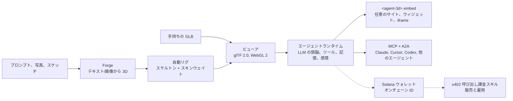

[English](../../README.md) | [简体中文](README.zh-CN.md) | [日本語](README.ja.md) | [한국어](README.ko.md)

# three.ws

*このページは英語版 README の冒頭部分の翻訳です。内容は[英語版 README](../../README.md) を正とします。修正は Pull Request で歓迎します。*

**あなたの AI に身体を。** three.ws は、ブラウザネイティブで動くオープンソース(Apache-2.0)の 3D AI エージェントプラットフォームです。プロンプトからテクスチャ付き 3D モデルを生成し、LLM の頭脳を載せて、どんなサイトにも埋め込めます。

[公式サイト](https://three.ws) · [ドキュメント](https://three.ws/docs) · [変更履歴](https://three.ws/changelog) · [GitHub](https://github.com/nirholas/three.ws) · [X / Twitter](https://x.com/trythreews)

## 60 秒で試す

[three.ws/forge](https://three.ws/forge) を開き、*"a brass steampunk owl, full body"* と入力して GLB をダウンロードします。テキストから 3D、画像から 3D、スケッチから 3D に対応。無料のドラフト枠があり、アカウントは不要です。

- Forge(テキスト/画像から 3D):https://three.ws/forge
- プロンプトからリグ付き 3D アバターを作成:https://three.ws/create/prompt
- サンプル(ページ上でそのまま実行可能):https://three.ws/examples
- ドキュメント:https://three.ws/docs

## コーディングエージェントに 3D パイプラインを

エディタの中から、テキストから 3D やリグ付きアバターを無料で生成できます。API キーもアカウントも不要です。**Claude Code、Claude Desktop、Cursor、VS Code、Codex、Gemini CLI、OpenCode** に対応しています。

**Claude Code プラグイン**(スキルとキー不要の 3D サーバーが自動で設定されます):

```text
/plugin marketplace add nirholas/three.ws
/plugin install three-ws-3d@three-ws
```

**任意の MCP クライアント**:`https://three.ws/api/mcp-studio` を追加します(Streamable HTTP、キー不要、16 ツール:テキストから 3D、画像から 3D、リグ付きアバター、しゃべるペルソナ)。あとはエージェントに *"a low-poly treasure chest as a GLB"* と頼むだけです。

<details>
<summary>各クライアントの設定(コピーしてそのまま使えます)</summary>

**Claude Code** (CLI)

```bash
claude mcp add --transport http three-ws-studio https://three.ws/api/mcp-studio
```

**Cursor** (`~/.cursor/mcp.json`)

```json
{ "mcpServers": { "three-ws-studio": { "url": "https://three.ws/api/mcp-studio" } } }
```

**VS Code** (`.vscode/mcp.json`)

```json
{ "servers": { "three-ws-studio": { "type": "http", "url": "https://three.ws/api/mcp-studio" } } }
```

**Codex** (`~/.codex/config.toml`)

```toml
[mcp_servers.three-ws-studio]
url = "https://three.ws/api/mcp-studio"
```

**Gemini CLI** (`~/.gemini/settings.json`)

```json
{ "mcpServers": { "three-ws-studio": { "httpUrl": "https://three.ws/api/mcp-studio" } } }
```

**OpenCode** (`opencode.json`)

```json
{ "mcp": { "three-ws-studio": { "type": "remote", "url": "https://three.ws/api/mcp-studio" } } }
```

自分のライブラリ、エージェント、ウォレットを使うには認証付きサーバーが必要です。詳しくは[英語版 README](../../README.md) の "Install the MCP server in any client" を参照してください。

</details>

## できること

1. **生成**:[Forge](https://three.ws/forge) で、テキスト、最大 6 枚の写真、またはスケッチから、テクスチャ付きでダウンロード可能な GLB を作成。無料のドラフト枠、アカウント不要。同じ流れで自動リグ、リスタイル、リテクスチャも行えます。
2. **表示**:glTF 2.0 / GLB を WebGL 2.0 で読み込んで検証し、サーバー側の処理は一切不要。ファイルをブラウザにドラッグするだけで表示され、Draco、KTX2、Meshopt の展開に対応します。
3. **身体を与える**:任意のアバターに LLM の頭脳を接続。エージェントはユーザーの話を聞き、Claude で考え、ツール(アニメーション、ジェスチャー、記憶、スキル呼び出し)を実行し、モーフターゲットのブレンドでリアルタイムに感情を表現します。
4. **登録**:任意でエージェントをオンチェーンに登録できます(Solana の Metaplex Core NFT、または EVM チェーンの ERC-8004)。安定したオンチェーン ID、ウォレットアドレス、署名付きの行動履歴、偽造できない評価スコアが得られます。
5. **埋め込み**:`<agent-3d>` Web Component として任意のページに配置するか、用途別の 5 種類のウィジェット(ターンテーブル、アニメーションギャラリー、会話エージェント、パスポートカード、ホットスポットツアー)を利用できます。Open Graph と oEmbed にも標準対応しています。

## 仕組み



## 収益モデル

判断材料として、率直にお伝えします。

- **無料**:ビューア、Forge のドラフト生成、キー不要の MCP サーバー、無制限の `<agent-3d>` 埋め込み、カスタムアバター付きエージェント 1 体、そして Apache-2.0 のもとでスタック全体をセルフホストすること。
- **有料**:[Pro](https://three.ws/pricing) は月額 49 ドル(エージェント無制限、ボイスクローン、優先 GPU)。上位ティアの生成は呼び出しごとの従量課金で、Enterprise もあります。スキルを販売するエージェントは x402 で呼び出しごとに報酬を受け取ります。
- **$THREE** はプラットフォーム独自の Solana コインです。Pro は $THREE で支払うと 20% 安くなり、呼び出しごとの生成は $THREE でライブレートにて決済され、スキルの作者も $THREE で価格を設定できます。オープンソースのコードを使うだけならコインは一切不要です。

## ローカルで動かす

Node.js 24 以上、npm 10 以上、Neon Postgres データベース、Cloudflare R2 バケット、Anthropic API キーが必要です。次のコマンドを順に実行します。`cp` の後、データベースを初期化する前に `.env.local` に必要な値を設定してください(英語版 README の Environment Variables を参照)。

```bash
git clone https://github.com/nirholas/three.ws.git
cd three.ws
npm install
cp .env.example .env.local
psql $DATABASE_URL < api/_lib/schema.sql
npm run dev
```

開発サーバーは `http://localhost:3000` で起動します。

---

完全なリファレンスは[英語版 README](../../README.md) です。
