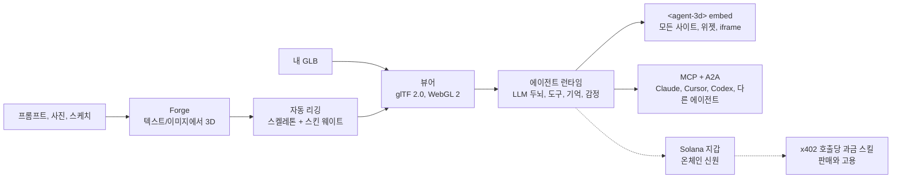

[English](../../README.md) | [简体中文](README.zh-CN.md) | [日本語](README.ja.md) | [한국어](README.ko.md)

# three.ws

*이 문서는 커뮤니티가 검토한 번역본입니다. 수정 사항은 Pull Request로 언제든 환영합니다.*

**AI에게 몸을 주세요.** three.ws는 브라우저에서 바로 동작하는 오픈소스(Apache-2.0) 3D AI 에이전트 플랫폼입니다. 프롬프트로 텍스처가 입혀진 3D 모델을 만들고, LLM 두뇌를 연결해 어떤 사이트에도 임베드할 수 있습니다.

[웹사이트](https://three.ws) · [문서](https://three.ws/docs) · [변경 내역](https://three.ws/changelog) · [GitHub](https://github.com/nirholas/three.ws) · [X / Twitter](https://x.com/trythreews)

## 60초 만에 써 보기

[three.ws/forge](https://three.ws/forge)를 열고 *"a brass steampunk owl, full body"*를 입력한 뒤 GLB를 내려받으세요. 텍스트에서 3D, 이미지에서 3D, 스케치에서 3D를 지원하며 무료 초안 티어가 있고 계정이 필요 없습니다.

- Forge (텍스트/이미지에서 3D): https://three.ws/forge
- 프롬프트로 리깅된 3D 아바타 만들기: https://three.ws/create/prompt
- 예제 (페이지에서 바로 실행): https://three.ws/examples
- 문서: https://three.ws/docs

## 코딩 에이전트에 3D 파이프라인 연결하기

에디터 안에서 텍스트에서 3D 모델과 리깅된 아바타를 무료로 만들 수 있습니다. API 키도, 계정도 필요 없습니다. **Claude Code, Claude Desktop, Cursor, VS Code, Codex, Gemini CLI, OpenCode**에서 동작합니다.

**Claude Code 플러그인** (스킬과 키 없는 3D 서버가 자동으로 설정됩니다):

```text
/plugin marketplace add nirholas/three.ws
/plugin install three-ws-3d@three-ws
```

**모든 MCP 클라이언트**: `https://three.ws/api/mcp-studio`를 추가하세요 (Streamable HTTP, 키 불필요, 16개 도구: 텍스트에서 3D, 이미지에서 3D, 리깅된 아바타, 말하는 페르소나). 그런 다음 에이전트에게 *"a low-poly treasure chest as a GLB"*라고 요청하면 됩니다.

<details>
<summary>클라이언트별 설정 (복사해서 바로 사용)</summary>

**Claude Code** (CLI)

```bash
claude mcp add --transport http three-ws-studio https://three.ws/api/mcp-studio
```

**Cursor** (`~/.cursor/mcp.json`)

```json
{ "mcpServers": { "three-ws-studio": { "url": "https://three.ws/api/mcp-studio" } } }
```

**VS Code** (`.vscode/mcp.json`)

```json
{ "servers": { "three-ws-studio": { "type": "http", "url": "https://three.ws/api/mcp-studio" } } }
```

**Codex** (`~/.codex/config.toml`)

```toml
[mcp_servers.three-ws-studio]
url = "https://three.ws/api/mcp-studio"
```

**Gemini CLI** (`~/.gemini/settings.json`)

```json
{ "mcpServers": { "three-ws-studio": { "httpUrl": "https://three.ws/api/mcp-studio" } } }
```

**OpenCode** (`opencode.json`)

```json
{ "mcp": { "three-ws-studio": { "type": "remote", "url": "https://three.ws/api/mcp-studio" } } }
```

나만의 라이브러리, 에이전트, 지갑을 쓰려면 인증이 필요한 서버를 연결해야 합니다. 자세한 내용은 [영문 README](../../README.md)의 "Install the MCP server in any client"를 참고하세요.

</details>

## 제공 기능

1. **생성**: [Forge](https://three.ws/forge)에서 텍스트, 최대 6장의 사진, 또는 스케치로 텍스처가 입혀진 다운로드 가능한 GLB를 만듭니다. 무료 초안 티어, 계정 불필요. 같은 흐름에서 자동 리깅, 리스타일, 리텍스처도 가능합니다.
2. **렌더링**: glTF 2.0 / GLB를 WebGL 2.0에서 불러와 검증하며, 서버 측 처리는 전혀 없습니다. 파일을 브라우저에 끌어다 놓으면 바로 표시되고 Draco, KTX2, Meshopt 압축 해제를 지원합니다.
3. **몸 부여**: 어떤 아바타에도 LLM 두뇌를 연결합니다. 에이전트는 사용자의 말을 듣고, Claude로 생각하고, 도구(애니메이션, 제스처, 기억, 스킬 호출)를 실행하며, 모프 타깃 블렌딩으로 감정을 실시간 표현합니다.
4. **등록**: 원한다면 에이전트를 온체인에 등록할 수 있습니다(Solana의 Metaplex Core NFT 또는 EVM 체인의 ERC-8004). 안정적인 온체인 신원, 지갑 주소, 서명된 행동 기록, 위조할 수 없는 평판 점수를 얻습니다.
5. **임베드**: `<agent-3d>` Web Component로 아무 페이지에나 넣거나, 용도별 5가지 위젯(턴테이블, 애니메이션 갤러리, 대화형 에이전트, 패스포트 카드, 핫스팟 투어)을 쓸 수 있습니다. Open Graph와 oEmbed가 기본 지원됩니다.

## 동작 방식



## 수익 구조

도입 여부를 판단하실 수 있도록 솔직하게 설명드립니다.

- **무료**: 뷰어, Forge 초안 생성, 키가 필요 없는 MCP 서버, 무제한 `<agent-3d>` 임베드, 커스텀 아바타를 가진 에이전트 1개, 그리고 Apache-2.0 아래 전체 스택 셀프 호스팅.
- **유료**: [Pro](https://three.ws/pricing)는 월 49달러(에이전트 무제한, 음성 복제, 우선 GPU)이며, 상위 티어 생성은 호출당 과금되고, Enterprise도 있습니다. 스킬을 판매하는 에이전트는 x402로 호출당 대금을 받습니다.
- **$THREE**는 플랫폼 자체의 Solana 코인입니다. Pro는 $THREE로 결제하면 20% 저렴하고, 호출당 생성은 실시간 환율로 $THREE로 정산되며, 스킬 제작자도 $THREE로 호출 가격을 정할 수 있습니다. 오픈소스 코드를 쓰는 데에는 코인이 전혀 필요하지 않습니다.

## 로컬에서 실행하기

Node.js 24 이상, npm 10 이상, Neon Postgres 데이터베이스, Cloudflare R2 버킷, Anthropic API 키가 필요합니다. `.env.local`에 값을 채운 뒤(영문 README의 Environment Variables 참고) 다음을 실행하세요.

```bash
git clone https://github.com/nirholas/three.ws.git
cd three.ws
npm install
cp .env.example .env.local
psql $DATABASE_URL < api/_lib/schema.sql
npm run dev
```

개발 서버는 `http://localhost:3000`에서 실행됩니다.

---

전체 내용을 담은 공식 레퍼런스는 [영문 README](../../README.md)입니다.
