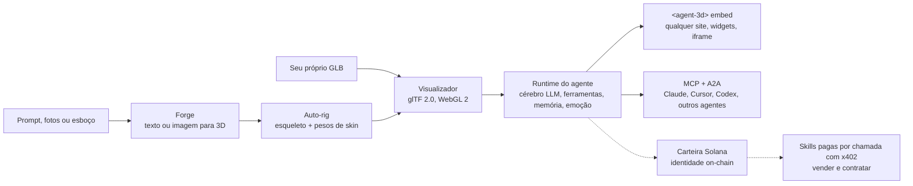

[English](../../README.md) | [简体中文](README.zh-CN.md) | [日本語](README.ja.md) | [한국어](README.ko.md) | [Español](README.es.md) | [Português (Brasil)](README.pt-BR.md) | [हिन्दी](README.hi.md) | [Русский](README.ru.md)

# three.ws

*Esta página é uma tradução da parte inicial do README em inglês. O [README em inglês](../../README.md) é a versão de referência. Correções são bem-vindas por Pull Request.*

**Dê um corpo à sua IA.** O three.ws é uma plataforma de agentes de IA 3D de código aberto (Apache-2.0) que roda nativamente no navegador. Escreva um prompt e gere um modelo 3D com texturas, adicione um cérebro LLM e incorpore em qualquer site.

[Site](https://three.ws) · [Documentação](https://three.ws/docs) · [Mudanças](https://three.ws/changelog) · [GitHub](https://github.com/nirholas/three.ws) · [X / Twitter](https://x.com/trythreews)

## Experimente em 60 segundos

Abra [three.ws/forge](https://three.ws/forge), digite *"a brass steampunk owl, full body"* e baixe o GLB. Há texto para 3D, imagem para 3D e esboço para 3D. Existe um nível gratuito de rascunhos e não é preciso criar conta.

- Forge (texto ou imagem para 3D): https://three.ws/forge
- Crie um avatar 3D com rig a partir de um prompt: https://three.ws/create/prompt
- Exemplos (rodam na própria página): https://three.ws/examples
- Documentação: https://three.ws/docs

## Dê um pipeline 3D ao seu agente de código

Gere texto para 3D e avatares com rig de graça dentro do seu editor. Sem chave e sem conta. Funciona com **Claude Code, Claude Desktop, Cursor, VS Code, Codex, Gemini CLI e OpenCode**.

**Plugin do Claude Code** (as skills e o servidor 3D sem chave são configurados para você):

```text
/plugin marketplace add nirholas/three.ws
/plugin install three-ws-3d@three-ws
```

**Qualquer cliente MCP**: adicione `https://three.ws/api/mcp-studio` (Streamable HTTP, sem chave, 16 ferramentas: texto para 3D, imagem para 3D, avatares com rig, personas que falam). Depois peça ao seu agente *"a low-poly treasure chest as a GLB"*.

<details>
<summary>Configuração por cliente (pronta para copiar e colar)</summary>

**Claude Code** (CLI)

```bash
claude mcp add --transport http three-ws-studio https://three.ws/api/mcp-studio
```

**Cursor** (`~/.cursor/mcp.json`)

```json
{ "mcpServers": { "three-ws-studio": { "url": "https://three.ws/api/mcp-studio" } } }
```

**VS Code** (`.vscode/mcp.json`)

```json
{ "servers": { "three-ws-studio": { "type": "http", "url": "https://three.ws/api/mcp-studio" } } }
```

**Codex** (`~/.codex/config.toml`)

```toml
[mcp_servers.three-ws-studio]
url = "https://three.ws/api/mcp-studio"
```

**Gemini CLI** (`~/.gemini/settings.json`)

```json
{ "mcpServers": { "three-ws-studio": { "httpUrl": "https://three.ws/api/mcp-studio" } } }
```

**OpenCode** (`opencode.json`)

```json
{ "mcp": { "three-ws-studio": { "type": "remote", "url": "https://three.ws/api/mcp-studio" } } }
```

Para usar sua própria biblioteca, seus agentes e suas carteiras, você precisa do servidor autenticado. Veja "Install the MCP server in any client" no [README em inglês](../../README.md).

</details>

## O que você pode fazer

1. **Gerar**: crie um GLB com texturas e pronto para baixar no [Forge](https://three.ws/forge), a partir de texto, até 6 fotos ou um esboço. Nível gratuito de rascunhos, sem conta. Auto-rig, troca de estilo e retexturização ficam no mesmo fluxo.
2. **Visualizar**: carregue e valide glTF 2.0 / GLB com WebGL 2.0, sem nenhum processamento no servidor. Arraste um arquivo para o navegador para vê-lo, com suporte a Draco, KTX2 e Meshopt.
3. **Dar um corpo**: conecte um cérebro LLM a qualquer avatar. O agente ouve o usuário, raciocina com o Claude, executa ferramentas (animações, gestos, memória, skills) e expressa emoções em tempo real misturando morph targets.
4. **Registrar**: se quiser, registre o agente on-chain (NFT Metaplex Core na Solana ou ERC-8004 em redes EVM). Você ganha uma identidade on-chain estável, um endereço de carteira, um histórico de ações assinado e uma reputação que não dá para falsificar.
5. **Incorporar**: coloque em qualquer página como Web Component `<agent-3d>` ou use um dos 5 widgets (turntable, galeria de animações, agente de conversa, cartão de passaporte, tour com hotspots). Open Graph e oEmbed já vêm prontos.

## Como funciona



## Modelo de negócio

Para você decidir com informação, vamos ser diretos.

- **Grátis**: o visualizador, os rascunhos do Forge, o servidor MCP sem chave, incorporações `<agent-3d>` ilimitadas, um agente com avatar personalizado e hospedar toda a stack por conta própria sob Apache-2.0.
- **Pago**: o [Pro](https://three.ws/pricing) custa 49 dólares por mês (agentes ilimitados, clonagem de voz, GPU prioritária). As gerações de nível superior são cobradas por chamada e existe o Enterprise. Agentes que vendem skills recebem por chamada via x402.
- **$THREE** é a moeda própria da plataforma na Solana. O Pro sai 20% mais barato pago em $THREE, as gerações por chamada são liquidadas em $THREE pela cotação do momento e os autores de skills podem definir o preço em $THREE. Você não precisa da moeda para usar o código aberto.

## Rodar localmente

Você precisa de Node.js 24 ou superior, npm 10 ou superior, um banco Neon Postgres, um bucket Cloudflare R2 e uma chave da API da Anthropic. Execute os comandos em ordem. Depois do `cp`, preencha o `.env.local` antes de inicializar o banco (veja Environment Variables no README em inglês).

```bash
git clone https://github.com/nirholas/three.ws.git
cd three.ws
npm install
cp .env.example .env.local
psql $DATABASE_URL < api/_lib/schema.sql
npm run dev
```

O servidor de desenvolvimento sobe em `http://localhost:3000`.

---

A referência completa é o [README em inglês](../../README.md).
