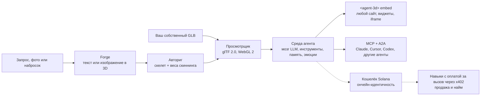

[English](../../README.md) | [简体中文](README.zh-CN.md) | [日本語](README.ja.md) | [한국어](README.ko.md) | [Español](README.es.md) | [Português (Brasil)](README.pt-BR.md) | [हिन्दी](README.hi.md) | [Русский](README.ru.md)

# three.ws

*Эта страница переводит начало английского README. Эталонной версией остаётся [английский README](../../README.md). Исправления приветствуются через Pull Request.*

**Дайте своему ИИ тело.** three.ws - это открытая (Apache-2.0) платформа 3D-агентов ИИ, которая работает прямо в браузере. Напишите запрос и получите 3D-модель с текстурами, подключите мозг на базе LLM и встройте её на любой сайт.

[Сайт](https://three.ws) · [Документация](https://three.ws/docs) · [Изменения](https://three.ws/changelog) · [GitHub](https://github.com/nirholas/three.ws) · [X / Twitter](https://x.com/trythreews)

## Попробуйте за 60 секунд

Откройте [three.ws/forge](https://three.ws/forge), введите *"a brass steampunk owl, full body"* и скачайте GLB. Доступны текст в 3D, изображение в 3D и набросок в 3D. Есть бесплатный уровень черновиков, аккаунт не нужен.

- Forge (текст или изображение в 3D): https://three.ws/forge
- Создайте 3D-аватар с ригом по запросу: https://three.ws/create/prompt
- Примеры (запускаются прямо на странице): https://three.ws/examples
- Документация: https://three.ws/docs

## Дайте вашему кодовому агенту 3D-конвейер

Бесплатно генерируйте 3D из текста и аватары с ригом прямо из редактора. Без ключа и без аккаунта. Работает с **Claude Code, Claude Desktop, Cursor, VS Code, Codex, Gemini CLI и OpenCode**.

**Плагин Claude Code** (навыки и 3D-сервер без ключа настраиваются сами):

```text
/plugin marketplace add nirholas/three.ws
/plugin install three-ws-3d@three-ws
```

**Любой MCP-клиент**: добавьте `https://three.ws/api/mcp-studio` (Streamable HTTP, без ключа, 16 инструментов: текст в 3D, изображение в 3D, аватары с ригом, говорящие персонажи). Затем попросите агента *"a low-poly treasure chest as a GLB"*.

<details>
<summary>Настройка для каждого клиента (можно копировать как есть)</summary>

**Claude Code** (CLI)

```bash
claude mcp add --transport http three-ws-studio https://three.ws/api/mcp-studio
```

**Cursor** (`~/.cursor/mcp.json`)

```json
{ "mcpServers": { "three-ws-studio": { "url": "https://three.ws/api/mcp-studio" } } }
```

**VS Code** (`.vscode/mcp.json`)

```json
{ "servers": { "three-ws-studio": { "type": "http", "url": "https://three.ws/api/mcp-studio" } } }
```

**Codex** (`~/.codex/config.toml`)

```toml
[mcp_servers.three-ws-studio]
url = "https://three.ws/api/mcp-studio"
```

**Gemini CLI** (`~/.gemini/settings.json`)

```json
{ "mcpServers": { "three-ws-studio": { "httpUrl": "https://three.ws/api/mcp-studio" } } }
```

**OpenCode** (`opencode.json`)

```json
{ "mcp": { "three-ws-studio": { "type": "remote", "url": "https://three.ws/api/mcp-studio" } } }
```

Чтобы использовать собственную библиотеку, агентов и кошельки, нужен сервер с авторизацией. См. "Install the MCP server in any client" в [английском README](../../README.md).

</details>

## Что можно делать

1. **Генерировать**: создавайте GLB с текстурами для скачивания в [Forge](https://three.ws/forge) из текста, до 6 фотографий или наброска. Бесплатный уровень черновиков, аккаунт не нужен. Авториг, смена стиля и ретекстуринг идут в том же потоке.
2. **Просматривать**: загружайте и проверяйте glTF 2.0 / GLB через WebGL 2.0 без какой-либо обработки на сервере. Перетащите файл в браузер, чтобы его увидеть. Поддерживаются Draco, KTX2 и Meshopt.
3. **Давать тело**: подключите мозг на базе LLM к любому аватару. Агент слушает пользователя, рассуждает с помощью Claude, вызывает инструменты (анимации, жесты, память, навыки) и в реальном времени выражает эмоции смешиванием морф-таргетов.
4. **Регистрировать**: при желании зарегистрируйте агента в блокчейне (NFT Metaplex Core в Solana или ERC-8004 в сетях EVM). Вы получаете устойчивую ончейн-идентичность, адрес кошелька, подписанную историю действий и репутацию, которую нельзя подделать.
5. **Встраивать**: разместите на любой странице как Web Component `<agent-3d>` или возьмите один из 5 виджетов (поворотный стенд, галерея анимаций, диалоговый агент, карточка-паспорт, тур по хотспотам). Open Graph и oEmbed поддерживаются из коробки.

## Как это работает



## Модель дохода

Чтобы вы могли принять решение, скажем прямо.

- **Бесплатно**: просмотрщик, черновики Forge, MCP-сервер без ключа, неограниченные встраивания `<agent-3d>`, один агент с собственным аватаром и самостоятельный хостинг всего стека по лицензии Apache-2.0.
- **Платно**: [Pro](https://three.ws/pricing) стоит 49 долларов в месяц (неограниченное число агентов, клонирование голоса, приоритетный GPU). Генерации верхних уровней оплачиваются за вызов, есть Enterprise. Агенты, продающие навыки, получают оплату за каждый вызов через x402.
- **$THREE** - собственная монета платформы в Solana. Pro на 20% дешевле при оплате в $THREE, генерации за вызов рассчитываются в $THREE по живому курсу, а авторы навыков могут назначать цену в $THREE. Для использования открытого кода монета не нужна.

## Запуск локально

Нужны Node.js 24 или новее, npm 10 или новее, база данных Neon Postgres, бакет Cloudflare R2 и ключ API Anthropic. Выполняйте команды по порядку. После `cp` заполните `.env.local`, прежде чем инициализировать базу (см. Environment Variables в английском README).

```bash
git clone https://github.com/nirholas/three.ws.git
cd three.ws
npm install
cp .env.example .env.local
psql $DATABASE_URL < api/_lib/schema.sql
npm run dev
```

Сервер разработки запускается на `http://localhost:3000`.

---

Полный справочник - это [английский README](../../README.md).
