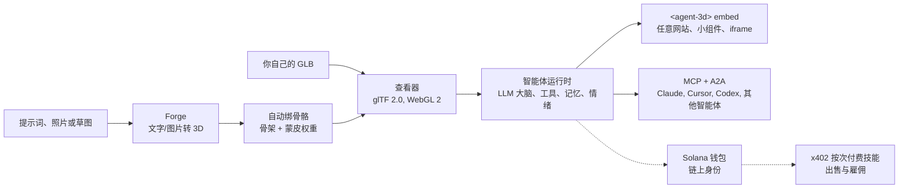

[English](../../README.md) | [简体中文](README.zh-CN.md) | [日本語](README.ja.md) | [한국어](README.ko.md)

# three.ws

*本页是社区审校的翻译版本,欢迎通过 Pull Request 提交修正。*

**给你的 AI 一副身体。** three.ws 是一个开源(Apache-2.0)、原生运行在浏览器中的 3D AI 智能体平台:输入一句提示词即可生成带贴图的 3D 模型,再为它接上 LLM 大脑,嵌入任何网站。

[官网](https://three.ws) · [文档](https://three.ws/docs) · [更新日志](https://three.ws/changelog) · [GitHub](https://github.com/nirholas/three.ws) · [X / Twitter](https://x.com/trythreews)

## 60 秒上手

打开 [three.ws/forge](https://three.ws/forge),输入 *"a brass steampunk owl, full body"*,然后下载 GLB 文件。支持文字转 3D、图片转 3D 和草图转 3D,免费草稿档,无需注册账号。

- Forge(文字/图片转 3D):https://three.ws/forge
- 提示词生成可绑骨骼的 3D 头像:https://three.ws/create/prompt
- 示例(可在页面内直接运行):https://three.ws/examples
- 文档:https://three.ws/docs

## 给你的编程智能体接上 3D 流水线

在编辑器里直接完成文字转 3D 和带骨骼头像的生成,无需 API Key,无需账号。支持 **Claude Code、Claude Desktop、Cursor、VS Code、Codex、Gemini CLI 和 OpenCode**。

**Claude Code 插件**(自带技能和免 Key 的 3D 服务,开箱即用):

```text
/plugin marketplace add nirholas/three.ws
/plugin install three-ws-3d@three-ws
```

**任意 MCP 客户端**:添加 `https://three.ws/api/mcp-studio`(Streamable HTTP,免 Key,共 16 个工具:文字转 3D、图片转 3D、带骨骼头像、会说话的角色)。然后对你的智能体说 *"a low-poly treasure chest as a GLB"* 即可。

<details>
<summary>各客户端的配置(可直接复制)</summary>

**Claude Code** (CLI)

```bash
claude mcp add --transport http three-ws-studio https://three.ws/api/mcp-studio
```

**Cursor** (`~/.cursor/mcp.json`)

```json
{ "mcpServers": { "three-ws-studio": { "url": "https://three.ws/api/mcp-studio" } } }
```

**VS Code** (`.vscode/mcp.json`)

```json
{ "servers": { "three-ws-studio": { "type": "http", "url": "https://three.ws/api/mcp-studio" } } }
```

**Codex** (`~/.codex/config.toml`)

```toml
[mcp_servers.three-ws-studio]
url = "https://three.ws/api/mcp-studio"
```

**Gemini CLI** (`~/.gemini/settings.json`)

```json
{ "mcpServers": { "three-ws-studio": { "httpUrl": "https://three.ws/api/mcp-studio" } } }
```

**OpenCode** (`opencode.json`)

```json
{ "mcp": { "three-ws-studio": { "type": "remote", "url": "https://three.ws/api/mcp-studio" } } }
```

如需使用你自己的模型库、智能体和钱包,请连接需要登录的服务器,详见[英文 README](../../README.md) 中的 "Install the MCP server in any client"。

</details>

## 你能得到什么

1. **生成**:通过 [Forge](https://three.ws/forge),用文字、最多 6 张照片或一张草图生成带贴图、可下载的 GLB。免费草稿档,无需账号,同一流程内支持自动绑骨骼、风格重绘和重新贴图。
2. **渲染**:在 WebGL 2.0 中加载并校验 glTF 2.0 / GLB,完全不经过服务器处理。把文件拖进浏览器即可显示,支持 Draco、KTX2 和 Meshopt 解压。
3. **赋予身体**:为任意头像接上 LLM 大脑。智能体会倾听用户、用 Claude 思考、调用工具(动画、手势、记忆、技能),并通过 morph target 混合实时表达情绪。
4. **注册**:可选地把智能体铸造到链上(Solana 上的 Metaplex Core NFT,或 EVM 链上的 ERC-8004),获得稳定的链上身份、钱包地址、带签名的行为历史和无法伪造的信誉分。
5. **嵌入**:以 `<agent-3d>` Web Component 的形式放进任何页面,或使用五种现成小组件(转台、动画图库、会说话的智能体、身份卡、热点导览),内置 Open Graph 和 oEmbed 支持。

## 工作原理



## 如何盈利

直截了当地说明,方便你在动手之前做判断:

- **免费**:查看器、Forge 草稿生成、免 Key 的 MCP 服务器、不限数量的 `<agent-3d>` 嵌入、一个带自定义头像的智能体,以及在 Apache-2.0 下自托管整套系统。
- **付费**:[Pro](https://three.ws/pricing) 每月 49 美元(不限智能体数量、声音克隆、优先 GPU),更高档位的生成按次计费,以及企业版。出售技能的智能体通过 x402 按次收款。
- **$THREE** 是平台自己的 Solana 代币。用 $THREE 支付 Pro 可享 8 折,按次生成以实时汇率用 $THREE 结算,技能作者也可以用 $THREE 为调用定价。开源代码本身完全不需要任何代币。

## 本地运行

需要 Node.js 24+、npm 10+、一个 Neon Postgres 数据库、一个 Cloudflare R2 存储桶和一个 Anthropic API Key。先把 `.env.local` 里的值填好(参见英文 README 的 Environment Variables 一节),再执行:

```bash
git clone https://github.com/nirholas/three.ws.git
cd three.ws
npm install
cp .env.example .env.local
psql $DATABASE_URL < api/_lib/schema.sql
npm run dev
```

开发服务器运行在 `http://localhost:3000`。

---

完整、权威的参考文档是[英文 README](../../README.md)。
