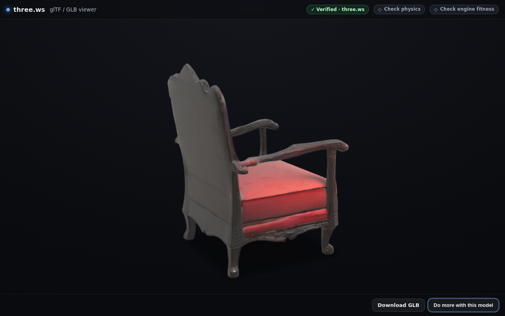
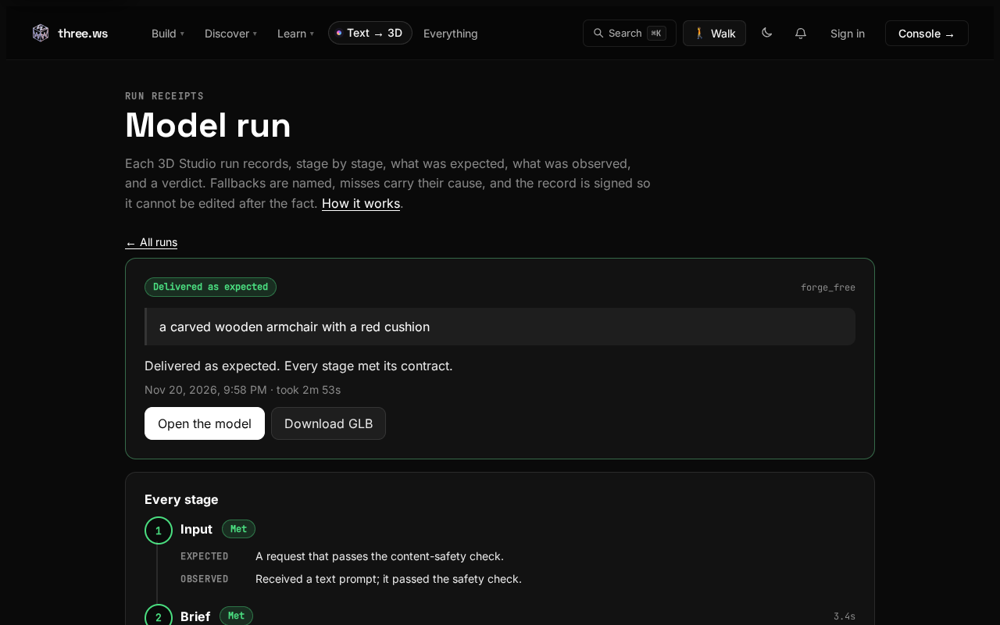

# three.ws plugin for Cursor

Free text-to-3D for [Cursor](https://cursor.com).
Ask the agent for "a 3D model of a brass telescope" or "a rigged astronaut I can
animate" and it returns a real, downloadable GLB plus a browser viewer link.
There is no payment. Making or rigging a model needs a free three.ws account,
so every model has an owner who can publish or delete it (new models stay
unlisted until you publish them).



This is a plugin in the [Cursor plugin format](https://cursor.com/docs/reference/plugins)
(`.cursor-plugin/plugin.json`, `mcp.json`, `rules/`, `skills/`, `commands/`). It
has no local code. It points Cursor at the hosted three.ws studio MCP server and
bundles rules, skills and commands that teach the agent when to use which tool.

Marketplace reviewers: [REVIEWING.md](REVIEWING.md) is a five-minute test plan.

## Install

**From the Cursor Marketplace** (once the listing is approved): open the
Marketplace, search for three.ws, and click Add to Cursor.

**From a local copy:** put this directory at `~/.cursor/plugins/local/three-ws`
(copy it; Cursor skips symlinks that point outside that folder), then run
**Developer: Reload Window**.

**Server only, without the rules, skills and commands:** add this to
`~/.cursor/mcp.json` (or a project's `.cursor/mcp.json`):

```json
{
  "mcpServers": {
    "three-ws": {
      "url": "https://three.ws/api/mcp-studio?auth=oauth"
    }
  }
}
```

On first connect Cursor asks you to sign in to the `three-ws` server (in
**Customize** in the sidebar). That opens the free three.ws sign-in, which can
create an account, and Cursor stores the token. The consent screen asks for
your profile and your 3D models only (`profile`, `avatars:read`,
`avatars:write`, `offline_access`) and nothing else. To
use an API key instead (from <https://three.ws/dashboard/api>), drop
`?auth=oauth` and add
`"headers": { "Authorization": "Bearer ${env:THREE_WS_API_KEY}" }`.

## What the agent gets

The server's tool list comes from `https://three.ws/api/mcp-studio` at run time.
These are the 16 tools it lists today:

| Tool | What it does |
| --- | --- |
| `forge_free` | Text to textured GLB on the free lane |
| `mesh_forge` | Art-directed text or reference-image to GLB |
| `text_to_avatar` | Text or reference image to a textured avatar GLB |
| `forge_avatar` | Text to rigged, animation-ready avatar in one step |
| `rig_mesh` | Adds a humanoid skeleton and skin weights to a GLB you already have |
| `refine_model` | Edits a model you generated by describing the change ("make it metallic") |
| `check_job`, `get_job` | Collects a generation that returned `pending` |
| `look_at_model` | Renders a GLB from several angles and returns the frames as images, so the agent can see what it made |
| `search_catalog`, `get_catalog_item`, `get_item_source` | Searches thousands of ready-made CC0 props, rigged characters and motion clips, and returns embed code |
| `search_docs` | Searches the three.ws documentation |
| `create_agent_persona`, `get_agent_persona`, `persona_say` | Turns a generated GLB into a named, reusable talking 3D persona |

Every generation links a run receipt: a signed, stage-by-stage record of what
was expected, what was observed and whether it passed, so a weak draft is named
as one instead of being presented as finished.



## Rules

| Rule | What it does |
| --- | --- |
| `search-catalog-before-generating` | Checks the free CC0 catalog before generating, and reuses a match. Attached when you work with `.glb` or `.gltf` files. |
| `look-at-the-model` | After a generation, renders the model with `look_at_model` and checks it before calling it done. |

Both rules are agent-requested (`alwaysApply: false`): Cursor pulls them in when
their description matches the task, so they add nothing to unrelated chats.

## Commands

| Command | What it does |
| --- | --- |
| `/make-3d <description>` | Catalog check, `forge_free`, a render check, then the GLB, viewer link, receipt and embed code |
| `/rig <GLB URL>` | Checks the model is a humanoid, rigs it with `rig_mesh`, and prints the rigged GLB and pose-studio link |
| `/embed <GLB URL>` | Paste-ready HTML: an animated `<agent-3d>` for a character or a `<model-viewer>` for anything else |

## Bundled skills

| Skill | Use it for |
| --- | --- |
| `generate-3d-model` | A static object, prop or creature from text |
| `create-3d-avatar` | A posable, rigged humanoid character |
| `rig-a-model` | Rigging a GLB the user already has |
| `find-3d-assets` | Checking the free CC0 catalog before generating anything |

The skills are byte-identical copies of the three.ws skill pack in
[`.agents/skills/`](https://github.com/nirholas/three.ws/tree/main/.agents/skills).
`tests/cursor-plugin.test.js` in the three.ws repository fails if a copy drifts from its source.

## Disclosures

Read this before you install.

- **Network calls.** Every tool call is an HTTPS request to `three.ws`, a
  third-party service run by the three.ws team. Prompts, reference image URLs,
  and GLB URLs you pass in are sent there. `look_at_model` and `rig_mesh` fetch
  the model URL you give them from three.ws's servers.
- **Models belong to your account.** Each model is filed under your three.ws
  account and kept out of the public gallery until you publish it. The GLB is
  stored on the three.ws CDN at an unguessable URL that anyone with the link can
  open, and it stays until you delete it from the model page or ask for removal.
  A persona copies its model into durable storage. Do not put private or
  confidential details in a prompt.
- **No training, no sale.** three.ws does not use your prompts, tool inputs or
  generated files to train AI models, and does not sell them.
- **What reaches your model provider.** Tool results (URLs, metadata, and the
  rendered frames from `look_at_model`) enter the session context, and so reach
  your model provider.
- **Credentials.** The server URL ends in `?auth=oauth`, so the first connect
  answers with a standard MCP OAuth challenge and Cursor runs the three.ws
  sign-in. The plugin itself stores no keys or tokens.
- **No local processes.** There are no shell commands, hooks, background
  processes, or telemetry. The plugin is configuration plus Markdown.
- **Rate limits.** The free studio caps generations per account per hour. When a
  call is refused, the response says when the quota resets.
- **No payments.** Nothing on the studio server costs money or charges you.
- **Tool list is server-side.** The tool list is served by three.ws at run time,
  so installing a fixed version of this plugin does not pin it.

Privacy policy: <https://three.ws/legal/privacy> (section 10 covers MCP
connectors). Terms of service: <https://three.ws/legal/tos>. Questions or
removal requests: privacy@three.ws.

## Links

- Server: `https://three.ws/api/mcp-studio?auth=oauth` (Streamable HTTP, MCP OAuth; an `Authorization: Bearer <API key>` header also works)
- Docs: <https://three.ws/docs/mcp>
- Source: <https://github.com/nirholas/three.ws>

## License

Apache-2.0, the same as the three.ws repository. See [LICENSE](LICENSE).
