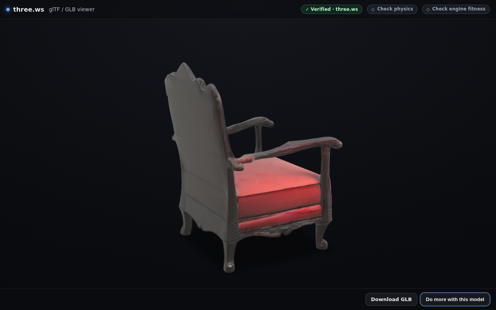
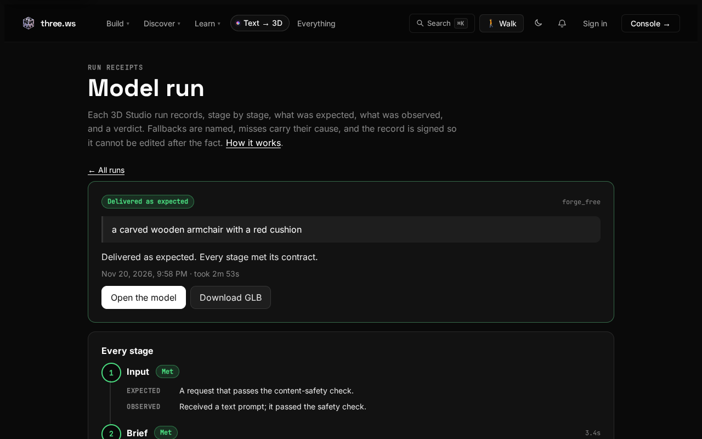

# Reviewing the three.ws plugin

A test plan for Cursor Marketplace reviewers. It takes about four minutes, and
under five in the slowest run we measured. You need Cursor desktop and an email
address, or a Google or Microsoft account, for a free three.ws sign-in. Nothing
in this plan costs money.

## What the plugin is

Configuration plus Markdown, no local code:

- `mcp.json` connects one remote MCP server, `https://three.ws/api/mcp-studio?auth=oauth`
  (Streamable HTTP, MCP OAuth with PKCE and dynamic client registration).
- `rules/` (2 agent-requested rules), `skills/` (4 skills) and `commands/`
  (`/make-3d`, `/rig`, `/embed`) teach the agent when to use which tool.
- No hooks, no shell commands, no background processes, no telemetry.

## Test plan

Timings are from real runs of this plugin's server on 2026-11-20 (see
"How we measured" below). Install and sign-in times depend on you.

1. **Install (about 1 minute).** Install from the Marketplace listing, or copy
   this directory to `~/.cursor/plugins/local/three-ws` and run
   **Developer: Reload Window**.
2. **Sign in (about 1 minute).** Open **Customize** in the sidebar. The
   `three-ws` server asks you to sign in. The three.ws page can create a free
   account with an email code, Google or Microsoft. The consent screen asks
   for four permissions (`avatars:read`, `profile`, `avatars:write`,
   `offline_access`): a **Read** group, always on, with "Read your avatars"
   and "See your name and email"; a **Manage** group with "Create and update
   avatars"; and the line "Stay connected without signing in again", followed
   by a note that the app can never spend money on your behalf. Click **Authorize**. The server then shows 21 tools.
3. **Find a ready-made asset (under 1 second).** In Agent chat:
   `Find me a free 3D chair model.` The agent calls `search_catalog` and returns
   CC0 results with viewer links (we measured 0.15 to 0.48 s).
4. **Generate a model (1 to 3 minutes).** `/make-3d a small wooden three-legged stool`,
   or ask in plain words: `Make a 3D model of a small wooden three-legged stool.`
   The agent calls `forge_free`, then `get_job` (or `check_job`) until the model
   is ready, and returns a GLB URL, a viewer link and a run receipt link (we
   measured 69.6 s, 73.5 s and 172.8 s for three drafts).
5. **Check the result (20 to 35 seconds).** `Show me what it looks like.` The
   agent calls `look_at_model`, which returns rendered frames the agent can see,
   and describes them (we measured 19.2 s, 25.1 s and 33.9 s). The
   `look-at-the-model` rule makes the agent do this on its own after a
   generation.
6. **Open the links.** The viewer link opens the model in the browser. The
   receipt link shows every stage of the run with what was expected, what was
   observed and whether it passed.

Optional: `/rig <GLB URL of a humanoid>` rigs a character, and
`/embed <GLB URL>` writes paste-ready HTML without calling anything that needs
an account.

## How we measured

- `scripts/validate-cursor-plugin.mjs` in the source repository checks the
  manifest against Cursor's published schema (vendored from `cursor/plugins`),
  the repository's root `.cursor-plugin/marketplace.json` and that it resolves
  to this directory, every rule, skill and command's frontmatter, the logo, and
  that the MCP server is remote and on three.ws.
- `scripts/cursor-plugin-session-check.mjs` connects to the server exactly as
  `mcp.json` names it: the unauthenticated 401 and its `resource_metadata`, the
  RFC 9728 and RFC 8414 metadata, sign-in, `tools/list`, then `search_catalog`,
  a `forge_free` draft and `look_at_model`. The timings above are from three of
  its runs.
- `tests/cursor-plugin-tool-surface.test.js` lists the live tools on every run,
  fails if any of them can move money, and fails if this plugin's README table
  or any rule or command names a tool the server does not have.
- We also registered an OAuth client with Cursor's two redirect URLs
  (`http://localhost:8787/callback` and
  `https://www.cursor.com/agents/mcp/oauth/callback`) and confirmed the
  authorize step goes to sign-in and then consent with the four scopes above.
  `tests/api/oauth-authorize.test.js` pins that a client which registered
  without naming scopes still gets all four, and nothing outside them.

These checks talk to the same production server a reviewer's Cursor does. We
did not drive Cursor desktop itself from automation, so step 2's screens are
described from the Cursor documentation.

## Data handling

- **What is sent.** Each tool call sends its inputs (prompts, reference image
  URLs, GLB URLs) over HTTPS to three.ws. `look_at_model` and `rig_mesh` fetch
  the GLB URL you give them. The plugin has no code, so it sends nothing on its
  own: only the arguments the agent puts in a tool call leave your machine.
- **Why.** Only to do the job the tool describes: generate, rig, render or
  search.
- **Where it is kept.** A generated model is filed under your three.ws account,
  stays unlisted until you publish it, and its GLB is stored on the three.ws CDN
  at an unguessable URL. It stays until you delete it from the model page or ask
  for removal at privacy@three.ws.
- **No training, no sale.** three.ws does not use prompts, tool inputs or
  generated files to train AI models, and does not sell them.
- **Account data.** Sign-in grants only the four scopes listed in step 2. The
  OAuth token is stored by Cursor, not by the plugin.
- **No cost.** Nothing on the server charges you. The free studio caps
  generations per account per hour and says when the quota resets.

Privacy policy: <https://three.ws/legal/privacy> (section 10 covers MCP
connectors and coding-agent plugins). Terms of service:
<https://three.ws/legal/tos>.

## Contact

privacy@three.ws for data questions and removal requests. Source and issues:
<https://github.com/nirholas/three.ws>.
