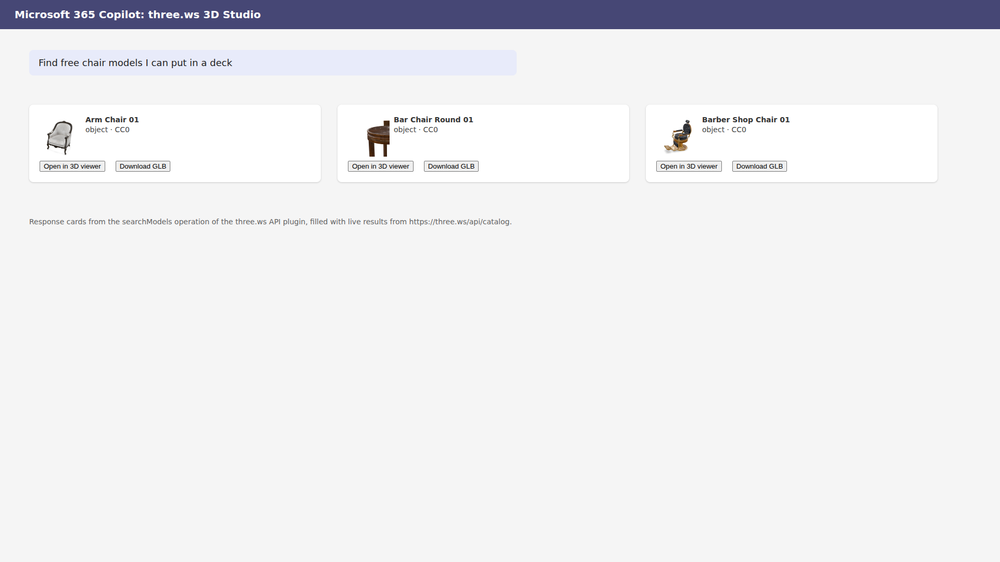

# three.ws 3D Studio declarative agent

## Summary

A declarative agent for Microsoft 365 Copilot that gives people at work a 3D studio. It finds free ready-made 3D models, finds public three.ws agents (each has a 3D body), lists the agents you own and generates a textured 3D model (GLB) from a plain-language description. Each result comes back as an Adaptive Card with an Open in 3D viewer link and a GLB download link.

The agent uses one API plugin with API key authentication. The key is stored in the Teams Developer Portal key vault by Microsoft 365 Agents Toolkit and never enters the app package. Searching the catalog and public agents needs no account; listing your agents and generating models use your key.

## Compatibility

## Contributors

- [nirholas](https://github.com/nirholas)

## Version history

| Version | Date             | Comments        |
| ------- | ---------------- | --------------- |
| 1.0     | November 16, 2026 | Initial release |

## Prerequisites

- A Microsoft 365 tenant with a Microsoft 365 Copilot license and custom app upload enabled (a Microsoft 365 developer tenant works).
- [Microsoft 365 Agents Toolkit](https://aka.ms/teams-toolkit) for Visual Studio Code, or the Agents Toolkit CLI.
- A free three.ws account and an API key from [three.ws/dashboard/api](https://three.ws/dashboard/api).

## Minimal path to awesome

1. Clone this repository and open the `da-threews-3d-studio` folder in Visual Studio Code.
1. Copy `env/.env.dev.user.sample` to `env/.env.dev.user` and set `SECRET_THREEWS_API_KEY` to your three.ws API key. That file is gitignored.
1. Open the Microsoft 365 Agents Toolkit pane and select **Provision**. Sign in to your tenant when asked. Provisioning registers the app, stores the API key in the Developer Portal key vault, validates the package and sideloads the agent.
1. Open [Microsoft 365 Copilot](https://m365.cloud.microsoft/chat), pick **da-threews-3d-studioDEV** in the agent list and try a conversation starter.

The same steps with the CLI: `atk provision --env dev`.

## Features

- Five API plugin functions: `searchModels`, `searchAgents`, `listMyAgents`, `generate3DModel` and `checkModelJob`, described by one OpenAPI file in `appPackage/apiSpecificationFile`.
- Static Adaptive Card templates for every function (`response_semantics` in `appPackage/ai-plugin.json`).
- Instructions that teach the agent to pick the right function, to treat generation as asynchronous and to never invent URLs or job handles.
- Four conversation starters.
- API key authentication through `apiKey/register`, so no secret is committed.

## Help

We do not support samples, but this community is always willing to help, and we want to improve these samples. We use GitHub to track issues, which makes it easy for community members to volunteer their time and help resolve issues.

If you have any issues when working with this sample, please [open an issue](https://github.com/nirholas/three.ws/issues) or see [three.ws/docs](https://three.ws/docs).

## Disclaimer

**THIS CODE IS PROVIDED *AS IS* WITHOUT WARRANTY OF ANY KIND, EITHER EXPRESS OR IMPLIED, INCLUDING ANY IMPLIED WARRANTIES OF FITNESS FOR A PARTICULAR PURPOSE, MERCHANTABILITY, OR NON-INFRINGEMENT.**

