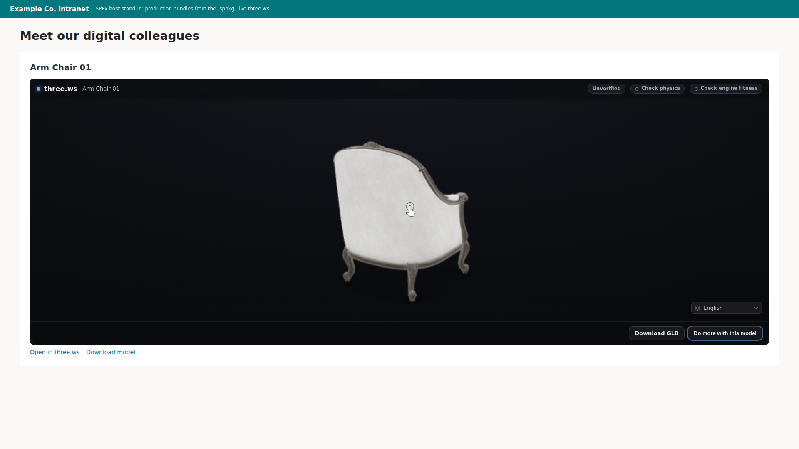

# three.ws 3D viewer web part

## Summary

An SPFx web part that shows an interactive 3D model on a SharePoint page. Page authors paste a GLB URL and choose a title, a render mode and a height in the property pane. The model renders in the hosted three.ws viewer, or with the `<agent-3d>` web component loaded on demand. The web part also declares Teams tab hosts.

## Compatibility

## Applies to

- [SharePoint Framework](https://aka.ms/spfx)
- [Microsoft 365 tenant](https://docs.microsoft.com/sharepoint/dev/spfx/set-up-your-developer-tenant)

> Get your own free development tenant by subscribing to [Microsoft 365 developer program](http://aka.ms/o365devprogram)

## Contributors

- [nirholas](https://github.com/nirholas)

## Version history

| Version | Date              | Comments        |
| ------- | ----------------- | --------------- |
| 1.0     | November 16, 2026 | Initial release |

## Prerequisites

- A Microsoft 365 tenant with an App Catalog.
- Node.js 22, 24 or 26 (see `.nvmrc`).
- The page must be allowed to frame `https://three.ws` (the default content security policy of SharePoint Online allows it).

## Minimal path to awesome

- Clone this repository and open the `react-threews-3d-viewer` folder.
- Run `npm install`.
- Run `npm run build` to produce `sharepoint/solution/react-threews-3d-viewer.sppkg`.
- Upload the package to your tenant or site App Catalog and add the app to a site.
- Edit a page, add the **three.ws 3D Viewer** web part and paste a GLB URL in the property pane.
- To develop locally, run `npm run start` and open the hosted workbench at `https://<tenant>.sharepoint.com/_layouts/workbench.aspx`.

## Features

- Two render modes: the hosted three.ws viewer in a frame, or the `<agent-3d>` web component.
- Property pane fields for model URL, title, mode and height, with validation of the URL.
- Helpers in `src/webparts/threeWs3DViewer/helpers` that build the viewer URL and load the web component only when asked.
- Hosts SharePointWebPart, TeamsTab and TeamsPersonalApp, with Teams tab icons in the `teams` folder.
- Localized strings in `loc`.

## Help

We do not support samples, but this community is always willing to help, and we want to improve these samples. We use GitHub to track issues, which makes it easy for community members to volunteer their time and help resolve issues.

If you have any issues when working with this sample, please [open an issue](https://github.com/nirholas/three.ws/issues) or see [three.ws/docs](https://three.ws/docs).

## Disclaimer

**THIS CODE IS PROVIDED *AS IS* WITHOUT WARRANTY OF ANY KIND, EITHER EXPRESS OR IMPLIED, INCLUDING ANY IMPLIED WARRANTIES OF FITNESS FOR A PARTICULAR PURPOSE, MERCHANTABILITY, OR NON-INFRINGEMENT.**

