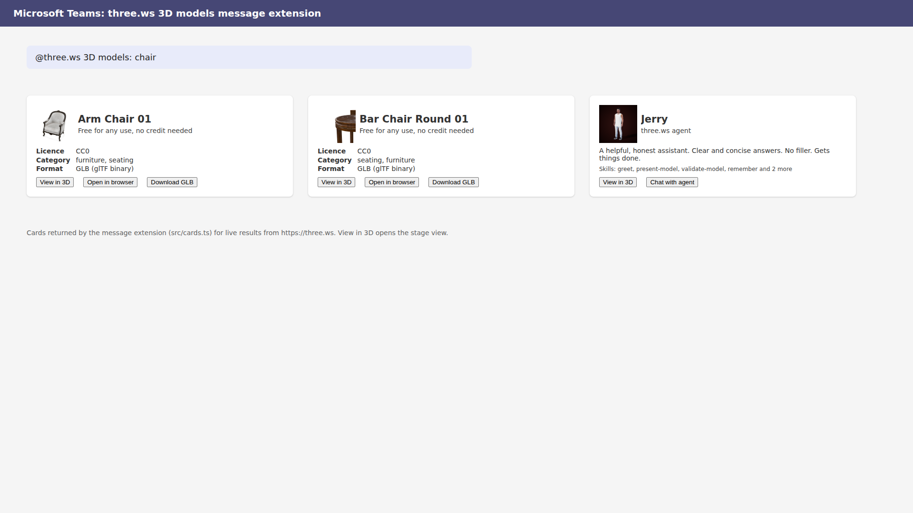
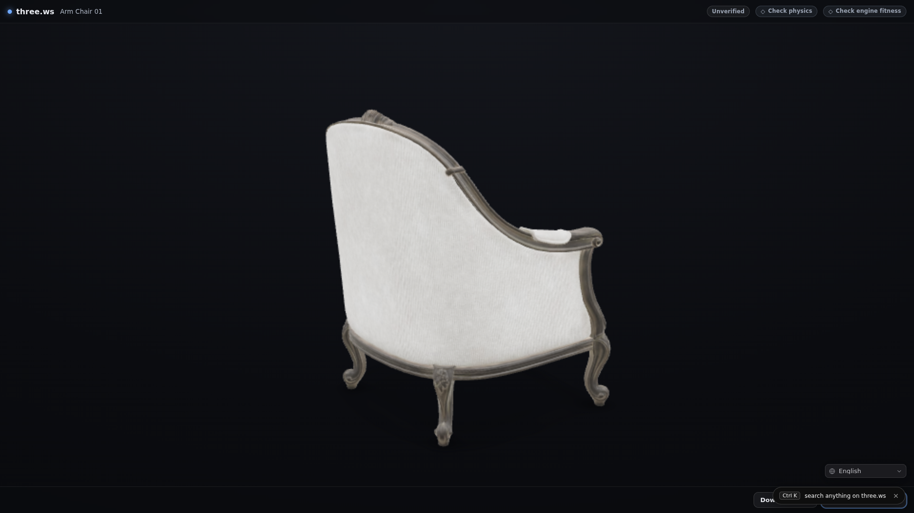

# three.ws 3D models message extension

## Summary

A Teams message extension and link unfurl that shares 3D from [three.ws](https://three.ws). Search free ready-made 3D models and public 3D agents from the compose box, or paste a three.ws link in a message and Teams unfurls it. Both produce an Adaptive Card whose **View in 3D** button opens an interactive stage view of the model inside Teams.

## Tools and Frameworks

## Prerequisites

- A Microsoft 365 tenant where you can upload custom Teams apps (a Microsoft 365 developer tenant works).
- [Node.js](https://nodejs.org) 22 or 24.
- [Microsoft 365 Agents Toolkit](https://aka.ms/teams-toolkit) for Visual Studio Code, or the Agents Toolkit CLI.
- Optional: a free three.ws API key from [three.ws/dashboard/api](https://three.ws/dashboard/api). Every endpoint the sample calls is public, so it works without one.

## Contributors

- [nirholas](https://github.com/nirholas)

## Version history

| Version | Date              | Comments        |
| ------- | ----------------- | --------------- |
| 1.0     | November 16, 2026 | Initial release |

## Disclaimer

**THIS CODE IS PROVIDED *AS IS* WITHOUT WARRANTY OF ANY KIND, EITHER EXPRESS OR IMPLIED, INCLUDING ANY IMPLIED WARRANTIES OF FITNESS FOR A PARTICULAR PURPOSE, MERCHANTABILITY, OR NON-INFRINGEMENT.**

## Minimal Path to Awesome

1. Clone this repository and open the `msgext-threews-3d-models-ts` folder in Visual Studio Code.
1. Copy `env/.env.local.sample` to `env/.env.local` and `env/.env.local.user.sample` to `env/.env.local.user`. Both are filled in by Agents Toolkit.
1. Run `npm install`.
1. Press **F5** (Debug in Teams). Agents Toolkit creates a dev tunnel, registers the bot and sideloads the app.
1. In a Teams chat, open the compose box, select the three.ws app and search for `chair`. Select a result to send the card.
1. Paste a link such as `https://three.ws/viewer?src=<GLB URL>` into a message to see the link unfurl.

To test without Teams, run **Debug in Microsoft 365 Agents Playground** from the debug menu. Run `npm run build` and `npm run lint` to type check the code.

## Features

- Two query commands, `searchModels` and `searchAgents`, backed by the public three.ws catalog and agent endpoints.
- Link unfurling for three.ws links (`message.ext.query-link`).
- Adaptive Cards for models and agents (`src/cards.ts`) with a View in 3D stage action (CollabStageAction) and an Open in browser link.
- A small three.ws client with timeouts and typed errors (`src/threews.ts`) and a corporate proxy helper that honors HTTPS_PROXY (`src/proxy.ts`).
- Azure Bicep templates in `infra` for a Bot Service and App Service when you deploy beyond local debugging.

