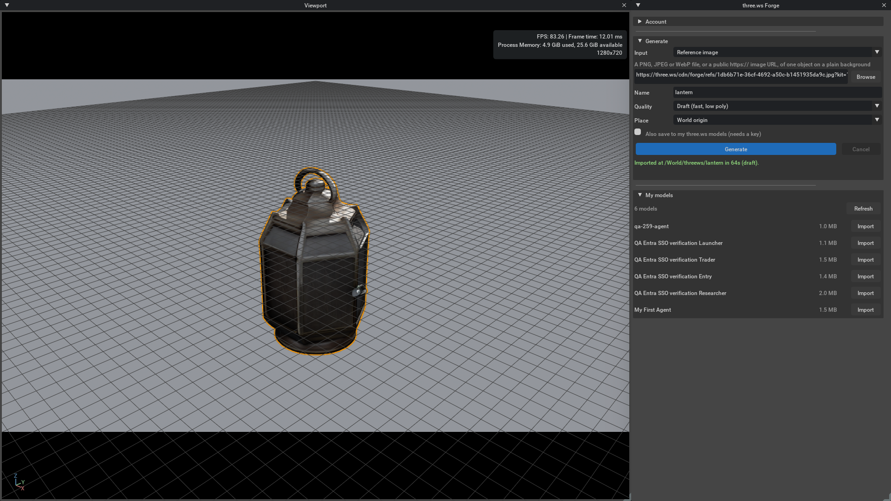

# Forge by three.ws for NVIDIA Omniverse Kit

`threews.forge` is a Kit extension that turns a text prompt or a reference image
into a textured 3D model with [Forge by three.ws](https://three.ws/forge) and
references it into the open USD stage, upright and to scale. It also browses
the models saved in your three.ws account and imports any of them.



[Screen capture: a real generation from the Generate press to the framed model](media/generate-from-panel.mp4)
([GIF](media/generate-from-panel.gif))

The extension runs in any Kit 110 app (USD Composer, a kit-app-template app, or
the `omniverse-kit` Python package). It talks to the public three.ws API over
HTTPS and needs nothing else.

## Install

From this repository:

1. Clone it, or download this folder.
2. In the Kit app, open **Window > Extensions**, click the gear icon and add
   `<this folder>/exts` to the extension search paths.
3. Search for **Forge by three.ws** and enable it. The panel opens; it is also under
   **Window > Forge by three.ws**.

From the command line:

```bash
kit <your app>.kit --ext-folder <this folder>/exts --enable threews.forge
```

## Use

| Section | What it does |
| --- | --- |
| **Account** | Paste a three.ws API key (from [three.ws/dashboard/api](https://three.ws/dashboard/api)). It is masked, stored in Kit persistent settings, and never logged. The label shows whether three.ws accepted it. |
| **Generate** | Text prompt or reference image (local PNG/JPEG/WebP, or a public `https://` URL); Draft, Standard or High lane; placement at the world origin, the selected prim, or in front of the camera; optional save to your three.ws models. Generate shows live job progress and Cancel stops at once. |
| **My models** | Your three.ws library with paging. Import references a model into the stage with the same placement and unit handling. |

Every lane needs a key, because making a model on three.ws needs an account
(free to create). Draft and Standard are free; High spends account credits. The
key also unlocks the library and saving.

## How the import works

1. The job runs on three.ws; the extension polls it from a worker thread, so Kit
   never blocks. Network errors and 429/502/503/504 responses are retried with
   exponential backoff.
2. The GLB is downloaded to Kit's cache. If it uses glTF extensions the Kit
   asset converter cannot read (`EXT_meshopt_compression`,
   `KHR_mesh_quantization`, `EXT_texture_webp`, which three.ws applies to
   saved models), [`gltf_compat.py`](exts/threews.forge/threews/forge/gltf_compat.py)
   decodes it into a plain GLB first, using the numpy and Pillow that Kit ships.
3. `omni.kit.asset_converter` converts it to USD. A library model that three.ws
   also stores as USDZ is referenced directly.
4. The USD is referenced under `/World/threews/<name>` inside a wrapper Xform
   that carries the axis and unit correction: glTF is Y-up in meters, so on a
   Z-up centimeter stage the wrapper rotates +90 degrees about X and scales by
   100. The model is grounded at z = 0 and its bounding box is measured in
   meters for the status line.

## Errors

Every failure tells the user what happened and what to do, with a **Fix this**
button when there is a page that fixes it: missing key (for High and the
library), a key three.ws rejected, a key without the needed scope, an account
that cannot run the High lane, rate limiting, the network being down (after
the automatic retries), a failed job with the server's reason, and a model the
converter cannot read.

## Settings

| Path | Default |
| --- | --- |
| `/persistent/exts/threews.forge/apiKey` | empty (or `THREEWS_API_KEY`) |
| `/persistent/exts/threews.forge/baseUrl` | `https://three.ws` |
| `/persistent/exts/threews.forge/lane` | `standard` |
| `/persistent/exts/threews.forge/placement` | `origin` |
| `/persistent/exts/threews.forge/saveToAccount` | `false` |

## Scripting

The extension is also a library. In the Kit Script Editor:

```python
import asyncio
import threews.forge as forge

async def run():
    outcome = await forge.generate_and_import("a brass ship lantern", lane="draft", placement="camera")
    print(outcome.imported.prim_path, outcome.imported.size_meters)

asyncio.ensure_future(run())
```

## Tests

The suite uses `omni.kit.test`.

```bash
pip install omniverse-kit==110.4.1.392751 --extra-index-url https://pypi.nvidia.com
scripts/run_tests.sh                  # headless: service, import, glTF decoding
KIT_WINDOW=1 scripts/run_tests.sh     # adds the panel tests (GPU and an X display)
THREEWS_LIVE=1 THREEWS_API_KEY=sk_live_... KIT_WINDOW=1 scripts/run_tests.sh
                                      # adds real generations against three.ws
```

- `tests/test_service.py` runs the client against a local HTTP stand-in for the
  failure modes a production server cannot be made to show on demand (retries,
  cancel, every error mapping, where the key travels).
- `tests/test_import.py` and `tests/test_gltf_compat.py` import real GLB bytes
  into Z-up and Y-up stages and check size, grounding and decoding against
  vectors from the reference meshoptimizer encoder.
- `tests/test_ui.py` drives the panel like a user. With `THREEWS_LIVE=1` it also
  runs a real image to 3D job from the panel and records a frame every two
  seconds into `$THREEWS_CAPTURE_DIR/frames`.
- `tests/test_live.py` runs a real generation through the controller, imports
  it, and writes timings to `$THREEWS_LIVE_REPORT`.

[`scripts/gce_gpu_run.sh`](scripts/gce_gpu_run.sh) runs the whole suite, live
tests included, on a Google Cloud L4 VM and brings back the log, report,
screenshots and screen capture; [`docs/omniverse-extension.md`](../../../docs/omniverse-extension.md)
has the latest measured run.

## Layout

```
exts/threews.forge/
  config/extension.toml      manifest, dependencies, settings, test config
  data/icon.png, preview.png registry images
  docs/README.md, CHANGELOG.md  shown in the Extension Manager
  threews/forge/
    extension.py   IExt entry point, Window menu
    window.py      omni.ui panel
    controller.py  async job orchestration and events
    service.py     three.ws API: generate, poll, download, account, library
    three_ws_client.py  shared Forge client (byte-identical across integrations)
    gltf_compat.py decoder for web-optimized GLBs
    stage_import.py  asset converter, axis and unit correction, placement
    settings.py    carb settings and key handling
    tests/
scripts/run_tests.sh, gce_gpu_run.sh, make_web_fixture.mjs
media/                       screenshots and screen capture for this README
```

## License

Apache-2.0. See [LICENSE](LICENSE).
