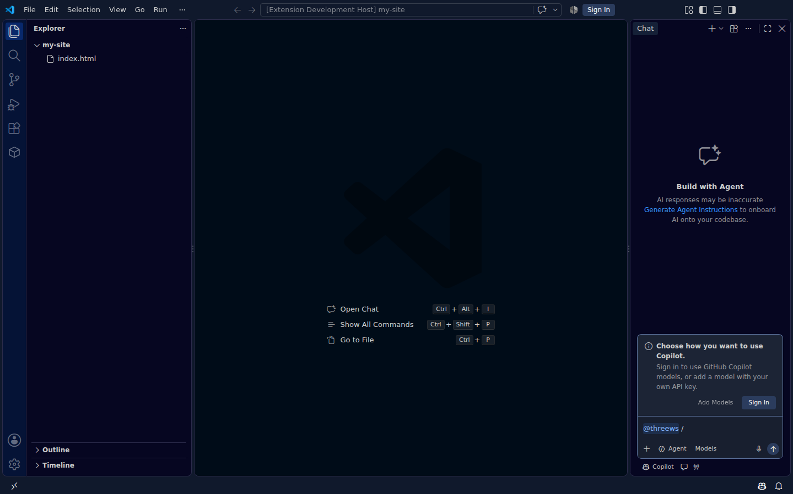
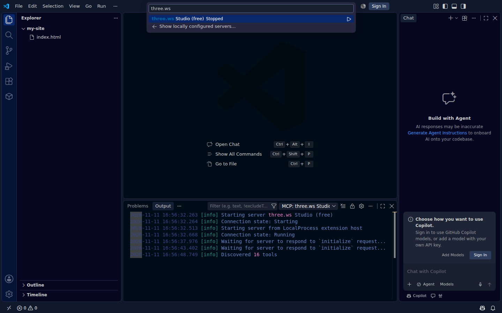

# three.ws 3D for VS Code

Preview, animate, refine, optimize, and review 3D models where you already are.
This extension makes `.glb` and `.gltf` files first-class in VS Code: double-click
one and it renders, animates, and reports on itself in an editor tab, next to the
code that ships it. Try any clip from the CC0 motion library on its rig and bake the
one you like into the file. Describe a change and get a new version. Optimize a
copy for the web without uploading it. Diff it against the committed version
before you open the pull request. And when you embed it, the editor checks the
`<agent-3d>` tag the way it checks your TypeScript.

Nothing here is a preview stub. The viewer is three.js with the same lighting,
decoders and retargeter the three.ws site uses, the report and the diff are the
platform's own inspectors, and generation calls the live studio API.

## Features

### See it

- **A real viewer, as the default editor for model files.** Orbit, pan, and zoom
  with the mouse. Animation clips get a picker, a play/pause button, and a scrub
  bar. Toggle a wireframe, the skeleton, the ground grid, or a slow auto-orbit.
  Draco, KTX2/Basis, and meshopt assets decode locally from decoders shipped
  inside the extension, so a compressed three.ws avatar renders offline.
- **Model report.** Triangles, vertices, meshes, materials, texture count and
  weight, animations, rig size, and glTF extensions, plus optimization notes.
  It is the same inspector that powers the three.ws `/validation` page, running
  in the extension host: your model is never uploaded anywhere to be measured.
  The status bar shows triangles, size, bones and clips while a model is open.
- **Snapshots and turntables.** `Snapshot` writes the current view as a PNG
  beside the model. `Turntable` writes a looping GIF of a full orbit, with the
  playing animation stepped in sync, for a README or a pull request.

### Move it

- **Try a library animation.** `Animate` in the toolbar (or `3D: Try a Library
  Animation`) searches the three.ws CC0 motion library, clips baked on the
  canonical humanoid skeleton, and plays your pick on the open model. The clip is
  retargeted onto the model's own bones in the viewer by the platform's
  retargeter, which knows Mixamo, Avaturn, VRM/VRoid, Unreal, Daz, MakeHuman,
  Blender `.L/.R` and simple `shoulderL` conventions. If a rig cannot be driven,
  the message says how many bones matched and offers to rig it.
- **Bake it in.** `Bake clip` writes the retargeted clip into a copy of the file
  as real glTF animation samplers and channels, so it plays in Unity, Unreal,
  Blender, `<model-viewer>`, or `<agent-3d>`. Meshopt-compressed models are
  re-encoded, not inflated.
- **Animate from words.** `3D: Animate this Model from a Text Prompt` sends
  "waving confidently with the right hand" to the text-to-motion worker on the
  three.ws GPU fleet and retargets the sampled clip the same way.

### Make it

- **Text to 3D.** `3D: Generate a Model from Text` for an object or prop,
  `3D: Generate an Avatar from Text` for a character. Both run on the free lane
  (no key, no account), save the GLB into your workspace, and open it.
- **Refine by describing a change.** `Refine` (or `3D: Refine this Model`) takes
  "make it metallic" or "bigger helmet" and generates a new version anchored to
  the current one, carrying its form and materials forward. Versions save as
  `name-v2.glb`, `name-v3.glb`, and the lineage is remembered, so refining a
  refinement extends the same history.
- **Auto-rigging.** `3D: Rig a Model for Animation` sends a static model to the
  three.ws rigger and brings back one with a humanoid skeleton and skin weights.
- **AI quality check.** `Check quality` renders the current view and asks a
  vision model to score realism and completeness against the subject, list the
  defects it can see, and suggest a fix. One click feeds that fix into a
  refinement. Because the render is what travels, it works on a model that has
  never left your disk.

### Ship it

- **Optimize for the web, locally.** `3D: Optimize a Copy for the Web` runs the
  asset pipeline's passes in the extension host (dedup, prune, weld, resample,
  meshopt; the Compact preset adds vertex quantization) and writes `name.web.glb`
  with a before/after summary. Textures are left as they are.
- **Compare with the committed version.** `3D: Compare with the Committed
  Version` reads the file at `HEAD` straight out of git, opens it in a second
  viewer beside yours, and writes a structural diff as Markdown: what changed in
  geometry, materials, textures, skeleton and animations, with a severity that
  says whether a consumer of the model breaks. The same comparison is offered
  after a refinement or an optimization.
- **`<agent-3d>` embeds, checked as you type.** In HTML, JSX/TSX, Vue, Svelte,
  Astro, Markdown and PHP files the extension reports an embed with no source
  (error), no size (warning: it collapses to 0×0), a library `<script>` on the
  `latest` channel (warning), a pinned script with no `integrity` (hint) or a
  stale one (error: the browser refuses the file), unknown or misspelt
  attributes, and invalid enum values. Every finding has a quick fix, including
  "pin to the current release with its hash". Hover any attribute for its docs,
  get completions for attribute names and values, and use the CodeLens to
  preview the referenced model in the viewer.
- **Embed snippet, correctly pinned.** `3D: Insert <agent-3d> Embed Snippet`
  resolves the current library version and its subresource-integrity hash from
  the live release manifest and writes a ready-to-paste snippet at your cursor.
- **Forge gallery.** Browse recent public three.ws creations in the sidebar,
  preview any of them in the viewer, and import the ones you want.

### In GitHub Copilot Chat

Everything above is also reachable from GitHub Copilot Chat (VS Code 1.101 or
newer), in three ways.

**The `@threews` chat participant.** Type `@threews` and a slash command:

| Command | What it does |
|---|---|
| `@threews /forge a brass lantern` | Free text to 3D. Streams the studio's real progress (queue position, stage, ETA) and ends with two buttons: **Open in the viewer** and **Save GLB to workspace**. |
| `@threews /find wooden chair` | Searches the public catalog of CC0 props, rigged characters and motion clips, with view links and buttons for the first match. |
| `@threews /rig` | Rigs a GLB: the URL in your message, a `#file` you attach, or the model open in the viewer. |
| `@threews /embed` | Inserts a pinned, SRI-checked `<agent-3d>` snippet for that model into the open file. |

Every reply offers follow-up suggestions, **Stop** cancels the request without
writing anything, and failures are explained in the chat with what to do next
(a refusal, a busy GPU lane and an unreachable server each read differently).



**Five agent-mode tools.** In agent mode Copilot can call these by itself, or
you can reference one with `#`:

| Tool | Reference | Writes or spends? |
|---|---|---|
| Generate a 3D model | `#threewsGenerate` | Asks first: it uses the free GPU lane and can save a GLB. |
| Check a 3D generation job | `#threewsCheckJob` | Asks only when it would save the finished GLB. |
| Find a 3D asset | `#threewsFind` | Read only. |
| Inspect a local GLB | `#threewsInspect` | Read only; the file never leaves your machine. |
| Optimize a local GLB | `#threewsOptimize` | Asks first: writes `name.web.glb` beside the original. |

Each tool returns plain `key: value` text (job ids, URLs, triangle counts,
suggestions with their estimated savings), so the model can reason over the
result and chain the next call, for example "generate a lantern, then optimize
it for the web".

**The three.ws MCP servers.** The extension registers the free three.ws Studio
server (`https://three.ws/api/mcp-studio`: text to 3D, rigging, the catalog,
docs search) with VS Code automatically; no key and no config file. Run
**3D: Connect my three.ws Account to Copilot Agent Mode (MCP)** to add the
account server (`https://three.ws/api/mcp`: your agents, wallets and paid
tools), signing in either through VS Code's own browser sign-in or with an API
key from [three.ws/dashboard/api](https://three.ws/dashboard/api), which is
checked against the server and then kept in VS Code's secret storage.



## Install

The extension is not on the Visual Studio Marketplace or Open VSX yet (checked
2026-11-11). Build and install it from source; it works the same in VS Code,
VSCodium, Cursor, Windsurf and other editors that accept a `.vsix`:

```bash
git clone https://github.com/nirholas/three.ws.git
cd three.ws/packages/vscode-3d
npm install
npm run package
code --install-extension vscode-3d-0.3.0.vsix
```

For development, open `packages/vscode-3d` in VS Code and press <kbd>F5</kbd> to
launch an Extension Development Host. Maintainers: releasing a new version is
covered in [PUBLISHING.md](https://github.com/nirholas/three.ws/blob/main/packages/vscode-3d/PUBLISHING.md).

## Use it

Open any `.glb` or `.gltf` in the explorer. That is the whole setup: the viewer
is the default editor for those files, and the **three.ws 3D** icon in the
activity bar lists every model in the workspace alongside the public gallery.

A typical loop: **3D: Generate an Avatar from Text**, describe a character, and
the GLB lands in `models/` and opens. Press **Animate**, type `wave`, and watch
it wave. Press **Bake clip** to save `astronaut-waving.glb`. Press **Refine**,
type `add a glowing visor`, and get `astronaut-v2.glb`. Press **Optimize** for
`astronaut-v2.web.glb`, then **Insert embed** to put it on a page:

```html
<script
  type="module"
  src="https://three.ws/agent-3d/1.5.2/agent-3d.js"
  integrity="sha384-…"
  crossorigin="anonymous"
></script>

<agent-3d
  body="https://three.ws/cdn/creations/…/mesh.glb"
  style="width: 400px; height: 500px; display: block;"
></agent-3d>
```

If that snippet later drifts (someone swaps the URL to `latest`, or the hash goes
stale after a release), the editor underlines it and the quick fix repairs it.

## Commands

| Command | What it does |
|---|---|
| `3D: Generate a Model from Text` | Free text to 3D. Saves the GLB and opens it. |
| `3D: Generate an Avatar from Text` | Same, tuned for characters. |
| `3D: Refine this Model by Describing a Change` | New version anchored to this one; lineage kept. |
| `3D: Try a Library Animation on this Model` | Search the CC0 motion library; retarget and play in the viewer. |
| `3D: Animate this Model from a Text Prompt` | Text to motion on the GPU fleet, retargeted onto the rig. |
| `3D: Rig a Model for Animation` | Adds a humanoid skeleton to a static model. |
| `3D: Optimize a Copy for the Web` | Local dedup, weld, resample, meshopt (and quantize). |
| `3D: Compare with the Committed Version` | Structural diff against `HEAD`, side-by-side viewers. |
| `3D: Check Quality with a Vision Model` | Realism and completeness score, defects, fix hint. |
| `3D: Insert <agent-3d> Embed Snippet` | Writes a pinned, SRI-checked embed at the cursor. |
| `3D: Preview a Model URL` | Opens any hosted `.glb` in the viewer. |
| `3D: Open in the three.ws Viewer` | Opens the model in the browser viewer. |
| `3D: Copy the Model's three.ws URL` | Copies the hosted URL to the clipboard. |
| `3D: Save a PNG Snapshot of the View` | Writes the current view beside the model. |
| `3D: Save a Turntable GIF of the Model` | Writes a looping orbit beside the model. |
| `3D: Toggle the Model Report` | Shows or hides the report panel. |
| `3D: Connect my three.ws Account to Copilot Agent Mode (MCP)` | Registers the account MCP server, by browser sign-in or API key. |
| `3D: Disconnect my three.ws Account from Copilot Agent Mode` | Removes it and deletes the stored key. |

## Settings

| Setting | Default | Purpose |
|---|---|---|
| `threews3d.origin` | `https://three.ws` | Host of the studio API, the gallery, the motion library, and the quality check. |
| `threews3d.downloadFolder` | `models` | Workspace folder generated models are saved into. |
| `threews3d.tier` | `draft` | Detail level for text to 3D: `draft`, `standard`, or `high`. All free. |
| `threews3d.environment` | `studio` | Image-based lighting: `studio`, `neutral`, or `none`. |
| `threews3d.showGrid` | `true` | Show the ground grid when a model opens. |
| `threews3d.autoRotate` | `false` | Orbit the camera automatically when a model opens. |
| `threews3d.embedChannel` | `pinned` | `pinned` resolves the current release plus its SRI hash; or name a channel such as `latest`, `1`, or `1.5`. |
| `threews3d.turntableFrames` | `36` | Frames in a turntable GIF (one full orbit). |
| `threews3d.turntableSize` | `480` | Pixel size of each square turntable frame. |
| `threews3d.embedDiagnostics` | `true` | Check `<agent-3d>` and library `<script>` tags in supported files. |

## How it works

Generation, refinement, rigging, the library, and the gallery go through public,
unauthenticated three.ws endpoints:

- `POST /api/mcp-studio` is the JSON-RPC studio. The extension calls the
  `forge_free`, `text_to_avatar`, `rig_mesh`, `refine_model`, and `check_job`
  tools. No key, no account, no payment: the platform's server-side keys cover
  provider cost.
- `GET /api/animations/library` lists the motion library; each clip is fetched
  from the CDN as a three.js `AnimationClip` JSON when you pick it.
- `POST /api/forge-motion` starts a text-to-motion job; `GET ?job=` polls it.
- `POST /api/forge-quality-check` scores a render you send as a PNG.
- `GET /api/forge-gallery` is the public feed of recent creations.
- `GET /agent-3d/versions.json` is the library release manifest the embed
  snippet and the embed diagnostics pin against.

Everything else is local. The viewer runs three.js inside a webview whose content
security policy allows exactly one nonce-gated script and no remote origin, so
the only things that cross the network while you look at a model are the model
file and, when you pick one, a clip. Retargeting runs in the webview with the
platform's `animation-retarget.js`; baking, optimization, inspection and the
structural diff run in the extension host with glTF-Transform. The Draco and
Basis decoders are copied out of three.js at build time and served from the
extension, never from a CDN.

## Which model can be embedded, rigged, or refined

Those three need a URL the browser (or the studio) can fetch. Models this
extension generated or imported carry their three.ws URL, so the commands just
work. For a local file that has never been uploaded, the extension asks for the
https URL where it is hosted rather than handing you a snippet that renders
nothing. Animating, baking, optimizing, comparing, and the quality check all
work on a purely local file.

## Develop

```bash
npm run watch   # rebuild the host bundle and the webview on change
npm test        # builds, then runs the suite
```

`npm test` activates the bundled extension against a stand-in extension host and
asserts that every command, view, language provider, and custom editor the
manifest promises really registers, that the viewer webview is nonce-gated and
CDN-free, that an HTML file with a broken embed yields the right diagnostics and
quick fixes, and that a canonical clip retargets onto the committed reference
avatar and bakes into it. The studio, library, motion, refine, quality, embed,
optimize, compare and naming modules are unit tested against local HTTP servers
and real committed GLBs.

## Related

- [`docs/vscode.md`](https://github.com/nirholas/three.ws/blob/main/docs/vscode.md) walks through the whole workflow.
- [`@three-ws/vscode-x402`](https://github.com/nirholas/three.ws/tree/main/packages/vscode-x402) is the sibling extension for paying
  x402 endpoints from the editor.
- [`docs/embedding.md`](https://github.com/nirholas/three.ws/blob/main/docs/embedding.md) documents every `<agent-3d>`
  attribute the diagnostics and completions know.
- [`@three-ws/glb-diff`](https://github.com/nirholas/three.ws/tree/main/packages/glb-diff) is the structural differ behind the
  compare command, also available as a CLI for CI.
- [`@three-ws/glb-tools`](https://github.com/nirholas/three.ws/tree/main/packages/glb-tools) does inspection and baking from the shell.

Apache-2.0. Built by [three.ws](https://three.ws).
